# Tutorial Eight: Chains and Distribution

## Several Stores, several servers

The tutorials before had one model, in one Store, on one server, and Tutorial Seven a model and its Log. An application has more: the model that it works with, the models that its screens read, its Log; and more than one server: a back office, depots, a site for the customers, services that react to what happens. Two questions follow. How to change several models as one, so that none of them ever tells something the others do not? And how to share them between servers, so that each one reads and writes them as if they were its own?

This tutorial shows how GBO answers both:

- **Several Repositories on one Store.** The models of an application in one Store, each with its Repository and its transactions, a number being one type in the Store: a bind refuses a conflict, with nothing written.
- **The chains of Stores.** Several Stores, each with its model, chained: `parcels.AddChildStore(tracking)`, then `carrier.Chain(site)`. A transaction of the chain is one transaction over all of them: the code writes the models as one, and the commit writes every Store, or none.
- **The distribution.** A Store on several servers, each holding a whole replica of it, connected by a `StoreDistributionEndPoint`. Each commit on one replica is copied to the others. Replicas `ReadOnly` read; replicas `ReadWrite` all write, their commits one sequence, the conflicts and the unique values guaranteed in the whole cluster.
- **A chain over the servers.** A chain is distributed as a whole; each server holds the Stores it needs of it: a writer the whole chain, a site the model that it reads, a service the Log that it follows.

None of this changes the code of the models: the transactions, the Views and the Bodies, the subscriptions are those of the tutorials before.

Each lesson is a test class of the project `GhostBodyObject.TutorialEight`. Read it here, run it, then change it and see what breaks. The tutorial follows Tutorials One to Seven: the Stores, the transactions, the conflicts, the rules of a model, the unique values, the Log, its Records and its replay are used here without being explained again.

## What you will build

The parcel carrier of Tutorial Seven, grown. Its parcels in one Repository, `CarrierRepository`; the tracking that its customers read in another one, `TrackingRepository`, a page for each parcel and a board for each depot; and the Log of what happened to the parcels, `CarrierLog`, after them. Three models, in one namespace, `Carrier`, declared in the first lessons that use them.

Then its servers: the office and the depots, which write the parcels; the site, which reads the tracking; a service of notifications, which follows the Log. In the lessons, every server runs in the process of the tests, on the loopback, each in a directory of its own; on a network, each one is a process on its machine, and the code is the same.

Every declaration and every call of the tutorial, and the lesson that shows it:

| Declaration or call | What GBO guarantees | Lessons |
| ------------------- | ------------------- | ------- |
| `new CarrierRepository(store)`, `new TrackingRepository(store)` | Several Repositories on one Store, their numbers compared at each bind, a conflict refused with nothing written | 1 |
| `parcels.AddChildStore(tracking)` | A chain of Stores: one transaction over all of them | 2, 4 |
| `carrier.Chain(site)`, `site.Chain(log)` | The Repositories and the Log of the chain: their transactions open and commit with the first one | 2, 4 |
| `TrackingPageRef.Of(parcel)` | The identity of a projection, derived from the identity of its source | 2, 4 |
| `new StoreDistributionEndPoint(DistributionModel.P2P, ...)` | A node of the cluster: it listens, joins through its seeds, discovers the others | 5 |
| `endPoint.Add(store)` | The Store, or the chain it starts, distributed: each commit copied to every replica | 5, 8 |
| A replica `ReadOnly` | It reads every commit of the writers, and writes nothing | 5, 8, 9 |
| Replicas `ReadWrite` | Several writers, one sequence of commits, one write token | 6, 7, 9 |
| `[ValueIndex(..., Unique = true)]` | A value unique in the whole cluster | 7 |
| `endPoint.GetStatus(store)` | Where the write token is: `IsWritable`, `OwnerEndPointId`, `TokenGeneration` | 5, 6, 9 |

## Part 1: Several models

### Lesson 1: Two Repositories on one Store

The tutorials before bound one Repository to its Store, and a Store is not limited to one: the modules of an application, each with its model, may share one, in one directory, in one sequence of commits. Each Repository binds its model to the Store when it is created, reads and writes the types of its model, and knows nothing of the others.

The tutorial starts with two models, one Repository each. Their values come first, each a value object ([Tutorial One, Lesson 19](One-TheBasics.md#lesson-19-give-each-value-its-type)); a count of steps or of parcels names no value, and stays a number:

```csharp
[ValueObject<GhostString>]
internal interface VTrackingNumber { }

[ValueObject<GhostString>]
internal interface VName { }

[ValueObject<GhostString>]
internal interface VDepot { }

/// <summary>What the customer reads of a parcel: "Registered", "In transit at Lyon", "Delivered".</summary>
[ValueObject<GhostString>]
internal interface VStatusLabel { }
```

The parcels, as the carrier works with them:

```csharp
internal enum ParcelStatus
{
    Registered,
    InTransit,
    Delivered
}

[Entity(1, 1, 4), Root, Removable, WithIdentity, Enumerable]
internal interface MParcel
{
    [Property(1)]
    VTrackingNumber TrackingNumber { get; set; }

    [Property(2)]
    VName Recipient { get; set; }

    [Property(3)]
    ParcelStatus Status { get; set; }

    [Property(4)]
    VDepot Depot { get; set; }
}

[GhostRepository(3), IncludeEntityModel(nameof(MParcel))]
internal interface MCarrierRepository
{
}
```

And their tracking, as the customers read it: a page for each parcel, a board for each depot:

```csharp
// The page of a parcel on the site of the carrier: its identity derived from the one of its parcel, TrackingPageRef.Of(parcel).
[Entity(11, 1, 4), Root, Removable, WithIdentity, Enumerable]
internal interface MTrackingPage
{
    [Property(1)]
    VTrackingNumber TrackingNumber { get; set; }

    [Property(2)]
    VName Recipient { get; set; }

    // What the customer reads: "Registered", "In transit at Lyon", "Delivered".
    [Property(3)]
    VStatusLabel Status { get; set; }

    [Property(4)]
    int Steps { get; set; }
}

// The board of a depot: the parcels there now.
[Entity(12, 1, 2), Root, Removable, Enumerable]
internal interface MDepotBoard
{
    [Property(1)]
    VDepot Depot { get; set; }

    [Property(2)]
    int Parcels { get; set; }
}

[GhostRepository(2), IncludeEntityModel(nameof(MTrackingPage)), IncludeEntityModel(nameof(MDepotBoard))]
internal interface MTrackingRepository
{
}
```

Both Repositories bind to one Store. It holds both models, and each Repository reads its own:

```csharp
[Fact]
public void BindTwoRepositoriesToOneStore()
{
    using var store = TransactionalMemoryStore.NewInMemoryRepositoryStore("lesson-01-shared", StoreAccessMode.ReadWrite);
    using var carrier = new CarrierRepository(store);
    using var site = new TrackingRepository(store);

    using (var transaction = carrier.OpenTransaction(StoreAccessMode.ReadWrite))
    {
        new Parcel(ParcelRef.New()) { TrackingNumber = "PX-0101", Recipient = "Ada", Depot = "Lyon" };
        transaction.Commit();
    }
    using (var transaction = site.OpenTransaction(StoreAccessMode.ReadWrite))
    {
        new DepotBoard { Depot = "Lyon", Parcels = 1 };
        transaction.Commit();
    }

    // One Store holds both models; each Repository reads its own.
    using (carrier.OpenTransaction(StoreAccessMode.ReadOnly))
        Assert.Equal("Ada", ParcelViewCollection.Single().Recipient);
    using (site.OpenTransaction(StoreAccessMode.ReadOnly))
        Assert.Equal("Lyon", DepotBoardViewCollection.Single().Depot);
}
```

**One Store is not one transaction.** Each Repository takes its own transaction, and commits it apart. When one of them fails, the other one stays: here the parcel is committed, and the board of its depot does not count it.

```csharp
[Fact]
public void CommitEachRepositoryApart()
{
    using var store = TransactionalMemoryStore.NewInMemoryRepositoryStore("lesson-01-apart", StoreAccessMode.ReadWrite);
    using var carrier = new CarrierRepository(store);
    using var site = new TrackingRepository(store);

    // Each Repository takes its own transaction: the parcel is committed, the count of its depot is not.
    using (var parcelTransaction = carrier.OpenTransaction(StoreAccessMode.ReadWrite))
    using (var boardTransaction = site.OpenTransaction(StoreAccessMode.ReadWrite))
    {
        new Parcel(ParcelRef.New()) { TrackingNumber = "PX-0102", Recipient = "Ada", Depot = "Lyon" };
        new DepotBoard { Depot = "Lyon", Parcels = 1 };
        parcelTransaction.Commit();
        boardTransaction.Rollback();
    }
    using (carrier.OpenTransaction(StoreAccessMode.ReadOnly))
        Assert.Equal(1, ParcelViewCollection.Count());
    using (site.OpenTransaction(StoreAccessMode.ReadOnly))
        Assert.Equal(0, DepotBoardViewCollection.Count());

    // Nothing makes these two one: a chain takes two Stores (Lesson 2).
    Assert.Throws<InvalidOperationException>(() => carrier.Chain(site));
}
```

This is the limit of a shared Store, and Lesson 2 goes beyond it: two models that must change together take a chain, and a chain takes two Stores.

**A number is one type in a Store.** The first number of `[Entity(11, 1, 4)]` is what the Store knows of a type: the number is the truth of its data, the name is not. A Store keeps the numbers of every Repository bound to it, and each bind compares its model with them. The carrier adds its invoices, a third module, in a Repository of its own. Its type takes the free number 13:

```csharp
namespace TutorialEight.Invoicing
{
    [Entity(13, 1, 1), Root, Removable]
    internal interface MInvoice
    {
        // A count of lines names no value: it stays a number.
        [Property(1)]
        int Lines { get; set; }
    }

    [GhostRepository(1), IncludeEntityModel(nameof(MInvoice))]
    internal interface MInvoicingRepository
    {
    }
}
```

Three mistakes would have taken the number of another type: the number 11 of the pages; the same number under the name of the page, in a higher version, the second number; and the number 12 with the board of a depot, strictly the same:

```csharp
namespace TutorialEight.Invoicing.NumberTaken
{
    // The number of the pages of the tracking.
    [Entity(11, 1, 1), Root, Removable]
    internal interface MInvoice
    {
        [Property(1)]
        int Lines { get; set; }
    }

    [GhostRepository(1), IncludeEntityModel(nameof(MInvoice))]
    internal interface MInvoicingRepository
    {
    }
}
```

```csharp
namespace TutorialEight.Invoicing.NameTaken
{
    // The number and the name of the pages of the tracking, in a higher version, the second number: another Repository all the same.
    [Entity(11, 2, 5), Root, Removable]
    internal interface MTrackingPage
    {
        [Property(5)]
        int Lines { get; set; }
    }

    [GhostRepository(1), IncludeEntityModel(nameof(MTrackingPage))]
    internal interface MInvoicingRepository
    {
    }
}
```

```csharp
namespace TutorialEight.Invoicing.TypeTaken
{
    // The board of a depot, strictly the same: one number for two models. Under a number of its own, it would be a type of its own.
    [ValueObject<GhostString>]
    internal interface VDepot { }

    [Entity(12, 1, 2), Root, Removable]
    internal interface MDepotBoard
    {
        [Property(1)]
        VDepot Depot { get; set; }

        [Property(2)]
        int Parcels { get; set; }
    }

    [GhostRepository(1), IncludeEntityModel(nameof(MDepotBoard))]
    internal interface MInvoicingRepository
    {
    }
}
```

The bind refuses the three by an `InvalidOperationException`, at the first conflict and with nothing written, and the Repositories of the Store go on. Neither a name nor a definition changes anything: a type of another Repository stays one, under any name, in any version, even identical. With a number of its own, the third Repository joins the Store:

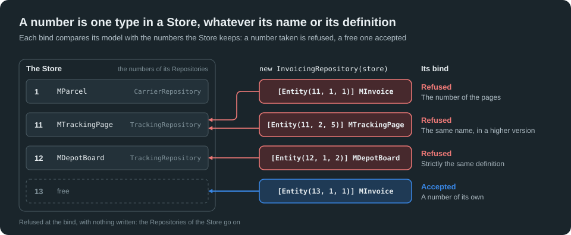

```csharp
[Fact]
public void RefuseTheNumberOfATypeOfAnotherRepository()
{
    using var store = TransactionalMemoryStore.NewInMemoryRepositoryStore("lesson-01-numbers", StoreAccessMode.ReadWrite);
    using var carrier = new CarrierRepository(store);
    using var site = new TrackingRepository(store);

    // The number 11 is the page of a parcel, in the Repository of the tracking: the invoices cannot take it.
    Assert.Contains("type 11", Assert.Throws<InvalidOperationException>(() => new Invoicing.NumberTaken.InvoicingRepository(store)).Message);

    // A name changes nothing: the same number under the name of the page, in a higher version, is still a type of another Repository.
    Assert.Contains("type 11", Assert.Throws<InvalidOperationException>(() => new Invoicing.NameTaken.InvoicingRepository(store)).Message);

    // Nor does a definition: the board of a depot, strictly the same, in another Repository, is still one number for two models.
    Assert.Contains("type 12", Assert.Throws<InvalidOperationException>(() => new Invoicing.TypeTaken.InvoicingRepository(store)).Message);

    // Refused before anything is written: the Repositories of the Store go on.
    using (var transaction = site.OpenTransaction(StoreAccessMode.ReadWrite))
    {
        new DepotBoard { Depot = "Nice" };
        transaction.Commit();
    }

    // A number of its own, and the third Repository joins the Store.
    using var invoicing = new Invoicing.InvoicingRepository(store);
    using (var transaction = invoicing.OpenTransaction(StoreAccessMode.ReadWrite))
    {
        new Invoicing.Invoice { Lines = 2 };
        transaction.Commit();
    }
    using (var transaction = invoicing.OpenTransaction(StoreAccessMode.ReadOnly))
        Assert.Equal(2, transaction.Enumerate<Invoicing.Invoice>().Single().Lines);
}
```

**A number keeps its nature.** An entity never becomes a Record, nor a Record an entity, whatever the version:

```csharp
namespace TutorialEight.Invoicing.NatureTaken
{
    // A Record on the number of the boards of the depots, an entity.
    [Record(12, 1, 1)]
    internal interface RInvoiceLine
    {
        [Property(1)]
        int Quantity { get; set; }
    }

    [Entity(13, 1, 1), Root, Removable]
    internal interface MInvoice
    {
        [Property(1)]
        RInvoiceLine Line { get; set; }
    }

    [GhostRepository(1), IncludeEntityModel(nameof(MInvoice)), IncludeRecordModel(nameof(RInvoiceLine))]
    internal interface MInvoicingRepository
    {
    }
}
```

```csharp
[Fact]
public void RefuseANumberOfAnotherNature()
{
    using var store = TransactionalMemoryStore.NewInMemoryRepositoryStore("lesson-01-nature", StoreAccessMode.ReadWrite);
    using var site = new TrackingRepository(store);

    // The number 12 is an entity, the board of a depot: a Record of the invoices cannot take it, in any version.
    Assert.Contains("type 12", Assert.Throws<InvalidOperationException>(() => new Invoicing.NatureTaken.InvoicingRepository(store)).Message);
}
```

**An index number is one index in a Store.** The Repositories of a Store number their indexes apart. Index numbers and type numbers are two numberings: the index 1 and the type 1 never meet.

```csharp
namespace TutorialEight.Invoicing.IndexTaken
{
    [Entity(13, 1, 1), Root, Removable]
    internal interface MInvoice
    {
        [Property(1)]
        int Lines { get; set; }
    }

    // The number of the index of the tracking numbers, in the Repository of the parcels.
    [ValueIndex(nameof(MInvoice), 1), ValueIndexComponent(1, nameof(MInvoice.Lines))]
    internal interface MInvoiceLinesIndex
    {
    }

    [GhostRepository(1), IncludeEntityModel(nameof(MInvoice))]
    internal interface MInvoicingRepository
    {
    }
}
```

```csharp
[Fact]
public void RefuseTheNumberOfAnIndexOfAnotherRepository()
{
    using var store = TransactionalMemoryStore.NewInMemoryRepositoryStore("lesson-01-indexes", StoreAccessMode.ReadWrite);
    using var carrier = new CarrierRepository(store);

    // The index 1 finds a parcel by its tracking number (Lesson 7): an index of the invoices cannot take this number.
    Assert.Contains("number 1", Assert.Throws<InvalidOperationException>(() => new Invoicing.IndexTaken.InvoicingRepository(store)).Message);
}
```

What a bind compares, for each Repository of the Store:

| A Repository declares | Its bind |
| --------------------- | -------- |
| A number that no type of the Store holds | Accepted |
| The number of a type of another Repository, under any name, in any version, with another definition | Refused |
| An entity on the number of a Record, or a Record on the number of an entity | Refused, in any version |
| The number of an index of another Repository | Refused |
| The same definition as a type of another Repository, of its number | Refused: a type is in one model, never shared |
| An identical type, of a number of its own, in another namespace | Accepted: two numbers make two types |

A name is free in its own Repository: a Repository renames its type in a new version, and it stays the same type, its entities read under the new name.

A Store keeps the model of each Repository. Opened again, they bind in any order: each one finds its entities and its indexes, which the bind of another Repository does not touch, and the numbers of a Repository that is not bound stay taken:

```csharp
[Fact]
public void BindAgainInAnyOrder()
{
    string directory = Path.Combine(AppContext.BaseDirectory, "lesson-01-reopened");
    if (Directory.Exists(directory))
        Directory.Delete(directory, recursive: true);

    using (var store = TransactionalMemoryStore.NewFileRepositoryStore(directory, "shared", StoreAccessMode.ReadWrite))
    using (var carrier = new CarrierRepository(store))
    using (var site = new TrackingRepository(store))
    {
        using (var transaction = carrier.OpenTransaction(StoreAccessMode.ReadWrite))
        {
            new Parcel(ParcelRef.New()) { TrackingNumber = "PX-0103", Recipient = "Ada", Depot = "Lyon" };
            transaction.Commit();
        }
        using (var transaction = site.OpenTransaction(StoreAccessMode.ReadWrite))
        {
            new DepotBoard { Depot = "Lyon", Parcels = 1 };
            transaction.Commit();
        }
    }

    // The other order: each Repository finds its entities, and the carrier its index, which no bind of another Repository touches.
    using (var store = TransactionalMemoryStore.NewFileRepositoryStore(directory, "shared", StoreAccessMode.ReadWrite))
    using (var site = new TrackingRepository(store))
    using (var carrier = new CarrierRepository(store))
    {
        using (carrier.OpenTransaction(StoreAccessMode.ReadOnly))
            Assert.Equal("Ada", ParcelTrackingIndex.Is("PX-0103").Single().Recipient);
        using (site.OpenTransaction(StoreAccessMode.ReadOnly))
            Assert.Equal(1, DepotBoardViewCollection.Single().Parcels);
    }

    // The carrier alone: the tracking is not bound, and the Store remembers its numbers.
    using (var store = TransactionalMemoryStore.NewFileRepositoryStore(directory, "shared", StoreAccessMode.ReadWrite))
    using (var carrier = new CarrierRepository(store))
        Assert.Throws<InvalidOperationException>(() => new Invoicing.NumberTaken.InvoicingRepository(store));
}
```

Two models on one Store, or two Stores in a chain:

| | Two Repositories on one Store | Two Stores in a chain (Lesson 2) |
| - | ----------------------------- | -------------------------------- |
| Transactions | One for each Repository, committed apart | One for the chain, all or nothing |
| Numbers of the types | Unique in the Store | Unique in the chain |
| On several servers | The whole Store on each replica | Each server with the Stores it needs (Lesson 8) |

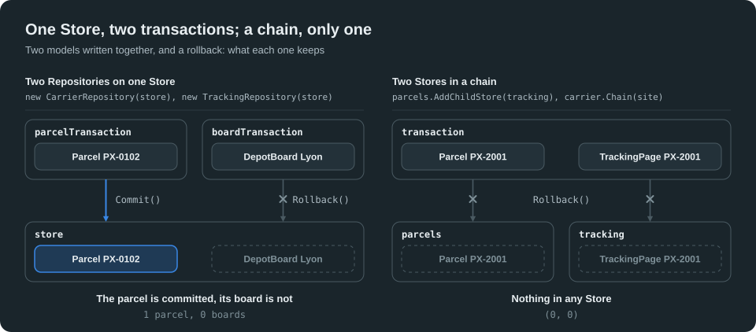

Models that change apart may share a Store; models that must change together take a chain.

### Lesson 2: Chain two Repositories

Two Repositories take two transactions, on one Store or on two: a parcel changed and its page not yet, or the page and not the parcel, when one of them fails.

A **chain** of Stores makes their transactions one: each model takes its Store. `parcels.AddChildStore(tracking)` chains the Store of the tracking after the Store of the parcels, before their first transaction; `carrier.Chain(site)` chains their Repositories, in the same order. Each transaction of the first Repository then opens a transaction of the second one, ambient, in the same mode: `TrackingRepositoryTransaction.Current`. The code writes both models as one, and the commit writes both Stores.

The page of a parcel takes an identity derived from the identity of its parcel, `TrackingPageRef.Of(parcel)`: the same parcel gives the same page, which is found from the parcel, in its own Store.

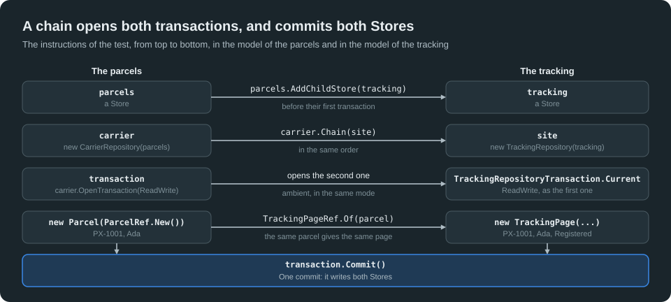

```csharp
[Fact]
public void WriteTwoModelsInOneTransaction()
{
    // The Stores, chained before their first transaction; then their Repositories, chained in the same order.
    using var parcels = TransactionalMemoryStore.NewInMemoryRepositoryStore("lesson-02-parcels", StoreAccessMode.ReadWrite);
    using var tracking = parcels.AddChildStore(TransactionalMemoryStore.NewInMemoryRepositoryStore("lesson-02-tracking", StoreAccessMode.ReadWrite));
    using var carrier = new CarrierRepository(parcels);
    using var site = new TrackingRepository(tracking);
    carrier.Chain(site);

    ParcelRef parcel;
    using (var transaction = carrier.OpenTransaction(StoreAccessMode.ReadWrite))
    {
        // The transaction of the tracking, opened with the one of the parcels: both models are written in it.
        Assert.NotNull(TrackingRepositoryTransaction.Current);
        parcel = new Parcel(ParcelRef.New()) { TrackingNumber = "PX-1001", Recipient = "Ada", Depot = "" }.Ref;

        // The page of the parcel takes an identity derived from the one of the parcel: found from it, in any Store.
        new TrackingPage(TrackingPageRef.Of(parcel)) { TrackingNumber = "PX-1001", Recipient = "Ada", Status = "Registered" };
        transaction.Commit();
    }

    // A ReadOnly transaction of the chain reads both models: the parcel, and its page from the identity of the parcel.
    using (carrier.OpenTransaction(StoreAccessMode.ReadOnly))
    {
        Assert.Equal("PX-1001", parcel.Resolve().TrackingNumber);
        Assert.Equal("Registered", TrackingPageRef.Of(parcel).Resolve().Status);
        Assert.Equal(1, TrackingPageViewCollection.Count());
    }
}
```

The second Repository has no transaction of its own: it opens and commits with the first one. Alone, the tracking would be read or written apart from the parcels:

```csharp
[Fact]
public void OpenTheSecondRepositoryWithTheFirstOnly()
{
    using var parcels = TransactionalMemoryStore.NewInMemoryRepositoryStore("lesson-02-first", StoreAccessMode.ReadWrite);
    using var tracking = parcels.AddChildStore(TransactionalMemoryStore.NewInMemoryRepositoryStore("lesson-02-second", StoreAccessMode.ReadWrite));
    using var carrier = new CarrierRepository(parcels);
    using var site = new TrackingRepository(tracking);
    carrier.Chain(site);

    // Alone, the tracking would be read or written apart from the parcels: refused.
    Assert.Throws<InvalidOperationException>(() => site.OpenTransaction(StoreAccessMode.ReadOnly));
    using (var transaction = carrier.OpenTransaction(StoreAccessMode.ReadWrite))
    {
        new DepotBoard { Depot = "Lyon" };
        Assert.Throws<InvalidOperationException>(() => TrackingRepositoryTransaction.Current!.Commit());
        transaction.Commit();
    }
    using (carrier.OpenTransaction(StoreAccessMode.ReadOnly))
        Assert.Equal("Lyon", DepotBoardViewCollection.Single(static board => board.Parcels == 0).Depot);
}
```

The Stores are chained first, then their Repositories. Apart, each Repository keeps its own transactions:

```csharp
[Fact]
public void ChainTheStoresFirst()
{
    using var parcels = TransactionalMemoryStore.NewInMemoryRepositoryStore("lesson-02-apart", StoreAccessMode.ReadWrite);
    using var tracking = TransactionalMemoryStore.NewInMemoryRepositoryStore("lesson-02-apart-tracking", StoreAccessMode.ReadWrite);
    using var carrier = new CarrierRepository(parcels);
    using var site = new TrackingRepository(tracking);

    // The Stores are not chained: the Repositories cannot be.
    Assert.Throws<InvalidOperationException>(() => carrier.Chain(site));

    // Apart, each Repository has its own transactions, its own commits: the Store of the parcels knows nothing of the other.
    using (var transaction = carrier.OpenTransaction(StoreAccessMode.ReadWrite))
    {
        Assert.Null(TrackingRepositoryTransaction.Current);
        new Parcel(ParcelRef.New()) { TrackingNumber = "PX-1002", Recipient = "Bob", Depot = "" };
        transaction.Commit();
    }
    using (carrier.OpenTransaction(StoreAccessMode.ReadOnly))
        Assert.Equal(1, ParcelViewCollection.Count());
}
```

### Lesson 3: All or nothing

A transaction of a chain is one transaction, whatever the count of its Stores: what the code wrote in any of them is committed in all of them, or in none. A rollback writes nothing in any Store:

```csharp
[Fact]
public void WriteNothingOfARollback()
{
    using var parcels = TransactionalMemoryStore.NewInMemoryRepositoryStore("lesson-03-rollback", StoreAccessMode.ReadWrite);
    using var tracking = parcels.AddChildStore(TransactionalMemoryStore.NewInMemoryRepositoryStore("lesson-03-rollback-tracking", StoreAccessMode.ReadWrite));
    using var carrier = new CarrierRepository(parcels);
    using var site = new TrackingRepository(tracking);
    carrier.Chain(site);

    using (var transaction = carrier.OpenTransaction(StoreAccessMode.ReadWrite))
    {
        var parcel = new Parcel(ParcelRef.New()) { TrackingNumber = "PX-2001", Recipient = "Ada", Depot = "" };
        new TrackingPage(TrackingPageRef.Of(parcel.Ref)) { TrackingNumber = "PX-2001", Recipient = "Ada", Status = "Registered" };
        transaction.Rollback();
    }
    using (carrier.OpenTransaction(StoreAccessMode.ReadOnly))
        Assert.Equal((0, 0), (ParcelViewCollection.Count(), TrackingPageViewCollection.Count()));
}
```

A rule of a model runs in its Store, and condemns its transaction when it throws after a write (Tutorial Two, Lesson 17). The tracking has one: a board never counts fewer than no parcel.

```csharp
// A rule of the tracking (Tutorial Two, Lesson 16): a board never counts fewer than no parcel. It runs after the write, and condemns
// the transaction when it throws (Tutorial Two, Lesson 17).
internal sealed partial class DepotBoard
{
    partial void OnParcelsChanged()
    {
        if (Parcels < 0)
            throw new InvalidOperationException($"The board of {Depot} counts {Parcels} parcels.");
    }
}
```

A condemned transaction of any Store of the chain refuses the commit of the whole chain, the exception of the rule given as its cause:

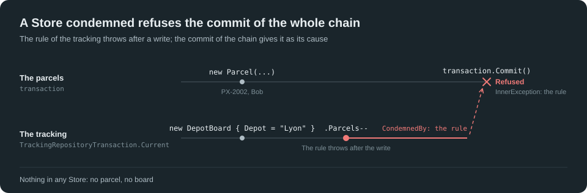

```csharp
[Fact]
public void RefuseTheCommitOfAChainCondemnedInOneStore()
{
    using var parcels = TransactionalMemoryStore.NewInMemoryRepositoryStore("lesson-03-condemned", StoreAccessMode.ReadWrite);
    using var tracking = parcels.AddChildStore(TransactionalMemoryStore.NewInMemoryRepositoryStore("lesson-03-condemned-tracking", StoreAccessMode.ReadWrite));
    using var carrier = new CarrierRepository(parcels);
    using var site = new TrackingRepository(tracking);
    carrier.Chain(site);

    using (var transaction = carrier.OpenTransaction(StoreAccessMode.ReadWrite))
    {
        new Parcel(ParcelRef.New()) { TrackingNumber = "PX-2002", Recipient = "Bob", Status = ParcelStatus.InTransit, Depot = "Lyon" };

        // A bug: the parcel leaves a depot whose board counts none. The rule throws after the write: the tracking is condemned.
        var rule = Assert.Throws<InvalidOperationException>(() => new DepotBoard { Depot = "Lyon" }.Parcels--);
        Assert.Same(rule, TrackingRepositoryTransaction.Current!.CondemnedBy);

        // The commit of the chain is refused, the rule given as its cause.
        Assert.Same(rule, Assert.Throws<InvalidOperationException>(transaction.Commit).InnerException);
    }
    using (carrier.OpenTransaction(StoreAccessMode.ReadOnly))
        Assert.Equal((0, 0), (ParcelViewCollection.Count(), DepotBoardViewCollection.Count()));
}
```

A conflict in any Store fails the commit of the whole chain, as a conflict of one Store fails its transaction in Tutorial One. Two transactions scan two different parcels at Lyon: their parcels do not conflict, but both change the board of Lyon. The second commit conflicts on the board, and the parcel of its transaction is not changed either:

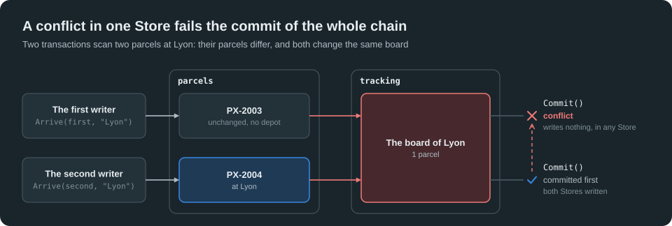

```csharp
// A parcel arrives at a depot: the parcel, and the board of the depot, one more parcel there.
private static void Arrive(ParcelRef parcel, Depot depot)
{
    var body = parcel.Resolve();
    body.Status = ParcelStatus.InTransit;
    body.Depot = depot;
    DepotBoardCollection.Single(depot, static (board, depot) => board.Depot == depot).Parcels++;
}

[Fact]
public async Task ConflictOnAnyStoreOfTheChain()
{
    using var parcels = TransactionalMemoryStore.NewInMemoryRepositoryStore("lesson-03-conflict", StoreAccessMode.ReadWrite);
    using var tracking = parcels.AddChildStore(TransactionalMemoryStore.NewInMemoryRepositoryStore("lesson-03-conflict-tracking", StoreAccessMode.ReadWrite));
    using var carrier = new CarrierRepository(parcels);
    using var site = new TrackingRepository(tracking);
    carrier.Chain(site);
    ParcelRef first, second;
    using (var transaction = carrier.OpenTransaction(StoreAccessMode.ReadWrite))
    {
        first = new Parcel(ParcelRef.New()) { TrackingNumber = "PX-2003", Recipient = "Cy", Depot = "" }.Ref;
        second = new Parcel(ParcelRef.New()) { TrackingNumber = "PX-2004", Recipient = "Di", Depot = "" }.Ref;
        new DepotBoard { Depot = "Lyon" };
        transaction.Commit();
    }

    // The first writer scans its parcel at Lyon, then waits; the second one scans its own parcel at Lyon, and commits first
    // (Tutorial One, Lesson 15).
    var written = new TaskCompletionSource();
    var committed = new TaskCompletionSource();
    var firstWriter = Task.Run(async () =>
    {
        using var transaction = carrier.OpenTransaction(StoreAccessMode.ReadWrite);
        Arrive(first, "Lyon");
        written.SetResult();
        await committed.Task;
        return Assert.Throws<TransactionConflictException>(transaction.Commit);
    });
    await written.Task;
    await Task.Run(() =>
    {
        using var transaction = carrier.OpenTransaction(StoreAccessMode.ReadWrite);
        Arrive(second, "Lyon");
        transaction.Commit();
    });
    committed.SetResult();
    await firstWriter;

    // The board changed since the first transaction opened: its commit failed, its parcel unchanged with it.
    using (carrier.OpenTransaction(StoreAccessMode.ReadOnly))
    {
        Assert.Equal("", first.Resolve().Depot);
        Assert.Equal("Lyon", second.Resolve().Depot);
        Assert.Equal(1, DepotBoardViewCollection.Single(static board => board.Depot == "Lyon").Parcels);
    }
}
```

### Lesson 4: The chain and its Log

A chain may hold any count of Repositories, and end with a Log: `parcels.AddChildStore(tracking).AddChildStore(journal)`, then `carrier.Chain(site)` and `site.Chain(log)`. A transaction of the chain opens the three, ambient: the commands add their Records to the Log, and their handlers change both models, in one commit of the three Stores.

The Log of the carrier, as in Tutorial Seven:

```csharp
[Record(21, 1, 3)]
internal interface RParcelRegistered
{
    [Property(1)]
    ParcelRef Parcel { get; set; }

    [Property(2)]
    VTrackingNumber TrackingNumber { get; set; }

    [Property(3)]
    VName Recipient { get; set; }
}

[Record(22, 1, 2)]
internal interface RParcelScanned
{
    [Property(1)]
    ParcelRef Parcel { get; set; }

    [Property(2)]
    VDepot Depot { get; set; }
}

[Record(23, 1, 1)]
internal interface RParcelDelivered
{
    [Property(1)]
    ParcelRef Parcel { get; set; }
}

[GhostLog(4), IncludeRecordModel(nameof(RParcelRegistered)), IncludeRecordModel(nameof(RParcelScanned)), IncludeRecordModel(nameof(RParcelDelivered))]
internal interface MCarrierLog
{
}
```

The commands and their handlers: each handler changes both models, the parcel, its page, the boards of the depots. The handlers are the only code that writes the models; the next lessons use these commands.

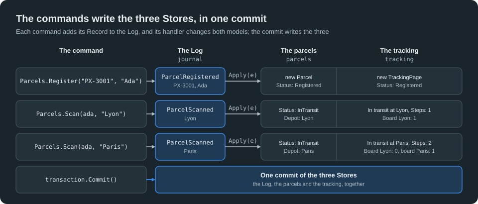

```csharp
// The commands of the carrier and the handlers of their Records (Tutorial Seven, Lesson 9). Each handler changes both models, the
// parcels and their tracking: in the ambient transactions of the chain, at a command and at a replay alike.
internal static class Parcels
{
    public static ParcelRef Register(TrackingNumber trackingNumber, Name recipient)
    {
        var registered = new ParcelRegistered { Parcel = ParcelRef.New(), TrackingNumber = trackingNumber, Recipient = recipient }.Add();
        Apply(registered.ToView());
        return registered.Parcel;
    }

    public static void Scan(ParcelRef parcel, Depot depot) => Apply(new ParcelScanned { Parcel = parcel, Depot = depot }.Add().ToView());

    public static void Deliver(ParcelRef parcel) => Apply(new ParcelDelivered { Parcel = parcel }.Add().ToView());

    public static LogStoreSubscription Apply(ParcelRegisteredView e)
    {
        new Parcel(e.Parcel) { TrackingNumber = e.TrackingNumber, Recipient = e.Recipient, Status = ParcelStatus.Registered, Depot = "" };
        new TrackingPage(TrackingPageRef.Of(e.Parcel)) { TrackingNumber = e.TrackingNumber, Recipient = e.Recipient, Status = "Registered" };
        return LogStoreSubscription.Continue;
    }

    public static LogStoreSubscription Apply(ParcelScannedView e)
    {
        var parcel = e.Parcel.Resolve();
        Leave(parcel.Depot);
        parcel.Status = ParcelStatus.InTransit;
        parcel.Depot = e.Depot;
        // The board of the depot, or a new one at the first parcel there.
        var board = DepotBoardCollection.FirstOrNone(e.Depot, static (board, depot) => board.Depot == depot).TryGet(out var found) ? found : new DepotBoard { Depot = e.Depot };
        board.Parcels++;
        var page = TrackingPageRef.Of(e.Parcel).Resolve();
        page.Status = $"In transit at {e.Depot}";
        page.Steps++;
        return LogStoreSubscription.Continue;
    }

    public static LogStoreSubscription Apply(ParcelDeliveredView e)
    {
        var parcel = e.Parcel.Resolve();
        Leave(parcel.Depot);
        parcel.Status = ParcelStatus.Delivered;
        parcel.Depot = "";
        var page = TrackingPageRef.Of(e.Parcel).Resolve();
        page.Status = "Delivered";
        page.Steps++;
        return LogStoreSubscription.Continue;
    }

    // A parcel leaves its depot, if it is at one: one parcel fewer on its board.
    private static void Leave(Depot depot)
    {
        if (depot.Length > 0)
            DepotBoardCollection.Single(depot, static (board, depot) => board.Depot == depot).Parcels--;
    }

    // The pages and the boards of the tracking, one line each, in order.
    public static List<string> Tracking()
    {
        var lines = new List<string>();
        foreach (var page in TrackingPageViewCollection)
            lines.Add($"{page.TrackingNumber}: {page.Status}, {page.Steps} steps");
        foreach (var board in DepotBoardViewCollection)
            lines.Add($"{board.Depot}: {board.Parcels}");
        lines.Sort(StringComparer.Ordinal);
        return lines;
    }
}
```

```csharp
[Fact]
public void CommitACommandInTheThreeStores()
{
    using var parcels = TransactionalMemoryStore.NewInMemoryRepositoryStore("lesson-04-parcels", StoreAccessMode.ReadWrite);
    using var tracking = parcels.AddChildStore(TransactionalMemoryStore.NewInMemoryRepositoryStore("lesson-04-tracking", StoreAccessMode.ReadWrite));
    using var journal = tracking.AddChildStore(TransactionalMemoryStore.NewInMemoryLogStore("lesson-04-journal", StoreAccessMode.ReadWrite));
    using var carrier = new CarrierRepository(parcels);
    using var site = new TrackingRepository(tracking);
    using var log = new CarrierLog(journal);
    carrier.Chain(site);
    site.Chain(log);

    using (var transaction = carrier.OpenTransaction(StoreAccessMode.ReadWrite))
    {
        Assert.NotNull(TrackingRepositoryTransaction.Current);
        Assert.NotNull(CarrierLogTransaction.Current);
        var ada = Parcels.Register("PX-3001", "Ada");
        Parcels.Scan(ada, "Lyon");
        Parcels.Scan(ada, "Paris");
        transaction.Commit();
    }
    using (carrier.OpenTransaction(StoreAccessMode.ReadOnly))
    {
        Assert.Equal("Paris", ParcelViewCollection.Single(static parcel => parcel.TrackingNumber == "PX-3001").Depot);
        Assert.Equal(["Lyon: 0", "PX-3001: In transit at Paris, 2 steps", "Paris: 1"], Parcels.Tracking());
    }
}
```

The Log is the memory of the chain: with it, both models may live in memory, rebuilt at each opening by a replay (Tutorial Seven, Lesson 10). One replay gives both models again: the handlers write them in the Replay transaction of the chain, as they write them at a command. Here, one Replay transaction for the whole Log, committed through its last transaction at the end of the replay:

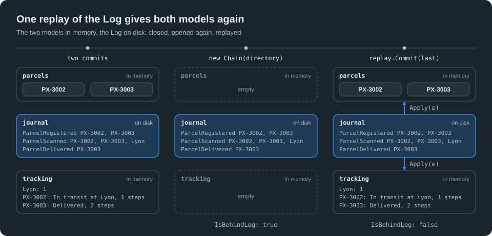

```csharp
[Fact]
public void ReplayBothModelsFromTheLog()
{
    string directory = Path.Combine(AppContext.BaseDirectory, "lesson-04-journal");
    if (Directory.Exists(directory))
        Directory.Delete(directory, recursive: true);

    List<string> expected;
    using (var chain = new Chain(directory))
    {
        ParcelRef ada, bob;
        using (var transaction = chain.Carrier.OpenTransaction(StoreAccessMode.ReadWrite))
        {
            (ada, bob) = (Parcels.Register("PX-3002", "Ada"), Parcels.Register("PX-3003", "Bob"));
            Parcels.Scan(ada, "Lyon");
            Parcels.Scan(bob, "Lyon");
            transaction.Commit();
        }
        using (var transaction = chain.Carrier.OpenTransaction(StoreAccessMode.ReadWrite))
        {
            Parcels.Deliver(bob);
            transaction.Commit();
        }
        using (chain.Carrier.OpenTransaction(StoreAccessMode.ReadOnly))
            expected = Parcels.Tracking();
    }
    Assert.Equal(["Lyon: 1", "PX-3002: In transit at Lyon, 1 steps", "PX-3003: Delivered, 2 steps"], expected);

    // Opened again: both models empty, behind the Log; one replay, through the last transaction of the Log.
    using (var chain = new Chain(directory))
    {
        Assert.True(chain.Parcels.IsBehindLog);
        using (var replay = chain.Carrier.OpenTransaction(StoreAccessMode.ReadWrite, replay: true))
        {
            chain.Log.SubscribeFrom(0)
                .Handle<ParcelRegisteredView>(static (_, e) => Parcels.Apply(e))
                .Handle<ParcelScannedView>(static (_, e) => Parcels.Apply(e))
                .Handle<ParcelDeliveredView>(static (_, e) => Parcels.Apply(e))
                .OnReplayEnd(replay, static (last, replay) =>
                {
                    replay.Commit(last);
                    return LogStoreSubscription.Cancel;
                })
                .Run();
        }
        Assert.False(chain.Parcels.IsBehindLog);
        using (chain.Carrier.OpenTransaction(StoreAccessMode.ReadOnly))
            Assert.Equal(expected, Parcels.Tracking());
    }
}
```

The chain of the test keeps the two models in memory, and the Log on disk, after them:

```csharp
// The chain of the lesson: the two models in memory, the Log on disk, after them.
private sealed class Chain : IDisposable
{
    public Chain(string directory)
    {
        Parcels = TransactionalMemoryStore.NewInMemoryRepositoryStore("lesson-04-replay-parcels", StoreAccessMode.ReadWrite);
        Tracking = Parcels.AddChildStore(TransactionalMemoryStore.NewInMemoryRepositoryStore("lesson-04-replay-tracking", StoreAccessMode.ReadWrite));
        Journal = Tracking.AddChildStore(TransactionalMemoryStore.NewFileLogStore(directory, "journal", StoreAccessMode.ReadWrite));
        Carrier = new CarrierRepository(Parcels);
        Site = new TrackingRepository(Tracking);
        Log = new CarrierLog(Journal);
        Carrier.Chain(Site);
        Site.Chain(Log);
    }

    public TransactionalMemoryStore Parcels { get; }

    public TransactionalMemoryStore Tracking { get; }

    public TransactionalMemoryStore Journal { get; }

    public CarrierRepository Carrier { get; }

    public TrackingRepository Site { get; }

    public CarrierLog Log { get; }

    public void Dispose()
    {
        Log.Dispose();
        Site.Dispose();
        Carrier.Dispose();
        Parcels.Dispose();
        Tracking.Dispose();
        Journal.Dispose();
    }
}
```

## Part 2: Distribution

### Lesson 5: A replica

A Store on a server is a **replica**: the same Store, the same name, on other servers, each in its own directory, each a whole copy of it. A `StoreDistributionEndPoint` connects the servers: it listens on a port, joins the cluster through one or more endpoints of it, its **seeds**, and discovers the others. `endPoint.Add(store)` distributes a Store, before its first transaction: each commit on one replica is copied to the others, in the order of the commits, and their Repositories read it.

The servers of the lessons are created by a small class of the tutorial: an endpoint on the loopback, a directory for each server, and a wait until a replica holds every transaction of another one. A copy takes the time it takes: the wait has no fixed delay. `CurrentEpoch` is the number of the last transaction that a Store holds.

```csharp
// The servers of the lessons of distribution, all in the process of the tests, on the loopback: each one an endpoint and its Stores,
// in a directory of its own.
internal static class Cluster
{
    // An endpoint: it listens on a port that the system chooses, and joins the cluster through the endpoints given, its seeds.
    public static StoreDistributionEndPoint EndPoint(params StoreDistributionEndPoint[] seeds)
        => new(DistributionModel.P2P, new StoreDistributionEndPointConfiguration {
            ListenAddress = "127.0.0.1",
            Others = [.. seeds.Select(static seed => new DistributionEndPoint("127.0.0.1", seed.ListenPort))]
        });

    // The directory of a server, emptied at each run.
    public static string NewDirectory(string name)
    {
        string directory = Path.Combine(AppContext.BaseDirectory, name);
        if (Directory.Exists(directory))
            Directory.Delete(directory, recursive: true);
        return directory;
    }

    // Waits until the replica holds every transaction of the source: a copy takes the time it takes, the wait has no fixed delay.
    public static async Task CaughtUp(TransactionalMemoryStore replica, TransactionalMemoryStore source)
    {
        while (replica.CurrentEpoch < source.CurrentEpoch)
            await Task.Delay(10);
    }
}
```

A replica opened `ReadOnly` only reads: a server of the queries, a report, a site, a cache, as many as needed. It never waits for the copy: its transactions read the last transaction it holds, as a transaction of Tutorial One reads the last commit. The Repository of a replica reads the model that the writer wrote: it is opened once the replica holds it.

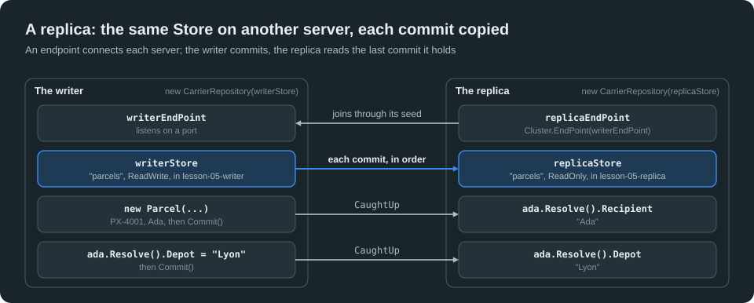

```csharp
[Fact]
public async Task CopyTheCommitsOfAWriterToAReplica()
{
    // The writer: its endpoint; its Store on disk, distributed before its first transaction; its Repository.
    using var writerEndPoint = Cluster.EndPoint();
    using var writerStore = TransactionalMemoryStore.NewFileRepositoryStore(Cluster.NewDirectory("lesson-05-writer"), "parcels", StoreAccessMode.ReadWrite);
    writerEndPoint.Add(writerStore);
    using var writer = new CarrierRepository(writerStore);
    ParcelRef ada;
    using (var transaction = writer.OpenTransaction(StoreAccessMode.ReadWrite))
    {
        ada = new Parcel(ParcelRef.New()) { TrackingNumber = "PX-4001", Recipient = "Ada", Depot = "" }.Ref;
        transaction.Commit();
    }

    // The replica: another server, joined through the writer; the same Store, ReadOnly, in a directory of its own.
    using var replicaEndPoint = Cluster.EndPoint(writerEndPoint);
    using var replicaStore = TransactionalMemoryStore.NewFileRepositoryStore(Cluster.NewDirectory("lesson-05-replica"), "parcels", StoreAccessMode.ReadOnly);
    replicaEndPoint.Add(replicaStore);
    await Cluster.CaughtUp(replicaStore, writerStore);
    using var replica = new CarrierRepository(replicaStore);
    using (replica.OpenTransaction(StoreAccessMode.ReadOnly))
        Assert.Equal("Ada", ada.Resolve().Recipient);

    // Each commit of the writer reaches the replica.
    using (var transaction = writer.OpenTransaction(StoreAccessMode.ReadWrite))
    {
        ada.Resolve().Status = ParcelStatus.InTransit;
        ada.Resolve().Depot = "Lyon";
        transaction.Commit();
    }
    await Cluster.CaughtUp(replicaStore, writerStore);
    using (replica.OpenTransaction(StoreAccessMode.ReadOnly))
        Assert.Equal("Lyon", ada.Resolve().Depot);
}
```

A Store has one **write token** in the cluster, and a commit takes it first. A replica `ReadOnly` never asks for it: its Repository refuses a ReadWrite transaction. `GetStatus` tells where the token is, as an endpoint knows it:

```csharp
[Fact]
public async Task ReadOnlyOnAReadOnlyReplica()
{
    using var writerEndPoint = Cluster.EndPoint();
    using var writerStore = TransactionalMemoryStore.NewFileRepositoryStore(Cluster.NewDirectory("lesson-05-only-writer"), "parcels", StoreAccessMode.ReadWrite);
    writerEndPoint.Add(writerStore);
    using var writer = new CarrierRepository(writerStore);
    using var replicaEndPoint = Cluster.EndPoint(writerEndPoint);
    using var replicaStore = TransactionalMemoryStore.NewFileRepositoryStore(Cluster.NewDirectory("lesson-05-only-replica"), "parcels", StoreAccessMode.ReadOnly);
    replicaEndPoint.Add(replicaStore);
    await Cluster.CaughtUp(replicaStore, writerStore);
    using var replica = new CarrierRepository(replicaStore);

    Assert.Throws<InvalidOperationException>(() => replica.OpenTransaction(StoreAccessMode.ReadWrite));

    // GetStatus: the write token of the Store, as an endpoint knows it. The writer holds it; the replica knows where it is.
    var status = replicaEndPoint.GetStatus(replicaStore);
    Assert.Equal((false, writerEndPoint.EndPointId), (status.IsWritable, status.OwnerEndPointId));
    Assert.True(writerEndPoint.GetStatus(writerStore).IsWritable);
}
```

### Lesson 6: Two writers

Replicas opened `ReadWrite` on several servers all write: a depot writes its scans, the office its registrations, each on its own replica, with its own Repository, and the code is the code of Tutorial One. Their commits form one sequence, the same on every replica: the token goes to the replica that commits, once it holds every transaction before. Its commit follows them, and the others receive it.

The token stays with its last writer until another one commits: a server that writes alone keeps it, and commits without any exchange. `TokenGeneration` counts its moves.

A transaction opens on the last commit its replica holds, as in Tutorial One. A server that changes what another one just changed waits for that commit first: otherwise its transaction changes the parcel as it was before, and conflicts (Lesson 7).

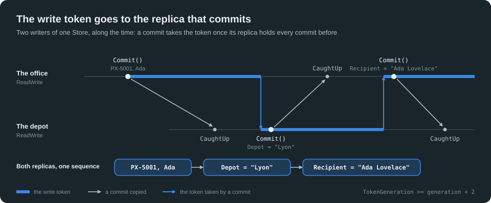

```csharp
[Fact]
public async Task MoveTheWriteTokenBetweenTwoWriters()
{
    using var officeEndPoint = Cluster.EndPoint();
    using var officeStore = TransactionalMemoryStore.NewFileRepositoryStore(Cluster.NewDirectory("lesson-06-office"), "parcels", StoreAccessMode.ReadWrite);
    officeEndPoint.Add(officeStore);
    using var office = new CarrierRepository(officeStore);
    ParcelRef ada;
    using (var transaction = office.OpenTransaction(StoreAccessMode.ReadWrite))
    {
        ada = new Parcel(ParcelRef.New()) { TrackingNumber = "PX-5001", Recipient = "Ada", Depot = "" }.Ref;
        transaction.Commit();
    }

    // The depot: a second writer of the same Store.
    using var depotEndPoint = Cluster.EndPoint(officeEndPoint);
    using var depotStore = TransactionalMemoryStore.NewFileRepositoryStore(Cluster.NewDirectory("lesson-06-depot"), "parcels", StoreAccessMode.ReadWrite);
    depotEndPoint.Add(depotStore);
    await Cluster.CaughtUp(depotStore, officeStore);
    using var depot = new CarrierRepository(depotStore);
    ulong generation = officeEndPoint.GetStatus(officeStore).TokenGeneration;

    // The depot scans the parcel: its commit takes the token.
    using (var transaction = depot.OpenTransaction(StoreAccessMode.ReadWrite))
    {
        ada.Resolve().Status = ParcelStatus.InTransit;
        ada.Resolve().Depot = "Lyon";
        transaction.Commit();
    }
    Assert.True(depotEndPoint.GetStatus(depotStore).IsWritable);

    // The office changes the recipient. Its transaction opens on the last commit its replica holds: it waits for the one of the
    // depot first, or it would change the parcel as it was before it, and conflict (Lesson 7). Its commit takes the token back.
    await Cluster.CaughtUp(officeStore, depotStore);
    using (var transaction = office.OpenTransaction(StoreAccessMode.ReadWrite))
    {
        ada.Resolve().Recipient = "Ada Lovelace";
        transaction.Commit();
    }
    Assert.True(officeEndPoint.GetStatus(officeStore).IsWritable);
    Assert.True(officeEndPoint.GetStatus(officeStore).TokenGeneration >= generation + 2);

    // Both replicas hold both commits, in the same order.
    await Cluster.CaughtUp(depotStore, officeStore);
    Assert.Equal(officeStore.CurrentEpoch, depotStore.CurrentEpoch);
    foreach (var repository in new[] { office, depot })
        using (repository.OpenTransaction(StoreAccessMode.ReadOnly))
        {
            Assert.Equal("Ada Lovelace", ada.Resolve().Recipient);
            Assert.Equal("Lyon", ada.Resolve().Depot);
        }
}
```

Writers that commit at the same time, many times, form one sequence too, every commit kept, the same on both replicas:

```csharp
[Fact]
public async Task KeepEveryCommitOfWritersInParallel()
{
    using var officeEndPoint = Cluster.EndPoint();
    using var officeStore = TransactionalMemoryStore.NewFileRepositoryStore(Cluster.NewDirectory("lesson-06-parallel-office"), "parcels", StoreAccessMode.ReadWrite);
    officeEndPoint.Add(officeStore);
    using var office = new CarrierRepository(officeStore);
    using var depotEndPoint = Cluster.EndPoint(officeEndPoint);
    using var depotStore = TransactionalMemoryStore.NewFileRepositoryStore(Cluster.NewDirectory("lesson-06-parallel-depot"), "parcels", StoreAccessMode.ReadWrite);
    depotEndPoint.Add(depotStore);
    await Cluster.CaughtUp(depotStore, officeStore);
    using var depot = new CarrierRepository(depotStore);

    // Each server registers its own parcels, one commit each, at the same time as the other one.
    const int Parcels = 20;
    await Task.WhenAll(Task.Run(() => Register(office, "PX-51", Parcels)), Task.Run(() => Register(depot, "PX-52", Parcels)));

    await Cluster.CaughtUp(depotStore, officeStore);
    await Cluster.CaughtUp(officeStore, depotStore);
    foreach (var repository in new[] { office, depot })
        using (repository.OpenTransaction(StoreAccessMode.ReadOnly))
            Assert.Equal(2 * Parcels, CarrierRepositoryCollections.ParcelViewCollection.Count());
}

private static void Register(CarrierRepository carrier, string prefix, int count)
{
    for (int i = 0; i < count; i++)
    {
        using var transaction = carrier.OpenTransaction(StoreAccessMode.ReadWrite);
        new Parcel(ParcelRef.New()) { TrackingNumber = $"{prefix}{i:D3}", Recipient = "Bob", Depot = "" };
        transaction.Commit();
    }
}
```

### Lesson 7: Conflicts across servers

Two servers are two writers, as two threads of Tutorial One: their transactions run at the same time, each on the last commit its replica held at its opening. The first commit wins. The second one finds what changed since its opening, on any server, and conflicts: a `TransactionConflictException`, its `Kind` telling what. It writes nothing, on any replica; the application decides, with a new transaction.

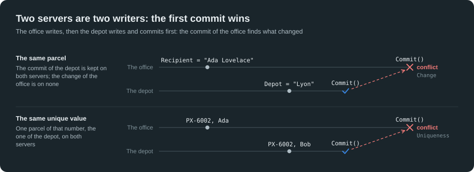

The office changes the recipient of a parcel, while the depot scans it and commits first. The commit of the office conflicts, of the kind `Change`:

```csharp
[Fact]
public async Task ConflictOnAParcelChangedOnAnotherServer()
{
    using var officeEndPoint = Cluster.EndPoint();
    using var officeStore = TransactionalMemoryStore.NewFileRepositoryStore(Cluster.NewDirectory("lesson-07-office"), "parcels", StoreAccessMode.ReadWrite);
    officeEndPoint.Add(officeStore);
    using var office = new CarrierRepository(officeStore);
    ParcelRef ada;
    using (var transaction = office.OpenTransaction(StoreAccessMode.ReadWrite))
    {
        ada = new Parcel(ParcelRef.New()) { TrackingNumber = "PX-6001", Recipient = "Ada", Depot = "" }.Ref;
        transaction.Commit();
    }
    using var depotEndPoint = Cluster.EndPoint(officeEndPoint);
    using var depotStore = TransactionalMemoryStore.NewFileRepositoryStore(Cluster.NewDirectory("lesson-07-depot"), "parcels", StoreAccessMode.ReadWrite);
    depotEndPoint.Add(depotStore);
    await Cluster.CaughtUp(depotStore, officeStore);
    using var depot = new CarrierRepository(depotStore);

    // The office changes the recipient, then waits; the depot scans the parcel and commits first.
    var written = new TaskCompletionSource();
    var committed = new TaskCompletionSource();
    var officeWriter = Task.Run(async () =>
    {
        using var transaction = office.OpenTransaction(StoreAccessMode.ReadWrite);
        ada.Resolve().Recipient = "Ada Lovelace";
        written.SetResult();
        await committed.Task;
        return Assert.Throws<TransactionConflictException>(transaction.Commit).Kind;
    });
    await written.Task;
    await Task.Run(() =>
    {
        using var transaction = depot.OpenTransaction(StoreAccessMode.ReadWrite);
        ada.Resolve().Status = ParcelStatus.InTransit;
        ada.Resolve().Depot = "Lyon";
        transaction.Commit();
    });
    committed.SetResult();
    Assert.Equal(TransactionConflictKind.Change, await officeWriter);

    // The commit of the depot is kept on both servers; the change of the office is on none.
    await Cluster.CaughtUp(officeStore, depotStore);
    using (office.OpenTransaction(StoreAccessMode.ReadOnly))
    {
        Assert.Equal("Ada", ada.Resolve().Recipient);
        Assert.Equal("Lyon", ada.Resolve().Depot);
    }
}
```

A unique value is unique in the whole cluster. The model gives each tracking number to one parcel (Tutorial Five, Lesson 9):

```csharp
// A tracking number belongs to one parcel, in the whole cluster (Tutorial Five, Lesson 9).
[ValueIndex(nameof(MParcel), 1, Unique = true), ValueIndexComponent(1, nameof(MParcel.TrackingNumber))]
internal interface MParcelTrackingIndex
{
}
```

Two servers that give the same tracking number to two parcels at the same time do not see each other's parcel, and both Setters accept it. The second commit conflicts, of the kind `Uniqueness`. A unique index guarantees what must be unique, whatever the count of the writers:

```csharp
[Fact]
public async Task RefuseAUniqueValueTakenOnAnotherServer()
{
    using var officeEndPoint = Cluster.EndPoint();
    using var officeStore = TransactionalMemoryStore.NewFileRepositoryStore(Cluster.NewDirectory("lesson-07-unique-office"), "parcels", StoreAccessMode.ReadWrite);
    officeEndPoint.Add(officeStore);
    using var office = new CarrierRepository(officeStore);
    using var depotEndPoint = Cluster.EndPoint(officeEndPoint);
    using var depotStore = TransactionalMemoryStore.NewFileRepositoryStore(Cluster.NewDirectory("lesson-07-unique-depot"), "parcels", StoreAccessMode.ReadWrite);
    depotEndPoint.Add(depotStore);
    await Cluster.CaughtUp(depotStore, officeStore);
    using var depot = new CarrierRepository(depotStore);

    var written = new TaskCompletionSource();
    var committed = new TaskCompletionSource();
    var officeWriter = Task.Run(async () =>
    {
        using var transaction = office.OpenTransaction(StoreAccessMode.ReadWrite);
        new Parcel(ParcelRef.New()) { TrackingNumber = "PX-6002", Recipient = "Ada", Depot = "" };
        written.SetResult();
        await committed.Task;
        return Assert.Throws<TransactionConflictException>(transaction.Commit).Kind;
    });
    await written.Task;
    await Task.Run(() =>
    {
        using var transaction = depot.OpenTransaction(StoreAccessMode.ReadWrite);
        new Parcel(ParcelRef.New()) { TrackingNumber = "PX-6002", Recipient = "Bob", Depot = "" };
        transaction.Commit();
    });
    committed.SetResult();
    Assert.Equal(TransactionConflictKind.Uniqueness, await officeWriter);

    // One parcel of that number, the one of the depot, on both servers.
    await Cluster.CaughtUp(officeStore, depotStore);
    using (office.OpenTransaction(StoreAccessMode.ReadOnly))
        Assert.Equal("Bob", ParcelTrackingIndex.Is("PX-6002").Single().Recipient);
}
```

### Lesson 8: Distribute a chain, and a part of it

`endPoint.Add(parcels)`, on the first Store of a chain, distributes the whole chain: each commit of the chain is copied with its three Stores, the parcels, the tracking and the Log, together. The other servers take what they need of it:

- **The writer** takes the whole chain, `ReadWrite`, and runs the commands of Lesson 4.
- **The site** of the tracking takes the Store of the tracking alone, `ReadOnly`: its pages and its boards, nothing of the parcels nor of the Log. Its Repository opens alone.
- **The service of notifications** takes the Log alone, `ReadOnly`, and follows it by a subscription (Tutorial Seven, Lesson 6): the commits of the writer reach its handlers as they are copied.

Each server holds the Stores it needs, and the cluster copies to each one the transactions of its Stores only: a front end of a million readers never holds the model it does not read.

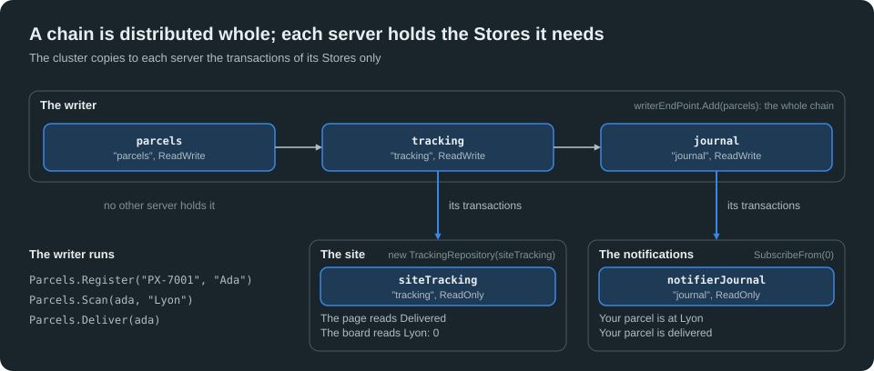

```csharp
[Fact]
public async Task CopyEachStoreOfTheChainToTheServersThatHoldIt()
{
    // The writer: the chain of the three Stores, in its directory, distributed by its first Store.
    string writerDirectory = Cluster.NewDirectory("lesson-08-writer");
    using var writerEndPoint = Cluster.EndPoint();
    using var parcels = TransactionalMemoryStore.NewFileRepositoryStore(writerDirectory, "parcels", StoreAccessMode.ReadWrite);
    using var tracking = parcels.AddChildStore(TransactionalMemoryStore.NewFileRepositoryStore(writerDirectory, "tracking", StoreAccessMode.ReadWrite));
    using var journal = tracking.AddChildStore(TransactionalMemoryStore.NewFileLogStore(writerDirectory, "journal", StoreAccessMode.ReadWrite));
    writerEndPoint.Add(parcels);
    using var carrier = new CarrierRepository(parcels);
    using var trackingModel = new TrackingRepository(tracking);
    using var log = new CarrierLog(journal);
    carrier.Chain(trackingModel);
    trackingModel.Chain(log);
    ParcelRef ada;
    using (var transaction = carrier.OpenTransaction(StoreAccessMode.ReadWrite))
    {
        ada = Parcels.Register("PX-7001", "Ada");
        Parcels.Scan(ada, "Lyon");
        transaction.Commit();
    }

    // The site: the Store of the tracking alone, ReadOnly, its Repository alone.
    using var siteEndPoint = Cluster.EndPoint(writerEndPoint);
    using var siteTracking = TransactionalMemoryStore.NewFileRepositoryStore(Cluster.NewDirectory("lesson-08-site"), "tracking", StoreAccessMode.ReadOnly);
    siteEndPoint.Add(siteTracking);
    await Cluster.CaughtUp(siteTracking, tracking);
    using var site = new TrackingRepository(siteTracking);
    using (site.OpenTransaction(StoreAccessMode.ReadOnly))
        Assert.Equal("In transit at Lyon", TrackingPageRef.Of(ada).Resolve().Status);

    // The notifications: the Log alone, ReadOnly, followed by a subscription from its start.
    using var notifierEndPoint = Cluster.EndPoint(writerEndPoint);
    using var notifierJournal = TransactionalMemoryStore.NewFileLogStore(Cluster.NewDirectory("lesson-08-notifier"), "journal", StoreAccessMode.ReadOnly);
    notifierEndPoint.Add(notifierJournal);
    using var notifierLog = new CarrierLog(notifierJournal);
    var notices = new List<string>();
    using var end = new CancellationTokenSource();
    var subscription = notifierLog.SubscribeFrom(0, end.Token)
        .Handle<ParcelScannedView, List<string>>(notices, static (_, e, notices) => Notify(notices, $"Your parcel is at {e.Depot}"))
        .Handle<ParcelDeliveredView, List<string>>(notices, static (_, _, notices) => Notify(notices, "Your parcel is delivered"))
        .Run();

    // The next command of the writer reaches the site and the notifications.
    using (var transaction = carrier.OpenTransaction(StoreAccessMode.ReadWrite))
    {
        Parcels.Deliver(ada);
        transaction.Commit();
    }
    await Cluster.CaughtUp(siteTracking, tracking);
    using (site.OpenTransaction(StoreAccessMode.ReadOnly))
    {
        Assert.Equal("Delivered", TrackingPageRef.Of(ada).Resolve().Status);
        Assert.Equal(0, DepotBoardViewCollection.Single(static board => board.Depot == "Lyon").Parcels);
    }
    await Cluster.CaughtUp(notifierJournal, journal);
    notifierLog.Store.DeliverTransactions(subscription);
    Assert.Equal(["Your parcel is at Lyon", "Your parcel is delivered"], notices);
    end.Cancel();
}

private static LogStoreSubscription Notify(List<string> notices, string notice)
{
    notices.Add(notice);
    return LogStoreSubscription.Continue;
}
```

### Lesson 9: Leave and join

A server leaves the cluster by the disposal of its endpoint, after its Repositories and its Stores. Its commits in progress end; the write token it holds goes to another writer, or is released; it leaves once another writer holds its last commit, and announces its departure. Nothing is lost, and the others go on: the next commit takes the token where it is.

A server joins at any time, through any endpoint of the cluster, with an empty directory: its replica receives the whole Store, then each commit after it, as the others. Starting a new replica, a new reader or a new writer, is opening a Store.

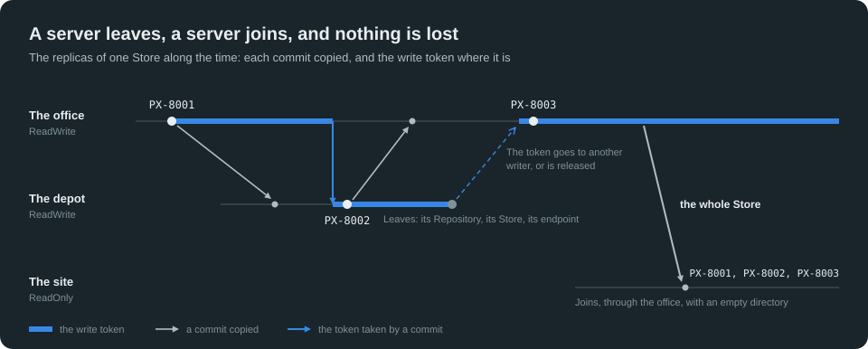

```csharp
[Fact]
public async Task GoOnWhenAWriterLeavesAndCopyTheStoreToAServerThatJoins()
{
    using var officeEndPoint = Cluster.EndPoint();
    using var officeStore = TransactionalMemoryStore.NewFileRepositoryStore(Cluster.NewDirectory("lesson-09-office"), "parcels", StoreAccessMode.ReadWrite);
    officeEndPoint.Add(officeStore);
    using var office = new CarrierRepository(officeStore);
    Register(office, "PX-8001");

    // The depot writes, then leaves the cluster: its Repository, its Store, then its endpoint. Its token goes to another writer, or is released.
    ulong depotId;
    using (var depotEndPoint = Cluster.EndPoint(officeEndPoint))
    using (var depotStore = TransactionalMemoryStore.NewFileRepositoryStore(Cluster.NewDirectory("lesson-09-depot"), "parcels", StoreAccessMode.ReadWrite))
    {
        depotId = depotEndPoint.EndPointId;
        depotEndPoint.Add(depotStore);
        await Cluster.CaughtUp(depotStore, officeStore);
        using (var depot = new CarrierRepository(depotStore))
        {
            Register(depot, "PX-8002");
            Assert.True(depotEndPoint.GetStatus(depotStore).IsWritable);
        }
    }

    // The office goes on: it holds the last commit of the depot, and its next commit takes the token.
    Assert.DoesNotContain(depotId, officeEndPoint.KnownEndPoints);
    Register(office, "PX-8003");
    Assert.Equal(officeEndPoint.EndPointId, officeEndPoint.GetStatus(officeStore).OwnerEndPointId);

    // A site joins later, with an empty directory, through the office: its replica receives the whole Store.
    using var siteEndPoint = Cluster.EndPoint(officeEndPoint);
    using var siteStore = TransactionalMemoryStore.NewFileRepositoryStore(Cluster.NewDirectory("lesson-09-site"), "parcels", StoreAccessMode.ReadOnly);
    siteEndPoint.Add(siteStore);
    await Cluster.CaughtUp(siteStore, officeStore);
    using var site = new CarrierRepository(siteStore);
    using (site.OpenTransaction(StoreAccessMode.ReadOnly))
    {
        var numbers = new List<string>();
        foreach (var parcel in ParcelViewCollection)
            numbers.Add(parcel.TrackingNumber);
        numbers.Sort(StringComparer.Ordinal);
        Assert.Equal(["PX-8001", "PX-8002", "PX-8003"], numbers);
    }
    Assert.Contains(siteEndPoint.EndPointId, officeEndPoint.KnownEndPoints);
}

private static void Register(CarrierRepository carrier, TrackingNumber trackingNumber)
{
    using var transaction = carrier.OpenTransaction(StoreAccessMode.ReadWrite);
    new Parcel(ParcelRef.New()) { TrackingNumber = trackingNumber, Recipient = "Ada", Depot = "" };
    transaction.Commit();
}
```

## From the need to the architecture

| The need | The answer | Lessons |
| -------- | ---------- | ------- |
| Several modules that change apart, in one Store | Repositories bound to one Store, their numbers apart | 1 |
| Several models, never out of step | A chain of Stores, `AddChildStore`, `Chain` | 2 |
| A failure, a rule, a conflict in one model | The whole chain rolled back, refused, or failed | 3 |
| The models and the Log of what happened, together | A chain that ends with its Log | 4 |
| Read the data on other servers | Replicas `ReadOnly` | 5 |
| Write the data on several servers | Replicas `ReadWrite`, one write token | 6 |
| The same entity, or a unique value, on two servers | A conflict, `Change` or `Uniqueness` | 7 |
| Each server with what it needs | A chain distributed, a part of it on each server | 8 |
| A server stopped, a server added | Leave by the disposal of the endpoint, join with an empty directory | 9 |

## What you learned

- A **Store takes several Repositories**, each with its transactions: a number is one type in the Store, of one nature, whatever its name and its Repository, an index number one index, and a bind refuses a conflict with nothing written.
- A **chain** of Stores makes their transactions one: `AddChildStore` chains the Stores, `Chain` their Repositories and their Log; the transactions of the chain open with the first one, ambient.
- A transaction of a chain is **all or nothing**: a rollback, a condemned Store, a conflict in any Store, and no Store is written.
- A chain may **end with its Log**: the commands, their Records and both models in one commit; one replay gives the models again.
- A Store is distributed by an **endpoint**: each server a whole **replica**, each commit copied to the others, in order.
- A replica **ReadOnly** reads the last commit it holds, and never waits for the copy; a replica **ReadWrite** writes, the **write token** taken at its commit.
- Several writers form **one sequence** of commits; the second of two concurrent changes **conflicts**, and a **unique value** is unique in the whole cluster.
- A chain is distributed **as a whole**, and each server holds the Stores it needs of it: a model alone, a Log alone and its subscription.
- A server **leaves** by the disposal of its endpoint, its token gone to another writer or released, and **joins** at any time, its replica copied whole.

[Tutorial Nine](Nine-Transaction-Conflicts.md) shows the concurrent changes that need no conflict: auto-merge and explicit merge.
