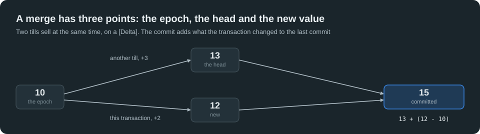
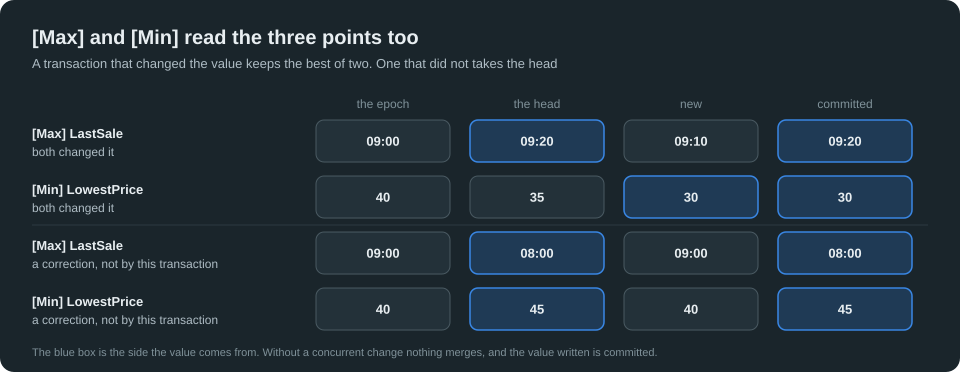
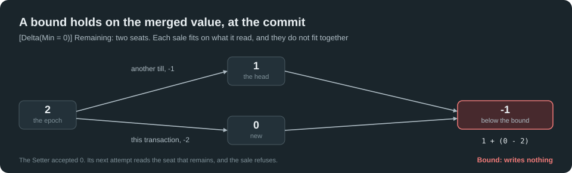
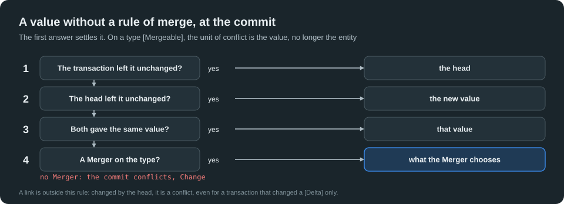
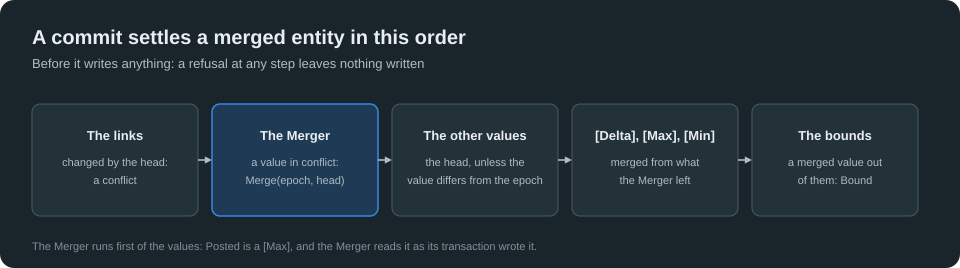

# Tutorial Nine: Transaction Conflicts

## Auto-merge and explicit merge

[Tutorial One](One-TheBasics.md#lesson-16-transaction-conflicts) showed what happens when two transactions change the same entity: the first commit wins, the other one conflicts and writes nothing, and the levels `Optimistic`, `Pessimistic` and `Exclusive` decide what a commit checks. That answer protects your data. On a counter that every till changes, it also makes each sale conflict with all the others: the application runs the work again, the writers of one entity follow one another, and the work wasted grows with them.

Yet two sales do not contradict each other: both happened, and they add up. This tutorial shows the other answer: a conflict that does not happen, because the two changes merge.

- **Auto-merge.** A type `[Mergeable]` does not conflict on its values: `[Delta]` adds the changes, `[Max]` and `[Min]` keep the latest and the lowest, each other value is settled on its own, and a bound still refuses what must not happen.
- **Explicit merge.** When no rule of the engine can merge two values, a **Merger**, a method of yours, decides, or refuses.

A commit that meets no concurrent change pays nothing for any of this.

Each lesson is a test class of the project `GhostBodyObject.TutorialNine`. Read it here, run it, then change it and see what breaks. The tutorial follows Tutorials One to Eight: the Stores, the transactions and their conflicts, the Views and the Bodies, the links, the value objects and the static lambdas are used here without being explained again.

## What you will build

The sales of the concerts of a hall, where several tills sell at the same time: the counters of a concert, the notice on its door, its posters, the ticket machines of the foyer. One model, `Sales`, and its Repository, `SalesRepository`.

**The values of the model come first**, each a value object ([Tutorial One, Lesson 19](One-TheBasics.md#lesson-19-give-each-value-its-type)):

```csharp
[ValueObject<GhostString>]
internal interface VTitle { }

[ValueObject<GhostString>]
internal interface VName { }

[ValueObject<decimal>(Operators = ValueOperators.Add | ValueOperators.Subtract, ImplicitConversion = true)]
internal interface VMoney { }

internal partial struct Money
{
    private static bool IsValid(decimal amount) => amount >= 0;

    public override string ToString() => Value.ToString("0.00", CultureInfo.InvariantCulture);
}

[ValueObject<int>(Operators = ValueOperators.Add | ValueOperators.Subtract, ImplicitConversion = true)]
internal interface VTickets { }

[ValueObject<DateTime>(ImplicitConversion = true)]
internal interface VInstant { }

[ValueObject<GhostString>]
internal interface VMessage { }
```

**A lesson on merges needs a commit between two instructions of a transaction.** [Tutorial One](One-TheBasics.md#lesson-16-transaction-conflicts) wrote two tasks and their signals for that. This tutorial has a helper, `AnotherTill`, so that the two transactions read in their order, from top to bottom. A transaction belongs to its execution context: `Runs` runs a work on a thread of its own, in a context of its own, and the transaction of the caller stays open. `Commits` runs a change in a transaction of its own, and waits for its commit:

```csharp
public static void Runs(Action work)
{
    var end = new TaskCompletionSource(TaskCreationOptions.RunContinuationsAsynchronously);
    using (ExecutionContext.SuppressFlow())
    {
        new Thread(() =>
        {
            try
            {
                work();
                end.SetResult();
            } catch (Exception failure)
            {
                end.SetException(failure);
            }
        }).Start();
    }
    end.Task.GetAwaiter().GetResult();
}

public static void Commits(SalesRepository sales, Action change) => Runs(() =>
{
    using var transaction = sales.OpenTransaction(StoreAccessMode.ReadWrite);
    change();
    transaction.Commit();
});
```

Every declaration of the tutorial, and the lesson that shows it:

| Declaration | What GBO does | Lessons |
| ----------- | ------------- | ------- |
| `[Mergeable]` on an entity, a part or a component | The concurrent changes of its values merge; each value is its own unit of conflict | 1, 4 |
| `[Delta]` on a value of it | The changes are added | 1 |
| `[Max]`, `[Min]` on a value of it | The latest or the greatest, the lowest | 2 |
| `[Delta(Min = 0)]`, `Max` | A value kept in its bounds, by its Setter and by the commit | 3 |
| `bool Merge(TView epoch, TView head)` in the partial class | A Merger: your choice between two values that conflict | 5, 6 |
| `[Mergeable(RemovalWins = true)]` | A removal wins over a concurrent write of values | 7 |

## Part 1: Auto-merge

### Lesson 1: Add the sales

The model holds a show, an ordinary entity, and a concert, whose type says how each of its values merges:

```csharp
[Entity(1, 1, 1), Root, Enumerable]
internal interface MHall
{
    [Property(1)]
    VName Name { get; set; }
}

[Entity(6, 1, 3), Root, Enumerable]
internal interface MShow
{
    [Property(1)]
    VTitle Title { get; set; }

    [Property(2)]
    VTickets Sold { get; set; }

    [Property(3)]
    VName Manager { get; set; }
}

[Entity(2, 1, 8), Root, Removable, Enumerable, Mergeable]
internal interface MConcert
{
    [Property(1)]
    VTitle Title { get; set; }

    // [Delta]: each transaction adds its own change to the last commit. Lesson 1.
    [Property(2), Delta]
    VTickets Sold { get; set; }

    [Property(3), Delta]
    VMoney Takings { get; set; }

    // [Max] and [Min]: the latest moment, the lowest price of the concurrent changes. Lesson 2.
    [Property(4), Max]
    VInstant LastSale { get; set; }

    [Property(5), Min]
    VMoney LowestPrice { get; set; }

    // A [Delta] that stays in its bounds: the tickets that remain never go below zero. Lesson 3.
    [Property(6), Delta(Min = 0)]
    VTickets Remaining { get; set; }

    // Values and links without a rule of merge. Lesson 4.
    [Property(7)]
    VName Manager { get; set; }

    [Property(8), Weak]
    Option<MHall> Hall { get; set; }
}

// The notices and the posters of Lessons 5 and 6 and the machines of Lesson 7 are declared with their lessons.
[GhostRepository(1), IncludeEntityModel(nameof(MHall)), IncludeEntityModel(nameof(MShow)), IncludeEntityModel(nameof(MConcert)), IncludeEntityModel(nameof(MNotice)), IncludeEntityModel(nameof(MPoster)), IncludeEntityModel(nameof(MKiosk))]
internal interface MSalesRepository
{
}
```

A sale changes the same entity as every other sale. On a show, two sales conflict, as in [Tutorial One](One-TheBasics.md#lesson-16-transaction-conflicts). `TryCommit(out kind)` is the same commit as `Commit()`, which gives a conflict back as a value: `false`, the transaction closed, nothing written, `kind` telling what happened. Code that expects a conflict uses it, and never catches an exception to go on; every other failure throws, as for `Commit()`.

```csharp
private static readonly DateTime Opening = new(2026, 11, 2, 9, 0, 0, DateTimeKind.Utc);

private static void Open(SalesRepository sales)
{
    using var transaction = sales.OpenTransaction(StoreAccessMode.ReadWrite);
    new Show { Title = "Tosca", Sold = 10, Manager = "Iris" };
    new Concert { Title = "Carmen", Sold = 10, Takings = 400m, LastSale = Opening, LowestPrice = 40m, Remaining = 500, Manager = "Iris" };
    transaction.Commit();
}

private static Concert Carmen() => ConcertCollection.Single();

[Fact]
public void ConflictOnAnOrdinaryCounter()
{
    using var store = TransactionalMemoryStore.NewInMemoryRepositoryStore("lesson-01-ordinary", StoreAccessMode.ReadWrite);
    using var sales = new SalesRepository(store);
    Open(sales);
    using (var transaction = sales.OpenTransaction(StoreAccessMode.ReadWrite))
    {
        ShowCollection.Single().Sold += 2;
        AnotherTill.Commits(sales, static () => ShowCollection.Single().Sold += 3);

        // TryCommit: the same commit as Commit(), its conflict given back as a value.
        Assert.False(transaction.TryCommit(out var kind));
        Assert.Equal(TransactionConflictKind.Change, kind);
    }
    using (sales.OpenTransaction(StoreAccessMode.ReadOnly))
        Assert.Equal(13, ShowCollection.Single().Sold);
}
```

The sale is lost until the application runs it again. Yet nothing here contradicts: both sales happened. A type `[Mergeable]` says so. Its Setters stay ordinary Setters, and a transaction reads and writes as usual; at its commit, when another transaction changed the entity meanwhile, GBO merges the two changes rather than conflict.

A merge has **three points**: the value at the opening of the transaction, its **epoch**; the value of the last commit, the **head**; and the **new** value of the transaction. `[Delta]` writes `head + (new - epoch)`: the last commit, and what the transaction changed.



```csharp
[Fact]
public void AddTheSalesOfTwoTills()
{
    using var store = TransactionalMemoryStore.NewInMemoryRepositoryStore("lesson-01-add", StoreAccessMode.ReadWrite);
    using var sales = new SalesRepository(store);
    Open(sales);
    using (var transaction = sales.OpenTransaction(StoreAccessMode.ReadWrite))
    {
        // The epoch of this transaction: 10 tickets. It writes 12.
        var carmen = Carmen();
        carmen.Sold += 2;
        carmen.Takings += 80m;

        // Another till commits 13 first: the head moves.
        AnotherTill.Commits(sales, static () =>
        {
            var concert = Carmen();
            concert.Sold += 3;
            concert.Takings += 120m;
        });

        // The transaction still reads its own version: its 12.
        Assert.Equal(12, carmen.Sold);

        // No conflict: the commit writes head + (new - epoch), 13 + (12 - 10).
        transaction.Commit();
    }
    using (sales.OpenTransaction(StoreAccessMode.ReadOnly))
    {
        Assert.Equal(15, Carmen().Sold);
        Assert.Equal(600m, Carmen().Takings);
    }
}
```

The value committed is not the value the transaction wrote: that is the point of it. Four tills meet no conflict, and nothing runs twice:

```csharp
[Fact]
public async Task SellFromFourTillsWithoutAConflict()
{
    using var store = TransactionalMemoryStore.NewInMemoryRepositoryStore("lesson-01-four", StoreAccessMode.ReadWrite);
    using var sales = new SalesRepository(store);
    Open(sales);
    int conflicts = 0;
    var tills = Enumerable.Range(0, 4).Select(till => Task.Run(() =>
    {
        for (int sale = 0; sale < 250; sale++)
        {
            using var transaction = sales.OpenTransaction(StoreAccessMode.ReadWrite);
            var carmen = Carmen();
            carmen.Sold += 1;
            carmen.Takings += 40m;
            if (!transaction.TryCommit(out _))
                Interlocked.Increment(ref conflicts);
        }
    }));
    await Task.WhenAll(tills);
    Assert.Equal(0, conflicts);
    using (sales.OpenTransaction(StoreAccessMode.ReadOnly))
    {
        Assert.Equal(1_010, Carmen().Sold);
        Assert.Equal(40_400m, Carmen().Takings);
    }
}
```

`[Delta]` takes a number, a duration, and a value object that declares `Add` and `Subtract`, as `VTickets` and `VMoney` do. A few rules follow from what a merge is:

- **An exact sum needs a `decimal` or an integer.** The addition of `double` depends on the order of the commits.
- **An average is a sum and a count**, two `[Delta]`: a merged average would be wrong.
- **A type `[Mergeable]` is an entity, a part or a component**, each type declaring it for itself. Never an edge, nor a Record, which never changes.

The generator stops the build, with GBO038, on what would not merge:

| Declared in the model | Why it is refused |
| ---------------------- | ------------------ |
| `[Delta]`, `[Max]` or `[Min]` in a type that is not `[Mergeable]` | A rule of merge exists in a Mergeable type only |
| Two of them on one value | A value has one rule |
| One of them on a text, an enum, an array or a link | A merge writes a number, a date, a duration, or a value object of a fixed size |
| `[Max]` or `[Min]` on a value object without an order, `[Delta]` on one without `Add` and `Subtract` | The merge runs by its operators |
| A method `Merge` in a type that is not `[Mergeable]`, or of another signature | See [Lesson 5](#lesson-5-a-merger-decides) |
| `[Mergeable]` on a Record | A Record never changes |

### Lesson 2: The latest and the lowest

Not every value adds up. The moment of the last sale keeps the latest one, whatever the order of the commits; the lowest price paid keeps the lowest one. `[Max]` and `[Min]` say so, on numbers, dates, times and durations, and on value objects that have an order:

```csharp
[Fact]
public void KeepTheLatestSaleAndTheLowestPrice()
{
    using var store = TransactionalMemoryStore.NewInMemoryRepositoryStore("lesson-02-keep", StoreAccessMode.ReadWrite);
    using var sales = new SalesRepository(store);
    Open(sales);
    using (var transaction = sales.OpenTransaction(StoreAccessMode.ReadWrite))
    {
        var carmen = Carmen();
        carmen.LastSale = Opening.AddMinutes(10);
        carmen.LowestPrice = 30m;
        AnotherTill.Commits(sales, static () =>
        {
            var concert = Carmen();
            concert.LastSale = Opening.AddMinutes(20);
            concert.LowestPrice = 35m;
        });
        transaction.Commit();
    }

    // The sale of the other till is the latest, the price of this one the lowest.
    using (sales.OpenTransaction(StoreAccessMode.ReadOnly))
    {
        Assert.Equal(Opening.AddMinutes(20), Carmen().LastSale);
        Assert.Equal(30m, Carmen().LowestPrice);
    }
}
```

Both rules read the three points. A transaction that changed the value writes the greater, or the lower, of the head and of its new value. A transaction that did not change it takes the head, so that a correction committed meanwhile is not undone by the value of its epoch:



```csharp
[Fact]
public void KeepACorrectionThatTheTransactionDidNotMake()
{
    using var store = TransactionalMemoryStore.NewInMemoryRepositoryStore("lesson-02-correction", StoreAccessMode.ReadWrite);
    using var sales = new SalesRepository(store);
    Open(sales);
    using (var transaction = sales.OpenTransaction(StoreAccessMode.ReadWrite))
    {
        // This sale changes the count, and neither the moment nor the price.
        Carmen().Sold += 1;

        // The manager corrects both: the moment moves back, the lowest price up.
        AnotherTill.Commits(sales, static () =>
        {
            var concert = Carmen();
            concert.LastSale = Opening.AddHours(-1);
            concert.LowestPrice = 45m;
        });
        transaction.Commit();
    }

    // A plain maximum with the value of the epoch would have undone the correction.
    using (sales.OpenTransaction(StoreAccessMode.ReadOnly))
    {
        Assert.Equal(Opening.AddHours(-1), Carmen().LastSale);
        Assert.Equal(45m, Carmen().LowestPrice);
        Assert.Equal(11, Carmen().Sold);
    }
}
```

They are rules of merge, not rules of the value. Without a concurrent change nothing merges, and the value written is the value committed. A code that must never move a date back compares before it writes:

```csharp
// A sale reported by a till: a message may come late, and the code compares before it writes.
private static void Report(Concert concert, DateTime sold, Money price)
{
    if (sold > concert.LastSale)
        concert.LastSale = sold;
    if (price < concert.LowestPrice)
        concert.LowestPrice = price;
}

[Fact]
public void WriteAnyValueWithoutAConcurrentChange()
{
    using var store = TransactionalMemoryStore.NewInMemoryRepositoryStore("lesson-02-alone", StoreAccessMode.ReadWrite);
    using var sales = new SalesRepository(store);
    Open(sales);

    // Nothing merges: the earlier moment is written.
    using (var transaction = sales.OpenTransaction(StoreAccessMode.ReadWrite))
    {
        Carmen().LastSale = Opening.AddHours(-1);
        transaction.Commit();
    }
    using (sales.OpenTransaction(StoreAccessMode.ReadOnly))
        Assert.Equal(Opening.AddHours(-1), Carmen().LastSale);

    // Report compares: a message that comes late changes nothing.
    using (var transaction = sales.OpenTransaction(StoreAccessMode.ReadWrite))
    {
        Report(Carmen(), Opening.AddHours(2), 42m);
        transaction.Commit();
    }
    using (var transaction = sales.OpenTransaction(StoreAccessMode.ReadWrite))
    {
        Report(Carmen(), Opening.AddHours(1), 41m);
        transaction.Commit();
    }
    using (sales.OpenTransaction(StoreAccessMode.ReadOnly))
    {
        Assert.Equal(Opening.AddHours(2), Carmen().LastSale);
        Assert.Equal(40m, Carmen().LowestPrice);
    }
}
```

### Lesson 3: Sell no more than the seats

A merged value carries no rule. Two refunds, each valid on what it read, leave the takings below zero, though the rule `IsValid` of `Money` refuses such a value: a merge reads no rule of a value.

```csharp
private static void Open(SalesRepository sales, int seats)
{
    using var transaction = sales.OpenTransaction(StoreAccessMode.ReadWrite);
    new Concert { Title = "Carmen", LowestPrice = 40m, Remaining = seats, Manager = "Iris" };
    transaction.Commit();
}

private static Concert Carmen() => ConcertCollection.First(static concert => concert.Title == "Carmen");

[Fact]
public void MergeBelowZeroWithoutABound()
{
    using var store = TransactionalMemoryStore.NewInMemoryRepositoryStore("lesson-03-refund", StoreAccessMode.ReadWrite);
    using var sales = new SalesRepository(store);
    Open(sales, seats: 1);
    using (var transaction = sales.OpenTransaction(StoreAccessMode.ReadWrite))
    {
        Carmen().Takings = 100m;
        transaction.Commit();
    }
    using (var transaction = sales.OpenTransaction(StoreAccessMode.ReadWrite))
    {
        Carmen().Takings -= 70m;
        AnotherTill.Commits(sales, static () => Carmen().Takings -= 60m);
        transaction.Commit();
    }
    using (sales.OpenTransaction(StoreAccessMode.ReadOnly))
        Assert.Equal(-30m, (decimal)Carmen().Takings);
}
```

A `[Delta]` takes bounds for that: `[Delta(Min = 0)]`, `Max`, or both, constants in the unit of the value. They bound the value of the field, never the change of a transaction, as `Remaining` does.

The bounds are checked twice. The Setter refuses a value out of them, `GhostBoundException`, and the transaction goes on, the value unchanged:

```csharp
[Fact]
public void RefuseAValueOutOfItsBoundsInTheSetter()
{
    using var store = TransactionalMemoryStore.NewInMemoryRepositoryStore("lesson-03-setter", StoreAccessMode.ReadWrite);
    using var sales = new SalesRepository(store);
    Open(sales, seats: 1);
    using (var transaction = sales.OpenTransaction(StoreAccessMode.ReadWrite))
    {
        var carmen = Carmen();
        Assert.Throws<GhostBoundException>(() => carmen.Remaining = -1);
        Assert.Equal(1, carmen.Remaining);

        // The bound itself is in.
        carmen.Remaining = 0;
        transaction.Commit();
    }
    using (sales.OpenTransaction(StoreAccessMode.ReadOnly))
        Assert.Equal(0, Carmen().Remaining);
}
```

The commit refuses a merged value out of them: a conflict of the kind `Bound`, nothing written. Each sale fitted on what it read; they do not fit together. The next attempt reads the head, and finds that there is nothing left:



```csharp
[Fact]
public void RefuseAMergedValueOutOfItsBoundsAtTheCommit()
{
    using var store = TransactionalMemoryStore.NewInMemoryRepositoryStore("lesson-03-commit", StoreAccessMode.ReadWrite);
    using var sales = new SalesRepository(store);
    Open(sales, seats: 2);
    using (var transaction = sales.OpenTransaction(StoreAccessMode.ReadWrite))
    {
        // Two seats: this sale of two fits.
        Carmen().Remaining -= 2;

        // Another till sells one first. The merged value is 1 + (0 - 2), below the bound.
        AnotherTill.Commits(sales, static () => Carmen().Remaining -= 1);
        Assert.False(transaction.TryCommit(out var kind));
        Assert.Equal(TransactionConflictKind.Bound, kind);
    }

    // The next attempt reads the seat that remains: the code of the sale compares, and refuses it.
    using (sales.OpenTransaction(StoreAccessMode.ReadOnly))
        Assert.False(Carmen().Remaining >= 2);
}
```

The code of a sale compares first, so it never meets the exception of the Setter: a seat that is gone is an answer, not a failure. The sales that fit do not conflict, and a concert sells exactly its seats to any number of tills:

```csharp
// One sale, run again on a conflict: true when it sold the seat, false when no seat remains.
private static bool Sell(SalesRepository sales)
{
    while (true)
    {
        using var transaction = sales.OpenTransaction(StoreAccessMode.ReadWrite);
        var carmen = Carmen();
        if (carmen.Remaining < 1)
            return false;
        carmen.Remaining -= 1;
        carmen.Sold += 1;
        if (transaction.TryCommit(out var kind))
            return true;
        Assert.Equal(TransactionConflictKind.Bound, kind);
    }
}

[Fact]
public async Task SellExactlyTheSeatsToConcurrentBuyers()
{
    using var store = TransactionalMemoryStore.NewInMemoryRepositoryStore("lesson-03-exactly", StoreAccessMode.ReadWrite);
    using var sales = new SalesRepository(store);
    Open(sales, seats: 500);
    int sold = 0, refused = 0;
    var tills = Enumerable.Range(0, 8).Select(_ => Task.Run(() =>
    {
        for (int buyer = 0; buyer < 100; buyer++)
            Interlocked.Increment(ref Sell(sales) ? ref sold : ref refused);
    }));
    await Task.WhenAll(tills);
    Assert.Equal(500, sold);
    Assert.Equal(300, refused);
    using (sales.OpenTransaction(StoreAccessMode.ReadOnly))
    {
        Assert.Equal(0, Carmen().Remaining);
        Assert.Equal(500, Carmen().Sold);
    }
}
```

This is the **escrow method**, a count of what remains: seats, a stock, a quota. Give each counter one fixed bound. A capacity that varies from one concert to another is counted by what remains, `Min = 0`, and never by a bound read from another field, which a concurrent transaction could change. A rule that is not a bound stays on an ordinary value, in conflict.

### Lesson 4: The other values, and the links

A type `[Mergeable]` changes the rule for all its values. On a show, an ordinary entity, the unit of conflict is the entity: two changes of two values conflict, though no value is changed twice.

```csharp
private static void Open(SalesRepository sales)
{
    using var transaction = sales.OpenTransaction(StoreAccessMode.ReadWrite);
    new Hall { Name = "Main hall" };
    new Show { Title = "Tosca", Manager = "Iris" };
    new Concert { Title = "Carmen", LowestPrice = 40m, Remaining = 500, Manager = "Iris" };
    transaction.Commit();
}

private static Concert Carmen() => ConcertCollection.Single();

[Fact]
public void ConflictOnTwoValuesOfAnOrdinaryEntity()
{
    using var store = TransactionalMemoryStore.NewInMemoryRepositoryStore("lesson-04-ordinary", StoreAccessMode.ReadWrite);
    using var sales = new SalesRepository(store);
    Open(sales);
    using var transaction = sales.OpenTransaction(StoreAccessMode.ReadWrite);
    ShowCollection.Single().Manager = "Jon";
    AnotherTill.Commits(sales, static () => ShowCollection.Single().Title = "Tosca (new staging)");
    Assert.False(transaction.TryCommit(out var kind));
    Assert.Equal(TransactionConflictKind.Change, kind);
}
```

On a concert, the unit of conflict is each value. A value without `[Delta]`, `[Max]` or `[Min]` follows the **rule of the three points**, in this order:



Each side keeps what it changed. And when both give the same value, there is nothing to choose:

```csharp
[Fact]
public void KeepWhatEachSideChanged()
{
    using var store = TransactionalMemoryStore.NewInMemoryRepositoryStore("lesson-04-each", StoreAccessMode.ReadWrite);
    using var sales = new SalesRepository(store);
    Open(sales);
    using (var transaction = sales.OpenTransaction(StoreAccessMode.ReadWrite))
    {
        Carmen().Manager = "Jon";
        AnotherTill.Commits(sales, static () => Carmen().Title = "Carmen (new staging)");
        transaction.Commit();
    }
    using (sales.OpenTransaction(StoreAccessMode.ReadOnly))
    {
        Assert.Equal("Jon", Carmen().Manager.ToString());
        Assert.Equal("Carmen (new staging)", Carmen().Title.ToString());
    }
}

[Fact]
public void AcceptTheSameValueFromBothSides()
{
    using var store = TransactionalMemoryStore.NewInMemoryRepositoryStore("lesson-04-same", StoreAccessMode.ReadWrite);
    using var sales = new SalesRepository(store);
    Open(sales);
    using (var transaction = sales.OpenTransaction(StoreAccessMode.ReadWrite))
    {
        Carmen().Manager = "Jon";
        AnotherTill.Commits(sales, static () => Carmen().Manager = "Jon");
        Assert.True(transaction.TryCommit(out _));
    }
}
```

Two values for one field: nothing can choose. Without a Merger, the commit conflicts, of the kind `Change`, and refuses its counters with the rest. A merge never writes a part of a transaction:

```csharp
[Fact]
public void ConflictOnTwoValuesOfOneField()
{
    using var store = TransactionalMemoryStore.NewInMemoryRepositoryStore("lesson-04-two", StoreAccessMode.ReadWrite);
    using var sales = new SalesRepository(store);
    Open(sales);
    using (var transaction = sales.OpenTransaction(StoreAccessMode.ReadWrite))
    {
        var carmen = Carmen();
        carmen.Manager = "Jon";
        carmen.Sold += 1;
        AnotherTill.Commits(sales, static () => Carmen().Manager = "Kay");
        Assert.False(transaction.TryCommit(out var kind));
        Assert.Equal(TransactionConflictKind.Change, kind);
    }
    using (sales.OpenTransaction(StoreAccessMode.ReadOnly))
    {
        Assert.Equal("Kay", Carmen().Manager.ToString());
        Assert.Equal(0, Carmen().Sold);
    }
}
```

**A link never merges.** A value stands alone; a link says something of its target, and of every rule that binds them. A reference, a collection, an Owner changed by the head since the epoch is a conflict, even for a transaction that changed a `[Delta]` only:

```csharp
[Fact]
public void NeverMergeALink()
{
    using var store = TransactionalMemoryStore.NewInMemoryRepositoryStore("lesson-04-link", StoreAccessMode.ReadWrite);
    using var sales = new SalesRepository(store);
    Open(sales);
    using (var transaction = sales.OpenTransaction(StoreAccessMode.ReadWrite))
    {
        Carmen().Sold += 1;
        AnotherTill.Commits(sales, static () => Carmen().Hall = HallCollection.Single());
        Assert.Equal(TransactionConflictKind.Change, Assert.Throws<TransactionConflictException>(transaction.Commit).Kind);
    }
    using (sales.OpenTransaction(StoreAccessMode.ReadOnly))
        Assert.Equal(0, Carmen().Sold);
}
```

A link that the transaction alone changed is written as usual, and a counter changed meanwhile merges with it:

```csharp
[Fact]
public void WriteALinkThatTheTransactionAloneChanged()
{
    using var store = TransactionalMemoryStore.NewInMemoryRepositoryStore("lesson-04-alone", StoreAccessMode.ReadWrite);
    using var sales = new SalesRepository(store);
    Open(sales);
    using (var transaction = sales.OpenTransaction(StoreAccessMode.ReadWrite))
    {
        Carmen().Hall = HallCollection.Single();
        AnotherTill.Commits(sales, static () => Carmen().Sold += 1);
        Assert.True(transaction.TryCommit(out _));
    }
    using (sales.OpenTransaction(StoreAccessMode.ReadOnly))
    {
        Assert.True(Carmen().Hall.Any());
        Assert.Equal(1, Carmen().Sold);
    }
}
```

An index follows the merged value: the entity is found by the value committed, not by the one that the transaction wrote.

## Part 2: Explicit merge

### Lesson 5: A Merger decides

Two values for one field: the engine cannot choose, and your code can. A **Merger** is a method of the partial class of the type, `private bool Merge(TView epoch, TView head)`: the explicit merge, beside the rules of Part 1. The notice of a concert on the door of its hall has rules that only your code knows: a stage only moves on, and the latest message wins:

```csharp
public enum Stage
{
    Announced,
    OnSale,
    SoldOut,
    Cancelled
}

[Entity(3, 1, 5), Root, Enumerable, Mergeable]
internal interface MNotice
{
    [Property(1)]
    VTitle Concert { get; set; }

    [Property(2)]
    VMessage Message { get; set; }

    [Property(3)]
    Stage Stage { get; set; }

    [Property(4), Max]
    VInstant Posted { get; set; }

    [Property(5)]
    VName Room { get; set; }
}

internal sealed partial class Notice
{
    // The Merger of a notice: at the commit, when a value without a rule of merge was changed by both sides to two values. This object
    // holds the values of the transaction; epoch and head, the two other points. It writes what it chooses, and returns true.
    private bool Merge(NoticeView epoch, NoticeView head)
    {
        // Two rooms, changed by both: nothing can choose between them. False fails the commit (Lesson 6).
        if (Room != epoch.Room && head.Room != epoch.Room && Room != head.Room)
            return false;

        // A stage only moves on: the furthest one wins, whatever the order of the commits.
        if (head.Stage > Stage)
            Stage = head.Stage;

        // The latest notice wins. Posted is read as this transaction wrote it: [Max] merges it after the Merger.
        if (head.Posted > Posted)
            Message = head.Message;
        return true;
    }
}
```

The Merger sees the three points. The object itself, `this`, holds the values of the transaction; the Views hold the epoch and the head. It writes the values that it chooses, by its own Setters, and returns `true`. The message posted last wins, whichever commits first:

```csharp
private static readonly DateTime Noon = new(2026, 11, 2, 12, 0, 0, DateTimeKind.Utc);

private static void Open(SalesRepository sales)
{
    using var transaction = sales.OpenTransaction(StoreAccessMode.ReadWrite);
    new Notice { Concert = "Carmen", Message = "Tickets at the door", Stage = Stage.OnSale, Posted = Noon, Room = "Main hall" };
    transaction.Commit();
}

private static Notice Carmen() => NoticeCollection.First(static notice => notice.Concert == "Carmen");

[Theory]
[InlineData(10, "Ten seats left")]
[InlineData(30, "Last seats")]
public void KeepTheLatestMessage(int minutes, string expected)
{
    using var store = TransactionalMemoryStore.NewInMemoryRepositoryStore($"lesson-05-latest-{minutes}", StoreAccessMode.ReadWrite);
    using var sales = new SalesRepository(store);
    Open(sales);
    using (var transaction = sales.OpenTransaction(StoreAccessMode.ReadWrite))
    {
        var carmen = Carmen();
        carmen.Message = "Last seats";
        carmen.Posted = Noon.AddMinutes(minutes);

        // The other till posts at 20 minutes, and commits first.
        AnotherTill.Commits(sales, static () =>
        {
            var notice = Carmen();
            notice.Message = "Ten seats left";
            notice.Posted = Noon.AddMinutes(20);
        });
        transaction.Commit();
    }
    using (sales.OpenTransaction(StoreAccessMode.ReadOnly))
    {
        Assert.Equal(expected, Carmen().Message.ToString());

        // Posted is a [Max]: the latest moment, in both cases.
        Assert.Equal(Noon.AddMinutes(Math.Max(minutes, 20)), Carmen().Posted);
    }
}
```

The furthest stage wins, in both orders of the commits: nothing depends on which till was faster.

```csharp
[Theory]
[InlineData(Stage.SoldOut, Stage.Cancelled)]
[InlineData(Stage.Cancelled, Stage.SoldOut)]
public void MoveTheStageOn(Stage mine, Stage theirs)
{
    using var store = TransactionalMemoryStore.NewInMemoryRepositoryStore($"lesson-05-stage-{mine}", StoreAccessMode.ReadWrite);
    using var sales = new SalesRepository(store);
    Open(sales);
    using (var transaction = sales.OpenTransaction(StoreAccessMode.ReadWrite))
    {
        Carmen().Stage = mine;
        AnotherTill.Commits(sales, () => Carmen().Stage = theirs);
        transaction.Commit();
    }
    using (sales.OpenTransaction(StoreAccessMode.ReadOnly))
        Assert.Equal(Stage.Cancelled, Carmen().Stage);
}
```

The commit calls the Merger only when a value without a rule of merge is in conflict: changed by both sides, to two values. Here each side changed its own value, and nothing calls it: it would have replaced this message by the older one of the head, posted later.

```csharp
[Fact]
public void CallTheMergerOnlyOnAConflict()
{
    using var store = TransactionalMemoryStore.NewInMemoryRepositoryStore("lesson-05-only", StoreAccessMode.ReadWrite);
    using var sales = new SalesRepository(store);
    Open(sales);
    using (var transaction = sales.OpenTransaction(StoreAccessMode.ReadWrite))
    {
        Carmen().Message = "Doors open at seven";
        AnotherTill.Commits(sales, static () =>
        {
            var notice = Carmen();
            notice.Stage = Stage.SoldOut;
            notice.Posted = Noon.AddMinutes(20);
        });
        transaction.Commit();
    }
    using (sales.OpenTransaction(StoreAccessMode.ReadOnly))
    {
        Assert.Equal("Doors open at seven", Carmen().Message.ToString());
        Assert.Equal(Stage.SoldOut, Carmen().Stage);
    }
}
```

What the commit does with a merged entity has an order, and everything comes before its first write:



After the Merger, a value that differs from the epoch keeps the choice of the Merger, and any other takes the head; then `[Delta]`, `[Max]` and `[Min]` are merged. So the Merger reads `Posted` as its transaction wrote it, which is why it compares the moments of the two messages.

The commit waits for the Merger, and so do the commits of every other till: **it stays brief, reads only its three versions, and gives the same answer every time.** No call outside, no other entity.

### Lesson 6: When a Merger refuses

A Merger that cannot choose returns `false`: the commit fails as a conflict, of the kind `Change`, nothing written, and the application decides, as for any conflict. Two rooms for one notice: the Merger of Lesson 5 does not guess.

```csharp
private static Notice Carmen() => NoticeCollection.First(static notice => notice.Concert == "Carmen");

[Fact]
public void FailTheCommitWhenTheMergerRefuses()
{
    using var store = TransactionalMemoryStore.NewInMemoryRepositoryStore("lesson-06-refuse", StoreAccessMode.ReadWrite);
    using var sales = new SalesRepository(store);
    using (var transaction = sales.OpenTransaction(StoreAccessMode.ReadWrite))
    {
        new Notice { Concert = "Carmen", Message = "Tickets at the door", Room = "Main hall" };
        transaction.Commit();
    }
    using (var transaction = sales.OpenTransaction(StoreAccessMode.ReadWrite))
    {
        Carmen().Room = "Small hall";
        AnotherTill.Commits(sales, static () => Carmen().Room = "Foyer");
        Assert.False(transaction.TryCommit(out var kind));
        Assert.Equal(TransactionConflictKind.Change, kind);
    }
    using (sales.OpenTransaction(StoreAccessMode.ReadOnly))
        Assert.Equal("Foyer", Carmen().Room.ToString());
}
```

A Merger that fails is another matter. It writes only the values without a rule of merge, and reads only its entity: writing a `[Delta]`, a `[Max]`, a `[Min]` or a link, or reading a link, is refused. The commit is then canceled by a `GhostMergeException`, nothing written, and so it is when a Merger throws, its exception in `InnerException`. This is a defect of the code, not a conflict: `TryCommit` throws it too.

```csharp
[Entity(4, 1, 3), Root, Enumerable, Mergeable]
internal interface MPoster
{
    [Property(1)]
    VTitle Concert { get; set; }

    [Property(2)]
    VMessage Caption { get; set; }

    [Property(3), Delta]
    VTickets Printed { get; set; }
}

internal sealed partial class Poster
{
    // A [Delta] belongs to the engine: a Merger that writes it fails the commit, as a Merger that throws.
    private bool Merge(PosterView epoch, PosterView head)
    {
        Printed = head.Printed;
        return true;
    }
}

private static Poster ThePoster() => PosterCollection.Single();

[Fact]
public void FailTheCommitOfAMergerThatDoesWhatItMayNot()
{
    using var store = TransactionalMemoryStore.NewInMemoryRepositoryStore("lesson-06-defect", StoreAccessMode.ReadWrite);
    using var sales = new SalesRepository(store);
    using (var transaction = sales.OpenTransaction(StoreAccessMode.ReadWrite))
    {
        new Poster { Concert = "Carmen", Caption = "Bizet", Printed = 100 };
        transaction.Commit();
    }
    using (var transaction = sales.OpenTransaction(StoreAccessMode.ReadWrite))
    {
        ThePoster().Caption = "Georges Bizet";
        AnotherTill.Commits(sales, static () => ThePoster().Caption = "Bizet, 1875");
        Assert.Throws<GhostMergeException>(() => transaction.TryCommit(out _));
    }
    using (sales.OpenTransaction(StoreAccessMode.ReadOnly))
        Assert.Equal("Bizet, 1875", ThePoster().Caption.ToString());
}
```

| The Merger | The commit | `TryCommit` |
| ---------- | ---------- | ----------- |
| Returns `true` | Goes on, and merges the rest | `true` |
| Returns `false` | A conflict, `Change`, nothing written | `false` |
| Throws, or does what it may not | `GhostMergeException`, nothing written | Throws |

### Lesson 7: A removal that wins

A merge settles values; a removal is another thing. By default, a type `[Mergeable]` keeps the rule of an ordinary entity, in both orders: a write of an entity removed meanwhile conflicts, `Removal`; a removal of an entity changed meanwhile conflicts, `Change`.

```csharp
private static void Open(SalesRepository sales)
{
    using var transaction = sales.OpenTransaction(StoreAccessMode.ReadWrite);
    new Hall { Name = "Main hall" };
    new Kiosk { Name = "Foyer" };
    new Concert { Title = "Carmen", LowestPrice = 40m, Remaining = 500, Manager = "Iris" };
    transaction.Commit();
}

private static Concert Carmen() => ConcertCollection.Single();

private static Kiosk Foyer() => KioskCollection.Single();

[Fact]
public void ConflictWithARemovalByDefault()
{
    using var store = TransactionalMemoryStore.NewInMemoryRepositoryStore("lesson-07-default", StoreAccessMode.ReadWrite);
    using var sales = new SalesRepository(store);
    Open(sales);
    using (var transaction = sales.OpenTransaction(StoreAccessMode.ReadWrite))
    {
        Carmen().Remove();
        AnotherTill.Commits(sales, static () => Carmen().Sold += 1);
        Assert.False(transaction.TryCommit(out var kind));
        Assert.Equal(TransactionConflictKind.Change, kind);
    }
    using (var transaction = sales.OpenTransaction(StoreAccessMode.ReadWrite))
    {
        Carmen().Sold += 1;
        AnotherTill.Commits(sales, static () => Carmen().Remove());
        Assert.False(transaction.TryCommit(out var kind));
        Assert.Equal(TransactionConflictKind.Removal, kind);
    }
}
```

`[Mergeable(RemovalWins = true)]` changes that, for the values only: the removal wins, in both orders of the commits. It serves a removal that is a command, a machine withdrawn from service:

```csharp
[Entity(5, 1, 3), Root, Removable, Enumerable, Mergeable(RemovalWins = true)]
internal interface MKiosk
{
    [Property(1)]
    VName Name { get; set; }

    [Property(2), Delta]
    VTickets Sold { get; set; }

    [Property(3), Weak]
    Option<MHall> Hall { get; set; }
}
```

A write that comes after the removal is dropped, and the rest of its transaction commits; a removal that comes after a write removes the entity all the same:

```csharp
[Fact]
public void DropAWriteThatComesAfterTheRemoval()
{
    using var store = TransactionalMemoryStore.NewInMemoryRepositoryStore("lesson-07-drop", StoreAccessMode.ReadWrite);
    using var sales = new SalesRepository(store);
    Open(sales);
    using (var transaction = sales.OpenTransaction(StoreAccessMode.ReadWrite))
    {
        Foyer().Sold += 1;
        Carmen().Sold += 1;
        AnotherTill.Commits(sales, static () => Foyer().Remove());
        Assert.True(transaction.TryCommit(out _));
    }
    using (sales.OpenTransaction(StoreAccessMode.ReadOnly))
    {
        Assert.Equal(0, KioskCollection.Count());
        Assert.Equal(1, Carmen().Sold);
    }
}

[Fact]
public void RemoveAnEntityChangedMeanwhile()
{
    using var store = TransactionalMemoryStore.NewInMemoryRepositoryStore("lesson-07-remove", StoreAccessMode.ReadWrite);
    using var sales = new SalesRepository(store);
    Open(sales);
    using (var transaction = sales.OpenTransaction(StoreAccessMode.ReadWrite))
    {
        Foyer().Remove();
        AnotherTill.Commits(sales, static () => Foyer().Sold += 1);
        Assert.True(transaction.TryCommit(out _));
    }
    using (sales.OpenTransaction(StoreAccessMode.ReadOnly))
        Assert.Equal(0, KioskCollection.Count());
}
```

| Order of the commits | Without `RemovalWins` | With `RemovalWins` |
| -------------------- | --------------------- | ------------------ |
| The removal, then a write of values | Conflict `Removal` | The write of the entity is dropped; the rest commits |
| A write of values, then the removal | Conflict `Change` | The entity is removed |
| Either one changed a link | Conflict | Conflict |

A link keeps its conflict, whatever the option: a removal never hides a link written meanwhile.

```csharp
[Fact]
public void KeepTheConflictOfALink()
{
    using var store = TransactionalMemoryStore.NewInMemoryRepositoryStore("lesson-07-link", StoreAccessMode.ReadWrite);
    using var sales = new SalesRepository(store);
    Open(sales);
    using (var transaction = sales.OpenTransaction(StoreAccessMode.ReadWrite))
    {
        Foyer().Hall = HallCollection.Single();
        AnotherTill.Commits(sales, static () => Foyer().Remove());
        Assert.False(transaction.TryCommit(out var kind));
        Assert.Equal(TransactionConflictKind.Removal, kind);
    }
}
```

Leave it off unless you mean it. The transaction that lost its write is told nothing, and a Log chained with it keeps the Record of what it did: its replay then runs a command on an entity already removed. A careful design lets that transaction fail.

## From the value to its merge

| The value | Its merge | Lessons |
| --------- | --------- | ------- |
| A count or an amount that many writers add to | `[Delta]` | 1 |
| The latest moment, the highest or the lowest value | `[Max]`, `[Min]` | 2 |
| A count that must stay in its bounds: seats, a stock, a quota | `[Delta(Min = 0)]` | 3 |
| Different values of one entity, changed at the same time | `[Mergeable]`: each value on its own | 4 |
| A choice between two values, by a rule of the business | A Merger | 5, 6 |
| A removal that is a command, whatever a sale writes | `RemovalWins` | 7 |
| A link, or a rule that is not a bound | No merge: a conflict | 3, 4 |

Merge what does not contradict itself. A rule between two values, or between two entities, stays on what conflicts.

## What you learned

- A type **`[Mergeable]`** merges its values on **three points**: the epoch, the head and the new value. Each value is its own unit of conflict.
- **`[Delta]`** adds, **`[Max]`** and **`[Min]`** keep the latest and the lowest: rules of merge, not rules of the value.
- A merge reads no rule of a value. **A bound** keeps a merged value in its range, in the Setter and at the commit.
- **A link never merges.**
- A **Merger** chooses between two values, with `this`, `epoch` and `head`: only on a conflict of values, briefly, and `false` refuses. A Merger that fails is a defect, not a conflict.
- **`RemovalWins`** lets a removal win over a write of values, in both orders, and stays off unless you mean it.

[Tutorial Ten](Ten-Claims-Points-And-Leases.md) shows what no merge settles: a decision on what was read, a rule over the parts of an aggregate, and a work outside a transaction.
