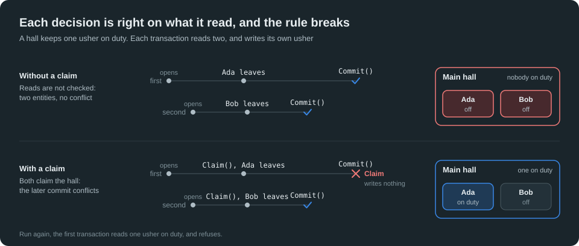
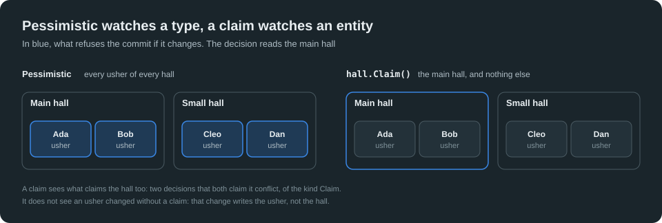
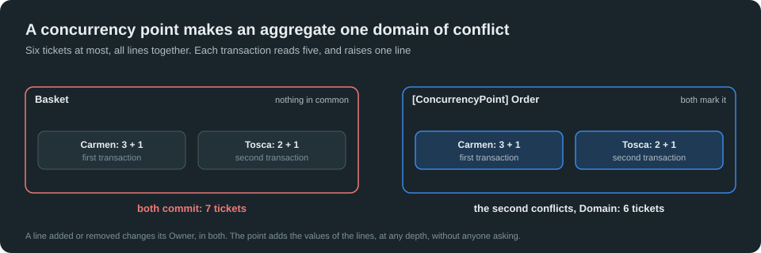
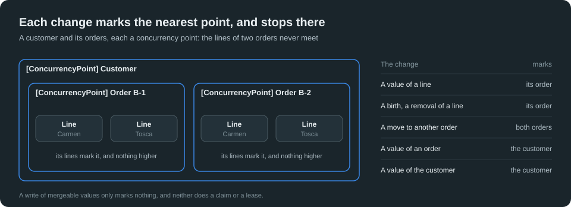
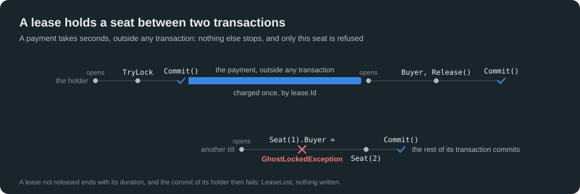
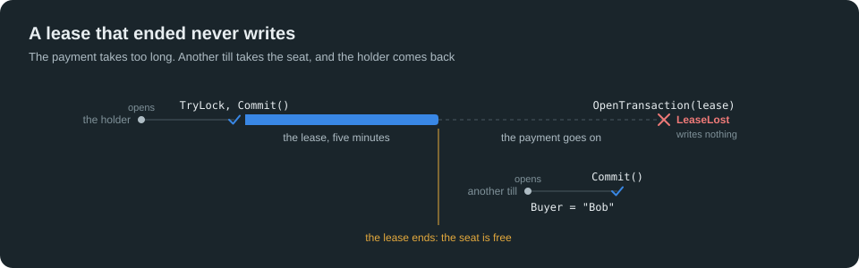

# Tutorial Ten: Claims, Points and Leases

## A decision, an aggregate, a work outside

A commit compares what a transaction writes ([Tutorial One](One-TheBasics.md#lesson-16-transaction-conflicts)), and a merge settles the values that many writers change ([Tutorial Nine](Nine-Transaction-Conflicts.md)). Three needs remain, which neither answers:

- **A decision on what was read.** A transaction reads a hall, and writes an usher: the commit checks the usher, and nothing tells it that the decision rested on the hall. `Claim()` ties a decision to the entity that it rests on.
- **A rule over the parts of an aggregate.** A change of a line writes that line, and a rule over all the lines is not protected. `[ConcurrencyPoint]` makes the aggregate one domain of conflict, declared once in the model.
- **A work outside GBO.** A payment takes seconds, and no transaction covers it. A **lease** holds entities between two transactions, on every server.

GBO has no lock manager: none of these tools makes anyone wait. The readers never stop, a claim and a point conflict at the commit, and a lease is refused at once.

Each lesson is a test class of the project `GhostBodyObject.TutorialTen`. Read it here, run it, then change it and see what breaks. The tutorial follows Tutorials One to Nine: the Stores, the transactions and their conflicts, the parts of an aggregate, the Views and the Bodies, the merges and the value objects are used here without being explained again.

## What you will build

The box office of a concert hall, where several tills work at the same time: the halls and their ushers, the baskets and the orders of the customers, the seats. One model, `BoxOffice`, and its Repository, `BoxOfficeRepository`.

**The values of the model come first**, each a value object ([Tutorial One, Lesson 19](One-TheBasics.md#lesson-19-give-each-value-its-type)):

```csharp
[ValueObject<GhostString>]
internal interface VName { }

[ValueObject<GhostString>]
internal interface VTitle { }

[ValueObject<GhostString>]
internal interface VReference { }

[ValueObject<int>(Operators = ValueOperators.Add | ValueOperators.Subtract, ImplicitConversion = true)]
internal interface VTickets { }

[ValueObject<int>(Operators = ValueOperators.Add | ValueOperators.Subtract, ImplicitConversion = true)]
internal interface VVisits { }

[ValueObject<int>(ImplicitConversion = true)]
internal interface VSeatNumber { }
```

**The other tills.** As in [Tutorial Nine](Nine-Transaction-Conflicts.md#what-you-will-build), the helper `AnotherTill` puts a commit between two instructions of a transaction, so that the two transactions read in their order, from top to bottom:

```csharp
public static void Runs(Action work)
{
    var end = new TaskCompletionSource(TaskCreationOptions.RunContinuationsAsynchronously);
    using (ExecutionContext.SuppressFlow())
    {
        new Thread(() =>
        {
            try
            {
                work();
                end.SetResult();
            } catch (Exception failure)
            {
                end.SetException(failure);
            }
        }).Start();
    }
    end.Task.GetAwaiter().GetResult();
}

public static void Commits(BoxOfficeRepository boxOffice, Action change) => Runs(() =>
{
    using var transaction = boxOffice.OpenTransaction(StoreAccessMode.ReadWrite);
    change();
    transaction.Commit();
});
```

Every declaration of the tutorial, and the lesson that shows it:

| Declaration or call | What GBO does | Lessons |
| ------------------- | ------------- | ------- |
| `Claim()` on a View or a Body | The commit conflicts when the entity changed, or when another transaction claimed it | 1, 2 |
| `[ConcurrencyPoint]` on an entity | Every change below it counts as a change of it: one domain of conflict | 3, 5 |
| `ConcurrencyVersion` | The version of a domain, raised by each commit that changes it | 4 |
| `view.TryLock(duration, out lease)` | A lease of one entity, taken by a commit | 6 |
| `repository.OpenTransaction(lease)`, `lease.Release()` | A transaction of the lease; the end of the lease, by its commit | 6 |
| `view.IsLocked` | The entity is held by a lease of another context | 7 |
| `transaction.NewLease(duration)`, `lease.TryAdd(view)` | A lease of several entities, all or none | 8 |
| `lease.Views<TView>()` | The entities of a lease | 8 |
| `lease.Renew(duration)`, `lease.Remaining`, `lease.IsActive` | The life of a lease | 9 |
| `ignoreLocks: true` | An exclusive transaction that writes through the leases | 10 |

## Part 1: Claims

### Lesson 1: A decision on what was read

A commit compares what a transaction writes, never what it reads. A decision taken on what it read, and written elsewhere, is not protected. The model starts with a hall and its ushers:

```csharp
internal enum Duty
{
    Off,
    On
}

[Entity(1, 1, 2), Root, Enumerable]
internal interface MHall
{
    [Property(1)]
    VName Name { get; set; }

    [Property(2)]
    IEntityCollection<MUsher> Ushers { get; }
}

[Entity(2, 1, 2)]
internal interface MUsher
{
    [Property(1)]
    VName Name { get; set; }

    [Property(2)]
    Duty Duty { get; set; }
}

internal interface MBoxOfficeRepository
{
}
```

A hall keeps one usher on duty, and Ada and Bob ask to leave at the same time. Each transaction reads two ushers on duty, and writes its own one. They write two different entities: both commit, and the hall has nobody left.



```csharp
// Two halls, two ushers on duty in each one.
internal static void Open(BoxOfficeRepository boxOffice)
{
    using var transaction = boxOffice.OpenTransaction(StoreAccessMode.ReadWrite);
    Staff(new Hall { Name = "Main hall" }, "Ada", "Bob");
    Staff(new Hall { Name = "Small hall" }, "Cleo", "Dan");
    transaction.Commit();
}

private static void Staff(Hall hall, string first, string second)
{
    foreach (var name in new[] { first, second })
    {
        var usher = hall.Ushers.New();
        usher.Name = name;
        usher.Duty = Duty.On;
    }
}

internal static Hall MainHall() => HallCollection.First(static hall => hall.Name == "Main hall");

internal static Hall SmallHall() => HallCollection.First(static hall => hall.Name == "Small hall");

// The rule of the hall: an usher leaves when another one stays on duty. The decision reads every usher of the hall, and
// writes only the one who leaves.
internal static bool Leave(Hall hall, string name)
{
    int onDuty = 0;
    Usher? leaving = null;
    foreach (var usher in hall.Ushers)
    {
        if (usher.Duty == Duty.On)
            onDuty++;
        if (usher.Name == name)
            leaving = usher;
    }
    if (onDuty < 2)
        return false;
    leaving!.Duty = Duty.Off;
    return true;
}

internal static int OnDuty(Hall hall)
{
    int onDuty = 0;
    foreach (var usher in hall.Ushers)
        if (usher.Duty == Duty.On)
            onDuty++;
    return onDuty;
}

[Fact]
public void LeaveAHallEmpty()
{
    using var store = TransactionalMemoryStore.NewInMemoryRepositoryStore("lesson-01-empty", StoreAccessMode.ReadWrite);
    using var boxOffice = new BoxOfficeRepository(store);
    Open(boxOffice);
    using (var transaction = boxOffice.OpenTransaction(StoreAccessMode.ReadWrite))
    {
        Assert.True(Leave(MainHall(), "Ada"));
        AnotherTill.Commits(boxOffice, static () => Assert.True(Leave(MainHall(), "Bob")));

        // Ada and Bob are two entities: nothing conflicts.
        Assert.True(transaction.TryCommit(out _));
    }
    using (boxOffice.OpenTransaction(StoreAccessMode.ReadOnly))
        Assert.Equal(0, OnDuty(MainHall()));
}
```

Each decision was right on what it read: no check in `Leave` can fix this. `Claim()` ties a decision to the entity that it rests on. The commit conflicts, of the kind `Claim`, when that entity changed since the opening of the transaction, and two transactions that claim one entity conflict:

```csharp
// The same decision, which claims the hall that it reads.
internal static bool LeaveWithAClaim(Hall hall, string name)
{
    hall.Claim();
    return Leave(hall, name);
}

[Fact]
public void KeepAnUsherOnDutyWithAClaim()
{
    using var store = TransactionalMemoryStore.NewInMemoryRepositoryStore("lesson-01-claim", StoreAccessMode.ReadWrite);
    using var boxOffice = new BoxOfficeRepository(store);
    Open(boxOffice);
    using (var transaction = boxOffice.OpenTransaction(StoreAccessMode.ReadWrite))
    {
        Assert.True(LeaveWithAClaim(MainHall(), "Ada"));
        AnotherTill.Commits(boxOffice, static () => Assert.True(LeaveWithAClaim(MainHall(), "Bob")));
        Assert.False(transaction.TryCommit(out var kind));
        Assert.Equal(TransactionConflictKind.Claim, kind);
    }

    // The work runs again, on the last commit: one usher on duty, and the decision refuses.
    using (var transaction = boxOffice.OpenTransaction(StoreAccessMode.ReadWrite))
    {
        Assert.False(LeaveWithAClaim(MainHall(), "Ada"));
        Assert.True(transaction.TryCommit(out _));
    }
    using (boxOffice.OpenTransaction(StoreAccessMode.ReadOnly))
        Assert.Equal(1, OnDuty(MainHall()));
}
```

This is a `SELECT ... FOR UPDATE` without any wait: nothing is frozen, the others go on, and the transaction that claims finds out at its commit. The work then runs again on the last commit, and the decision refuses.

### Lesson 2: What a claim watches

A claim watches one entity, and nothing else. The `Pessimistic` level of [Tutorial One](One-TheBasics.md#lesson-17-pessimistic-transactions) also protects this decision, by watching a whole type: a change of any usher of any hall refuses the commit, though the rule of this hall still holds.

```csharp
[Fact]
public void ConflictOnAnyUsherAtThePessimisticLevel()
{
    using var store = TransactionalMemoryStore.NewInMemoryRepositoryStore("lesson-02-pessimistic", StoreAccessMode.ReadWrite);
    using var boxOffice = new BoxOfficeRepository(store);
    Open(boxOffice);
    using var transaction = boxOffice.OpenTransaction(StoreAccessMode.ReadWrite, TransactionConflictLevel.Pessimistic);
    Assert.True(Leave(MainHall(), "Ada"));
    AnotherTill.Commits(boxOffice, static () => Assert.True(Leave(SmallHall(), "Dan")));
    Assert.False(transaction.TryCommit(out var kind));
    Assert.Equal(TransactionConflictKind.Collection, kind);
}
```

A claim lets the other hall work:



```csharp
[Fact]
public void LeaveTheOtherHallAlone()
{
    using var store = TransactionalMemoryStore.NewInMemoryRepositoryStore("lesson-02-other", StoreAccessMode.ReadWrite);
    using var boxOffice = new BoxOfficeRepository(store);
    Open(boxOffice);
    using (var transaction = boxOffice.OpenTransaction(StoreAccessMode.ReadWrite))
    {
        Assert.True(LeaveWithAClaim(MainHall(), "Ada"));
        AnotherTill.Commits(boxOffice, static () => Assert.True(LeaveWithAClaim(SmallHall(), "Dan")));
        Assert.True(transaction.TryCommit(out _));
    }
    using (boxOffice.OpenTransaction(StoreAccessMode.ReadOnly))
    {
        Assert.Equal(1, OnDuty(MainHall()));
        Assert.Equal(1, OnDuty(SmallHall()));
    }
}
```

A claim is taken on a View or on a Body, and a View needs no Body. It watches every change of its entity, not only the claims of the others:

```csharp
[Fact]
public void ConflictWithAChangeOfTheEntityClaimed()
{
    using var store = TransactionalMemoryStore.NewInMemoryRepositoryStore("lesson-02-change", StoreAccessMode.ReadWrite);
    using var boxOffice = new BoxOfficeRepository(store);
    Open(boxOffice);
    using var transaction = boxOffice.OpenTransaction(StoreAccessMode.ReadWrite);
    HallViewCollection.First(static hall => hall.Name == "Main hall").Claim();
    AnotherTill.Commits(boxOffice, static () => MainHall().Name = "Grand hall");
    Assert.False(transaction.TryCommit(out var kind));
    Assert.Equal(TransactionConflictKind.Claim, kind);
}
```

**It protects only those who claim.** A change of an usher writes the usher, not the hall, and a code that changes an usher without claiming the hall goes through:

```csharp
[Fact]
public void MissADecisionThatDoesNotClaim()
{
    using var store = TransactionalMemoryStore.NewInMemoryRepositoryStore("lesson-02-miss", StoreAccessMode.ReadWrite);
    using var boxOffice = new BoxOfficeRepository(store);
    Open(boxOffice);
    using (var transaction = boxOffice.OpenTransaction(StoreAccessMode.ReadWrite))
    {
        Assert.True(LeaveWithAClaim(MainHall(), "Ada"));
        AnotherTill.Commits(boxOffice, static () => Assert.True(Leave(MainHall(), "Bob")));
        Assert.True(transaction.TryCommit(out _));
    }
    using (boxOffice.OpenTransaction(StoreAccessMode.ReadOnly))
        Assert.Equal(0, OnDuty(MainHall()));
}
```

A claim is a write, and costs one: it goes on what the decision depends on, not on everything read. Claiming a product that each order reads would make all the orders pass one after the other. A transaction that reads has none to give:

```csharp
[Fact]
public void RefuseAClaimInATransactionThatReads()
{
    using var store = TransactionalMemoryStore.NewInMemoryRepositoryStore("lesson-02-read", StoreAccessMode.ReadWrite);
    using var boxOffice = new BoxOfficeRepository(store);
    Open(boxOffice);
    using (boxOffice.OpenTransaction(StoreAccessMode.ReadOnly))
        Assert.Throws<InvalidOperationException>(() => MainHall().Claim());
}
```

An entity that a transaction claims never merges in it: the transaction decided on its values, and no merge changes them behind it. And when every change of an aggregate must count, without anyone asking, the model says so.

## Part 2: Concurrency points

### Lesson 3: A rule over the parts

A customer takes six tickets at most, all concerts of an order together. Each line is checked against all the others, and a change of a line writes that line only. The structure of an aggregate is protected, a line added or removed changes its Owner ([Tutorial Two, Lesson 18](Two-Relationships.md#lesson-18-links-and-concurrency)); the values of its parts are not. The same lines, in a basket and in an order, which is a **concurrency point**:

```csharp
internal enum Delivery
{
    AtTheDoor,
    ByPost
}

[Entity(3, 1, 2)]
internal interface MLine
{
    [Property(1)]
    VTitle Concert { get; set; }

    [Property(2)]
    VTickets Tickets { get; set; }
}

[Entity(4, 1, 2), Root, Enumerable]
internal interface MBasket
{
    [Property(1)]
    VName Customer { get; set; }

    [Property(2)]
    IEntityCollection<MLine> Lines { get; }
}

[Entity(5, 1, 2), Root, Enumerable, ConcurrencyPoint]
internal interface MCustomer
{
    [Property(1)]
    VName Name { get; set; }

    [Property(2)]
    IEntityCollection<MOrder> Orders { get; }
}

[Entity(6, 1, 4), Enumerable, ConcurrencyPoint]
internal interface MOrder
{
    [Property(1)]
    VReference Reference { get; set; }

    [Property(2)]
    Delivery Delivery { get; set; }

    [Property(3)]
    IEntityCollection<MLine> Lines { get; }

    [Property(4)]
    IEntityCollection<MCounter> Counters { get; }
}

[Entity(7, 1, 1), Mergeable]
internal interface MCounter
{
    [Property(1), Delta]
    VVisits Visits { get; set; }
}
```

The rule reads every line, and writes one. In a basket, two transactions that add a ticket each read five tickets, and both commit:

```csharp
// A basket of Bo, and two orders of Bo: three tickets for Carmen and two for Tosca in each one.
internal static void Open(BoxOfficeRepository boxOffice)
{
    using var transaction = boxOffice.OpenTransaction(StoreAccessMode.ReadWrite);
    Book(new Basket { Customer = "Bo" }.Lines);
    var bo = new Customer { Name = "Bo" };
    foreach (var reference in new[] { "B-1", "B-2" })
    {
        var order = bo.Orders.New();
        order.Reference = reference;
        Book(order.Lines);
        order.Counters.New();
    }
    transaction.Commit();
}

private static void Book(PartCollection<Line, BoxOfficeRepositoryTag> lines)
{
    var carmen = lines.New();
    carmen.Concert = "Carmen";
    carmen.Tickets = 3;
    var tosca = lines.New();
    tosca.Concert = "Tosca";
    tosca.Tickets = 2;
}

// The rule: six tickets at most, all lines together. It reads every line, and writes one.
internal static bool AddATicket(PartCollection<Line, BoxOfficeRepositoryTag> lines, string concert)
{
    int total = 0;
    Line? added = null;
    foreach (var line in lines)
    {
        total += (int)line.Tickets;
        if (line.Concert == concert)
            added = line;
    }
    if (total >= 6)
        return false;
    added!.Tickets += 1;
    return true;
}

internal static int Total(PartCollection<Line, BoxOfficeRepositoryTag> lines)
{
    int total = 0;
    foreach (var line in lines)
        total += (int)line.Tickets;
    return total;
}

internal static Basket TheBasket() => BasketCollection.Single();

internal static Order OrderOf(string reference) => OrderCollection.First(reference, static (order, reference) => order.Reference == reference);

[Fact]
public void BreakARuleOfThePartsWithoutAPoint()
{
    using var store = TransactionalMemoryStore.NewInMemoryRepositoryStore("lesson-03-without", StoreAccessMode.ReadWrite);
    using var boxOffice = new BoxOfficeRepository(store);
    Open(boxOffice);
    using (var transaction = boxOffice.OpenTransaction(StoreAccessMode.ReadWrite))
    {
        Assert.True(AddATicket(TheBasket().Lines, "Carmen"));
        AnotherTill.Commits(boxOffice, static () => Assert.True(AddATicket(TheBasket().Lines, "Tosca")));
        Assert.True(transaction.TryCommit(out _));
    }
    using (boxOffice.OpenTransaction(StoreAccessMode.ReadOnly))
        Assert.Equal(7, Total(TheBasket().Lines));
}
```

`[ConcurrencyPoint]` on the Owner makes the aggregate one domain of conflict. Every change below it marks the point, once per transaction, without anyone asking. Two transactions that change one domain conflict, of the kind `Domain`, and a rule read over the parts now holds:



```csharp
[Fact]
public void KeepARuleOfThePartsWithAPoint()
{
    using var store = TransactionalMemoryStore.NewInMemoryRepositoryStore("lesson-03-with", StoreAccessMode.ReadWrite);
    using var boxOffice = new BoxOfficeRepository(store);
    Open(boxOffice);
    using (var transaction = boxOffice.OpenTransaction(StoreAccessMode.ReadWrite))
    {
        Assert.True(AddATicket(OrderOf("B-1").Lines, "Carmen"));
        AnotherTill.Commits(boxOffice, static () => Assert.True(AddATicket(OrderOf("B-1").Lines, "Tosca")));
        Assert.False(transaction.TryCommit(out var kind));
        Assert.Equal(TransactionConflictKind.Domain, kind);
    }
    using (boxOffice.OpenTransaction(StoreAccessMode.ReadOnly))
    {
        Assert.Equal(6, Total(OrderOf("B-1").Lines));
        Assert.False(AddATicket(OrderOf("B-1").Lines, "Carmen"));
    }
}
```

A domain never touches its neighbors:

```csharp
[Fact]
public void ChangeTwoOrdersAtTheSameTime()
{
    using var store = TransactionalMemoryStore.NewInMemoryRepositoryStore("lesson-03-two", StoreAccessMode.ReadWrite);
    using var boxOffice = new BoxOfficeRepository(store);
    Open(boxOffice);
    using (var transaction = boxOffice.OpenTransaction(StoreAccessMode.ReadWrite))
    {
        Assert.True(AddATicket(OrderOf("B-1").Lines, "Carmen"));
        AnotherTill.Commits(boxOffice, static () => Assert.True(AddATicket(OrderOf("B-2").Lines, "Carmen")));
        Assert.True(transaction.TryCommit(out _));
    }
}
```

> **A rule contained in a domain of concurrency is coded in C#. A rule across domains needs a tool of the engine:** a claim, a unique index, a merge with its bound.

### Lesson 4: The version of a domain

A point carries `ConcurrencyVersion`, which every change of its domain raises, read on its View and on its Body, never written. It says whether a domain changed since a moment, whatever changed in it, without reading its parts.

It serves what no transaction can hold: a client that reads an order now, and writes it minutes later. A transaction does not stay open between two requests. The page keeps the version of the order, as an ETag, and the request that writes compares it, as an `If-Match` of HTTP:

```csharp
[Fact]
public void CheckTheVersionThatAClientRead()
{
    using var store = TransactionalMemoryStore.NewInMemoryRepositoryStore("lesson-04-version", StoreAccessMode.ReadWrite);
    using var boxOffice = new BoxOfficeRepository(store);
    Open(boxOffice);

    // The page of the client shows the order, and keeps its version.
    ulong version;
    using (boxOffice.OpenTransaction(StoreAccessMode.ReadOnly))
        version = OrderOf("B-1").ConcurrencyVersion;

    // Another request changes a line: the version of the order moves, though no value of the order changed.
    AnotherTill.Commits(boxOffice, static () => AddATicket(OrderOf("B-1").Lines, "Tosca"));

    // The request of the client compares: this order is not the one that the client saw.
    using (boxOffice.OpenTransaction(StoreAccessMode.ReadOnly))
        Assert.NotEqual(version, OrderOf("B-1").ConcurrencyVersion);
}
```

The comparison belongs at the start of the transaction that writes. A change that comes after it conflicts at the commit, as any other change of the domain:

```csharp
[Fact]
public void WriteOnTheVersionThatAClientRead()
{
    using var store = TransactionalMemoryStore.NewInMemoryRepositoryStore("lesson-04-write", StoreAccessMode.ReadWrite);
    using var boxOffice = new BoxOfficeRepository(store);
    Open(boxOffice);
    ulong version;
    using (boxOffice.OpenTransaction(StoreAccessMode.ReadOnly))
        version = OrderOf("B-1").ConcurrencyVersion;
    using (var transaction = boxOffice.OpenTransaction(StoreAccessMode.ReadWrite))
    {
        // The version matches: the client saw this order. The change marks the point, so a change made from here on conflicts.
        Assert.Equal(version, OrderOf("B-1").ConcurrencyVersion);
        Assert.True(AddATicket(OrderOf("B-1").Lines, "Carmen"));
        AnotherTill.Commits(boxOffice, static () => AddATicket(OrderOf("B-1").Lines, "Tosca"));
        Assert.False(transaction.TryCommit(out var kind));
        Assert.Equal(TransactionConflictKind.Domain, kind);
    }
}
```

### Lesson 5: What marks a point

Every change of an entity, a value, a link, a birth, a removal, marks the nearest point above it, at any depth, once per transaction. The marking stops there: so points nest. A line marks its order, an order its customer.



The versions show what each change marks:

```csharp
private static Customer Bo() => CustomerCollection.Single();

private static Line LineOf(string reference, string concert)
{
    foreach (var line in OrderOf(reference).Lines)
        if (line.Concert == concert)
            return line;
    throw new InvalidOperationException("No line.");
}

// How much a change raises the versions of the customer and of its two orders: what it marked.
private static (ulong Customer, ulong First, ulong Second) Raised(BoxOfficeRepository boxOffice, Action change)
{
    var before = Versions(boxOffice);
    using (var transaction = boxOffice.OpenTransaction(StoreAccessMode.ReadWrite))
    {
        change();
        transaction.Commit();
    }
    var after = Versions(boxOffice);
    return (after.Customer - before.Customer, after.First - before.First, after.Second - before.Second);
}

private static (ulong Customer, ulong First, ulong Second) Versions(BoxOfficeRepository boxOffice)
{
    using (boxOffice.OpenTransaction(StoreAccessMode.ReadOnly))
        return (Bo().ConcurrencyVersion, OrderOf("B-1").ConcurrencyVersion, OrderOf("B-2").ConcurrencyVersion);
}

[Fact]
public void MarkTheNearestPoint()
{
    using var store = TransactionalMemoryStore.NewInMemoryRepositoryStore("lesson-05-nearest", StoreAccessMode.ReadWrite);
    using var boxOffice = new BoxOfficeRepository(store);
    Open(boxOffice);

    // A value of a line, a birth, a removal: the order.
    Assert.Equal((0UL, 1UL, 0UL), Raised(boxOffice, static () => LineOf("B-1", "Carmen").Tickets = 4));
    Assert.Equal((0UL, 1UL, 0UL), Raised(boxOffice, static () => OrderOf("B-1").Lines.New().Concert = "Aida"));
    Assert.Equal((0UL, 1UL, 0UL), Raised(boxOffice, static () => OrderOf("B-1").Lines.Remove(LineOf("B-1", "Aida"))));

    // A value of an order: the order, which changed, and the customer, the point above it.
    Assert.Equal((1UL, 1UL, 0UL), Raised(boxOffice, static () => OrderOf("B-1").Delivery = Delivery.ByPost));

    // A value of the customer: the customer.
    Assert.Equal((1UL, 0UL, 0UL), Raised(boxOffice, static () => Bo().Name = "Bo Lind"));
}
```

The version says that a domain changed, not how much:

```csharp
[Fact]
public void MarkOncePerTransaction()
{
    using var store = TransactionalMemoryStore.NewInMemoryRepositoryStore("lesson-05-once", StoreAccessMode.ReadWrite);
    using var boxOffice = new BoxOfficeRepository(store);
    Open(boxOffice);
    Assert.Equal((0UL, 1UL, 0UL), Raised(boxOffice, static () =>
    {
        for (int tickets = 1; tickets <= 10; tickets++)
            LineOf("B-1", "Carmen").Tickets = tickets;
    }));
}
```

A move to another Owner marks both domains:

```csharp
[Fact]
public void MarkBothDomainsOfAMove()
{
    using var store = TransactionalMemoryStore.NewInMemoryRepositoryStore("lesson-05-move", StoreAccessMode.ReadWrite);
    using var boxOffice = new BoxOfficeRepository(store);
    Open(boxOffice);
    Assert.Equal((0UL, 1UL, 1UL), Raised(boxOffice, static () => LineOf("B-1", "Tosca").MoveTo(OrderOf("B-2").Lines)));
}
```

A write of mergeable values only marks nothing: a counter below a point stays a counter. Any other write of the same entity marks its point. A claim and a lease mark nothing either.

```csharp
[Fact]
public void MarkNothingOfAMergeableValue()
{
    using var store = TransactionalMemoryStore.NewInMemoryRepositoryStore("lesson-05-mergeable", StoreAccessMode.ReadWrite);
    using var boxOffice = new BoxOfficeRepository(store);
    Open(boxOffice);
    Assert.Equal((0UL, 0UL, 0UL), Raised(boxOffice, static () =>
    {
        foreach (var counter in OrderOf("B-1").Counters)
            counter.Visits += 1;
    }));
}
```

Nested points keep two rules apart. The lines of two orders of one customer never meet; the values of the two orders do, in the domain of the customer:

```csharp
[Fact]
public void KeepTheLinesOfTwoOrdersApartAndTheirValuesTogether()
{
    using var store = TransactionalMemoryStore.NewInMemoryRepositoryStore("lesson-05-nested", StoreAccessMode.ReadWrite);
    using var boxOffice = new BoxOfficeRepository(store);
    Open(boxOffice);
    using (var transaction = boxOffice.OpenTransaction(StoreAccessMode.ReadWrite))
    {
        LineOf("B-1", "Carmen").Tickets = 4;
        AnotherTill.Commits(boxOffice, static () => LineOf("B-2", "Carmen").Tickets = 4);
        Assert.True(transaction.TryCommit(out _));
    }
    using (var transaction = boxOffice.OpenTransaction(StoreAccessMode.ReadWrite))
    {
        OrderOf("B-1").Delivery = Delivery.ByPost;
        AnotherTill.Commits(boxOffice, static () => OrderOf("B-2").Delivery = Delivery.ByPost);
        Assert.False(transaction.TryCommit(out var kind));
        Assert.Equal(TransactionConflictKind.Domain, kind);
    }
}
```

The conflict is of the kind `Domain` when the transaction only marked the point, and `Change` when it changed the point itself:

```csharp
[Fact]
public void ConflictAsAChangeOnAPointThatTheTransactionChanged()
{
    using var store = TransactionalMemoryStore.NewInMemoryRepositoryStore("lesson-05-kind", StoreAccessMode.ReadWrite);
    using var boxOffice = new BoxOfficeRepository(store);
    Open(boxOffice);
    using var transaction = boxOffice.OpenTransaction(StoreAccessMode.ReadWrite);
    OrderOf("B-1").Delivery = Delivery.ByPost;
    AnotherTill.Commits(boxOffice, static () => LineOf("B-1", "Carmen").Tickets = 4);
    Assert.False(transaction.TryCommit(out var kind));
    Assert.Equal(TransactionConflictKind.Change, kind);
}
```

**Place a point at the height of the rule.** A point high in a tree puts its whole domain in series: on a customer alone, all the lines of all its orders would conflict. A model without points pays nothing.

A point is an entity of its own, and the generator stops the build, with GBO039, on what cannot be one:

| Declared in the model | Why it is refused |
| ---------------------- | ------------------ |
| `[ConcurrencyPoint]` on a component | It is a part of its entity, and marks the point of its entity |
| `[ConcurrencyPoint]` on an edge | It has no Owner nor parts, and no domain |
| `[ConcurrencyPoint]` on a type `[Mergeable]` | Its version would change at each write: its writes would always conflict, and its merge never apply |
| `[ConcurrencyPoint]` on a Record | A Record never changes |

## Part 3: Leases

### Lesson 6: Hold a seat

A transaction covers no work outside GBO. A payment takes seconds, and a transaction that fails after it has charged the customer for nothing. A **lease** holds entities between transactions. `view.TryLock(duration, out lease)` takes it, by the commit of the transaction that decides; the work runs outside any transaction; `repository.OpenTransaction(lease)` opens a transaction that writes the entities of the lease, and `lease.Release()` frees them by its commit.

```csharp
[Entity(8, 1, 2), Root, Removable, Enumerable]
internal interface MSeat
{
    [Property(1)]
    VSeatNumber Number { get; set; }

    [Property(2)]
    VName Buyer { get; set; }
}
```



```csharp
internal static readonly TimeSpan Five = TimeSpan.FromMinutes(5);

// Three free seats.
internal static void Open(BoxOfficeRepository boxOffice)
{
    using var transaction = boxOffice.OpenTransaction(StoreAccessMode.ReadWrite);
    for (int number = 1; number <= 3; number++)
        new Seat { Number = number, Buyer = "" };
    transaction.Commit();
}

internal static SeatView SeatNumber(int number) => SeatViewCollection.First(number, static (seat, number) => seat.Number == number);

[Fact]
public void HoldASeatDuringAPayment()
{
    using var store = TransactionalMemoryStore.NewInMemoryRepositoryStore("lesson-06-payment", StoreAccessMode.ReadWrite);
    using var boxOffice = new BoxOfficeRepository(store);
    Open(boxOffice);

    // The transaction that decides takes the lease: its commit holds the seat, on every server.
    GhostLease? lease;
    using (var transaction = boxOffice.OpenTransaction(StoreAccessMode.ReadWrite))
    {
        Assert.True(SeatNumber(1).TryLock(Five, out lease));
        transaction.Commit();
    }

    // The payment, outside any transaction. The provider charges a key once: lease.Id makes a retry harmless.
    var charged = new HashSet<ulong>();
    Assert.True(lease!.IsActive);
    Assert.True(charged.Add(lease.Id));

    // A transaction of the lease writes the seat, and frees it by its commit.
    using (var transaction = boxOffice.OpenTransaction(lease))
    {
        SeatNumber(1).ToBody().Buyer = "Ada";
        lease.Release();
        transaction.Commit();
    }
    Assert.False(lease.IsActive);
    using (boxOffice.OpenTransaction(StoreAccessMode.ReadOnly))
    {
        Assert.Equal("Ada", SeatNumber(1).Buyer.ToString());
        Assert.False(SeatNumber(1).IsLocked);
    }
}
```

`lease.Id`, chosen by GBO, is the key that makes the work outside run once. Between the two transactions the other commits go on, on every server: only the entities of the lease are refused, where an exclusive transaction would stop them all.

The lease is taken by a commit. A transaction that does not commit holds nothing, and its lease opens no transaction:

```csharp
[Fact]
public void TakeNothingWithoutACommit()
{
    using var store = TransactionalMemoryStore.NewInMemoryRepositoryStore("lesson-06-nothing", StoreAccessMode.ReadWrite);
    using var boxOffice = new BoxOfficeRepository(store);
    Open(boxOffice);
    GhostLease? lease;
    using (boxOffice.OpenTransaction(StoreAccessMode.ReadWrite))
        Assert.True(SeatNumber(1).TryLock(Five, out lease));
    Assert.False(lease!.IsActive);
    Assert.Throws<InvalidOperationException>(() => boxOffice.OpenTransaction(lease));
    using (boxOffice.OpenTransaction(StoreAccessMode.ReadOnly))
        Assert.False(SeatNumber(1).IsLocked);
}
```

### Lesson 7: What a lease refuses

A lease is refused at once, never queued: no wait, no deadlock. While it is active, a write of another context is refused at its instruction, `GhostLockedException`, the transaction intact, and a removal with it. Compare first, as for a bound of a value: `IsLocked` says it, and `TryLock` answers `false`. The transactions that read see the entity as usual.

```csharp
// The decision: a lease of one seat, taken by this commit.
internal static GhostLease Hold(BoxOfficeRepository boxOffice, int number)
{
    using var transaction = boxOffice.OpenTransaction(StoreAccessMode.ReadWrite);
    Assert.True(SeatNumber(number).TryLock(Five, out var lease));
    transaction.Commit();
    return lease!;
}
```

```csharp
[Fact]
public void RefuseASeatThatAnotherTillHolds()
{
    using var store = TransactionalMemoryStore.NewInMemoryRepositoryStore("lesson-07-refuse", StoreAccessMode.ReadWrite);
    using var boxOffice = new BoxOfficeRepository(store);
    Open(boxOffice);
    Hold(boxOffice, 1);
    AnotherTill.Commits(boxOffice, static () =>
    {
        // Compare first: IsLocked says it, and TryLock refuses it without an exception.
        Assert.True(SeatNumber(1).IsLocked);
        Assert.False(SeatNumber(1).TryLock(Five, out _));

        // A write or a removal that did not compare is refused at its instruction, nothing written, the transaction intact.
        Assert.Throws<GhostLockedException>(() => SeatNumber(1).ToBody().Buyer = "Bob");
        Assert.Throws<GhostLockedException>(() => SeatNumber(1).ToBody().Remove());
        SeatNumber(2).ToBody().Buyer = "Bob";
    });
    using (boxOffice.OpenTransaction(StoreAccessMode.ReadOnly))
    {
        Assert.Equal("", SeatNumber(1).Buyer.ToString());
        Assert.Equal("Bob", SeatNumber(2).Buyer.ToString());
    }
}
```

A lock taken after a transaction opened, which its instruction could not see, fails its commit, of the kind `Lock`:

```csharp
[Fact]
public void ConflictOnALockTakenMeanwhile()
{
    using var store = TransactionalMemoryStore.NewInMemoryRepositoryStore("lesson-07-meanwhile", StoreAccessMode.ReadWrite);
    using var boxOffice = new BoxOfficeRepository(store);
    Open(boxOffice);
    using var transaction = boxOffice.OpenTransaction(StoreAccessMode.ReadWrite);
    var seat = SeatNumber(1).ToBody();
    AnotherTill.Commits(boxOffice, static () => Assert.True(SeatNumber(1).TryLock(Five, out _)));

    // The instruction reads the seat as the transaction saw it, free: the commit meets the lock.
    seat.Buyer = "Ada";
    Assert.False(transaction.TryCommit(out var kind));
    Assert.Equal(TransactionConflictKind.Lock, kind);
}
```

The transactions of a lease follow one another, and a lease is taken in a transaction that writes:

```csharp
[Fact]
public void OpenOneTransactionOfALeaseAtATime()
{
    using var store = TransactionalMemoryStore.NewInMemoryRepositoryStore("lesson-07-one", StoreAccessMode.ReadWrite);
    using var boxOffice = new BoxOfficeRepository(store);
    Open(boxOffice);
    var lease = Hold(boxOffice, 1);
    using (boxOffice.OpenTransaction(lease))
        Assert.Throws<InvalidOperationException>(() => AnotherTill.Runs(() => boxOffice.OpenTransaction(lease).Dispose()));
}

[Fact]
public void RefuseALeaseInATransactionThatReads()
{
    using var store = TransactionalMemoryStore.NewInMemoryRepositoryStore("lesson-07-read", StoreAccessMode.ReadWrite);
    using var boxOffice = new BoxOfficeRepository(store);
    Open(boxOffice);
    using (boxOffice.OpenTransaction(StoreAccessMode.ReadOnly))
        Assert.Throws<InvalidOperationException>(() => SeatNumber(1).TryLock(Five, out _));
}
```

### Lesson 8: Several seats

A family takes three seats, or none. `transaction.NewLease(duration)` creates a lease, `lease.TryAdd(view)` adds an entity to it, and one commit holds them all. `TryAdd` answers `false` for an entity that another lease holds: a transaction that meets a `false` does not commit, and nothing is held.

```csharp
[Fact]
public void HoldSeveralSeatsAllOrNone()
{
    using var store = TransactionalMemoryStore.NewInMemoryRepositoryStore("lesson-08-none", StoreAccessMode.ReadWrite);
    using var boxOffice = new BoxOfficeRepository(store);
    Open(boxOffice);
    Hold(boxOffice, 2);
    using (var transaction = boxOffice.OpenTransaction(StoreAccessMode.ReadWrite))
    {
        var lease = transaction.NewLease(Five);
        Assert.True(lease.TryAdd(SeatNumber(1)));
        Assert.False(lease.TryAdd(SeatNumber(2)));
    }
    using (boxOffice.OpenTransaction(StoreAccessMode.ReadOnly))
        Assert.False(SeatNumber(1).IsLocked);
}
```

`lease.Views<TView>()` gives the entities of a lease, in a transaction:

```csharp
// A lease of two seats, taken by one commit.
private static GhostLease HoldTwoSeats(BoxOfficeRepository boxOffice)
{
    using var transaction = boxOffice.OpenTransaction(StoreAccessMode.ReadWrite);
    var lease = transaction.NewLease(Five);
    Assert.True(lease.TryAdd(SeatNumber(1)));
    Assert.True(lease.TryAdd(SeatNumber(3)));
    transaction.Commit();
    return lease;
}

[Fact]
public void ReadTheSeatsOfALease()
{
    using var store = TransactionalMemoryStore.NewInMemoryRepositoryStore("lesson-08-views", StoreAccessMode.ReadWrite);
    using var boxOffice = new BoxOfficeRepository(store);
    Open(boxOffice);
    var lease = HoldTwoSeats(boxOffice);
    using (boxOffice.OpenTransaction(StoreAccessMode.ReadOnly))
        Assert.True(SeatNumber(1).IsLocked && SeatNumber(3).IsLocked);
    using (var transaction = boxOffice.OpenTransaction(lease))
    {
        foreach (var seat in lease.Views<SeatView>())
            seat.ToBody().Buyer = "Ada";
        lease.Release();
        transaction.Commit();
    }
    using (boxOffice.OpenTransaction(StoreAccessMode.ReadOnly))
    {
        Assert.Equal("Ada", SeatNumber(1).Buyer.ToString());
        Assert.Equal("", SeatNumber(2).Buyer.ToString());
        Assert.Equal("Ada", SeatNumber(3).Buyer.ToString());
    }
}
```

A transaction of the lease grows it by `TryAdd`, held by its commit:

```csharp
[Fact]
public void GrowALeaseInOneOfItsTransactions()
{
    using var store = TransactionalMemoryStore.NewInMemoryRepositoryStore("lesson-08-grow", StoreAccessMode.ReadWrite);
    using var boxOffice = new BoxOfficeRepository(store);
    Open(boxOffice);
    var lease = Hold(boxOffice, 1);
    using (var transaction = boxOffice.OpenTransaction(lease))
    {
        Assert.True(lease.TryAdd(SeatNumber(2)));
        transaction.Commit();
    }
    Assert.Throws<GhostLockedException>(() => AnotherTill.Commits(boxOffice, static () => SeatNumber(2).ToBody().Buyer = "Bob"));
}
```

### Lesson 9: The life of a lease

A lease lives by its duration. `lease.Remaining` tells what is left; `lease.Renew(duration)`, in one of its transactions, gives a new duration by its commit. The lesson moves a clock of its own, `store.TimeProvider`, rather than wait:

```csharp
private sealed class TestClock : TimeProvider
{
    private long _ticks = TimeSpan.TicksPerDay;

    public override long TimestampFrequency => TimeSpan.TicksPerSecond;

    public override long GetTimestamp() => Interlocked.Read(ref _ticks);

    public void Advance(TimeSpan delay) => Interlocked.Add(ref _ticks, delay.Ticks);
}

[Fact]
public void RenewALease()
{
    using var store = TransactionalMemoryStore.NewInMemoryRepositoryStore("lesson-09-renew", StoreAccessMode.ReadWrite);
    var clock = new TestClock();
    store.TimeProvider = clock;
    using var boxOffice = new BoxOfficeRepository(store);
    Open(boxOffice);
    var lease = Hold(boxOffice, 1);
    clock.Advance(TimeSpan.FromMinutes(4));
    Assert.Equal(TimeSpan.FromMinutes(1), lease.Remaining);
    using (var transaction = boxOffice.OpenTransaction(lease))
    {
        lease.Renew(TimeSpan.FromMinutes(10));
        transaction.Commit();
    }
    Assert.Equal(TimeSpan.FromMinutes(10), lease.Remaining);
}
```

A lease never released expires by itself: a holder that dies leaves no lock for ever. Durations count on the steady clock of each server, never on an hour compared between two servers, and the other tills see a lease end a little later than its holder does.

A lease that ended is **fenced**: its transaction commits only if the lock is still its own. Its commit otherwise fails, of the kind `LeaseLost`, nothing written. There are never two holders of one seat:



```csharp
[Fact]
public void LoseALeaseThatExpired()
{
    using var store = TransactionalMemoryStore.NewInMemoryRepositoryStore("lesson-09-expired", StoreAccessMode.ReadWrite);
    var clock = new TestClock();
    store.TimeProvider = clock;
    using var boxOffice = new BoxOfficeRepository(store);
    Open(boxOffice);
    var lease = Hold(boxOffice, 1);

    // The payment took too long: the lease ended, and the seat is free for another till.
    clock.Advance(Five + TimeSpan.FromSeconds(2));
    Assert.False(lease.IsActive);
    AnotherTill.Commits(boxOffice, static () => SeatNumber(1).ToBody().Buyer = "Bob");

    // The holder comes back: never two holders of one seat.
    using (var transaction = boxOffice.OpenTransaction(lease))
    {
        SeatNumber(2).ToBody().Buyer = "Ada";
        Assert.False(transaction.TryCommit(out var kind));
        Assert.Equal(TransactionConflictKind.LeaseLost, kind);
    }
    using (boxOffice.OpenTransaction(StoreAccessMode.ReadOnly))
    {
        Assert.Equal("Bob", SeatNumber(1).Buyer.ToString());
        Assert.Equal("", SeatNumber(2).Buyer.ToString());
    }

    // A lease lost opens no transaction.
    Assert.Throws<InvalidOperationException>(() => boxOffice.OpenTransaction(lease));
}
```

Another till may have taken the seat by a lease of its own, or nobody may have touched it at all: the holder froze beyond its duration, in the middle of its transaction. Both end the same way:

```csharp
[Fact]
public void FenceALeaseThatAnotherTook()
{
    using var store = TransactionalMemoryStore.NewInMemoryRepositoryStore("lesson-09-fence", StoreAccessMode.ReadWrite);
    var clock = new TestClock();
    store.TimeProvider = clock;
    using var boxOffice = new BoxOfficeRepository(store);
    Open(boxOffice);
    var lease = Hold(boxOffice, 1);
    clock.Advance(Five + TimeSpan.FromSeconds(2));
    AnotherTill.Commits(boxOffice, static () => Assert.True(SeatNumber(1).TryLock(Five, out _)));
    using (var transaction = boxOffice.OpenTransaction(lease))
    {
        Assert.Throws<GhostLockedException>(() => SeatNumber(1).ToBody().Buyer = "Ada");
        Assert.False(transaction.TryCommit(out var kind));
        Assert.Equal(TransactionConflictKind.LeaseLost, kind);
    }
}

[Fact]
public void LoseALeaseThatExpiresDuringItsTransaction()
{
    using var store = TransactionalMemoryStore.NewInMemoryRepositoryStore("lesson-09-frozen", StoreAccessMode.ReadWrite);
    var clock = new TestClock();
    store.TimeProvider = clock;
    using var boxOffice = new BoxOfficeRepository(store);
    Open(boxOffice);
    var lease = Hold(boxOffice, 1);
    using var transaction = boxOffice.OpenTransaction(lease);
    SeatNumber(1).ToBody().Buyer = "Ada";
    clock.Advance(Five);
    Assert.False(transaction.TryCommit(out var kind));
    Assert.Equal(TransactionConflictKind.LeaseLost, kind);
}
```

The fencing protects what GBO writes, not the work outside: a payment that ran after the end of its lease has run. `lease.Id` makes it run once; check `lease.Remaining` before a long step.

### Lesson 10: Leases, points and exclusive transactions

The point is the unit of the locks as it is of the conflicts. `TryLock` of an entity of a domain locks the nearest point: a part never carries a lock of its own, the whole domain is held, and `IsLocked` reads the lock of the point from any of its entities. The mergeable values of a part stay writable: a counter below a locked order goes on counting.

```csharp
private static Line LineOf(string reference, string concert)
{
    foreach (var line in OrderOf(reference).Lines)
        if (line.Concert == concert)
            return line;
    throw new InvalidOperationException("No line.");
}

[Fact]
public void HoldTheDomainOfAPoint()
{
    using var store = TransactionalMemoryStore.NewInMemoryRepositoryStore("lesson-10-domain", StoreAccessMode.ReadWrite);
    using var boxOffice = new BoxOfficeRepository(store);
    Lesson03ARuleOverTheParts.Open(boxOffice);
    GhostLease? lease;
    using (var transaction = boxOffice.OpenTransaction(StoreAccessMode.ReadWrite))
    {
        Assert.True(LineOf("B-1", "Carmen").ToView().TryLock(Five, out lease));
        transaction.Commit();
    }
    AnotherTill.Commits(boxOffice, static () =>
    {
        // The lock is the one of the order, seen from every entity of its domain.
        Assert.True(LineOf("B-1", "Tosca").ToView().IsLocked);
        Assert.True(OrderOf("B-1").ToView().IsLocked);
        Assert.Throws<GhostLockedException>(() => LineOf("B-1", "Tosca").Tickets = 4);

        // Another order is another domain, and a mergeable value marks nothing.
        LineOf("B-2", "Tosca").Tickets = 4;
        foreach (var counter in OrderOf("B-1").Counters)
            counter.Visits += 1;
    });

    // The holder writes the whole domain.
    using (var transaction = boxOffice.OpenTransaction(lease!))
    {
        LineOf("B-1", "Tosca").Tickets = 1;
        lease!.Release();
        transaction.Commit();
    }
    using (boxOffice.OpenTransaction(StoreAccessMode.ReadOnly))
        Assert.Equal(1, LineOf("B-1", "Tosca").Tickets);
}
```

An exclusive transaction ([Tutorial One, Lesson 18](One-TheBasics.md#lesson-18-exclusive-transactions)) checks the leases as any other. Opened with `ignoreLocks: true`, and only at this level, it writes through them, and the transaction of the lease, open meanwhile, then fails at its commit. That option is a tool of maintenance: **against it, a lease no longer guarantees anything.**

```csharp
[Fact]
public void PassOverALeaseOnlyWhenAsked()
{
    using var store = TransactionalMemoryStore.NewInMemoryRepositoryStore("lesson-10-ignore", StoreAccessMode.ReadWrite);
    using var boxOffice = new BoxOfficeRepository(store);
    Lesson06HoldASeat.Open(boxOffice);
    var lease = Hold(boxOffice, 1);
    using (boxOffice.OpenTransaction(StoreAccessMode.ReadWrite, TransactionConflictLevel.Exclusive))
        Assert.Throws<GhostLockedException>(() => SeatNumber(1).ToBody().Buyer = "Bob");
    using (var transaction = boxOffice.OpenTransaction(lease))
    {
        SeatNumber(1).ToBody().Buyer = "Ada";
        AnotherTill.Runs(() =>
        {
            using var exclusive = boxOffice.OpenTransaction(StoreAccessMode.ReadWrite, TransactionConflictLevel.Exclusive, ignoreLocks: true);
            SeatNumber(1).ToBody().Buyer = "Bob";
            exclusive.Commit();
        });
        Assert.Equal(TransactionConflictKind.Change, Assert.Throws<TransactionConflictException>(transaction.Commit).Kind);
    }
    using (boxOffice.OpenTransaction(StoreAccessMode.ReadOnly))
        Assert.Equal("Bob", SeatNumber(1).Buyer.ToString());
}
```

## From the rule to the tool

The three tools, side by side:

| | `Claim()` | `[ConcurrencyPoint]` | A lease |
| - | --------- | -------------------- | ------- |
| Decided | In the code, at each decision | In the model, once | In the code, by a commit |
| Covers | One entity | A whole domain | Its entities, or their domains |
| Lasts | One transaction | Always | Its duration, over several transactions |
| Refuses | At the commit | At the commit | At once, at the instruction |
| Costs | One write | One write of the point, per transaction | One commit, and one to release |

And every rule, with what protects it:

| What you must guarantee | The tool | Where |
| ----------------------- | -------- | ----- |
| A rule within one entity | Nothing: two writes of one entity conflict | [Tutorial One](One-TheBasics.md#lesson-16-transaction-conflicts) |
| The structure of an aggregate, a count of lines | Nothing: the structure is in its Owner | [Tutorial Two](Two-Relationships.md#lesson-18-links-and-concurrency) |
| A value that many writers change | A merge | [Tutorial Nine](Nine-Transaction-Conflicts.md) |
| A value unique among all the entities | A unique index | [Tutorial Five](Five-Indexes.md#lesson-9-a-unique-value) |
| A decision on an entity that the transaction does not write | `Claim()` | Lessons 1, 2 |
| A rule over the values of the parts of an aggregate | `[ConcurrencyPoint]` | Lessons 3, 5 |
| A page that a client reads now and writes later | `ConcurrencyVersion` | Lesson 4 |
| An effect outside GBO, done once, the entity held meanwhile | A lease | Lessons 6 to 9 |
| A long work that must succeed once | An exclusive transaction | [Tutorial One](One-TheBasics.md#lesson-18-exclusive-transactions) |

Start from the first lines of this table: the cheapest tool that keeps the rule is the right one. Nothing protects a rule that no conflict reaches, so ask of each rule: which two transactions could break it together, and what makes them conflict?

## What you learned

- A commit compares what a transaction writes. A **decision on what it read** needs a tool of its own.
- **`Claim()`** ties a decision to one entity: the commit conflicts when it changed, or when another transaction claimed it. It protects only those who claim, and costs one write.
- **`[ConcurrencyPoint]`** makes an aggregate one domain of conflict, without anyone asking: a rule read over the parts holds. Each change marks the nearest point, once per transaction, and points nest.
- **`ConcurrencyVersion`** is the ETag of a domain, for a client that reads now and writes later.
- A **lease** holds entities between transactions: taken by a commit, refused at once to the others, ended by its release or its duration.
- A lease that ended is **fenced**: its commit fails, `LeaseLost`, and there are never two holders. `lease.Id` makes the work outside run once.
- A lease on a part holds its **domain**, and an exclusive transaction passes over a lease only when it says so.

The next tutorials show the evolution of the models, the models of distribution, and the architectures built on these chains: commands, Mutation Sourcing, Event Sourcing, CQRS.
