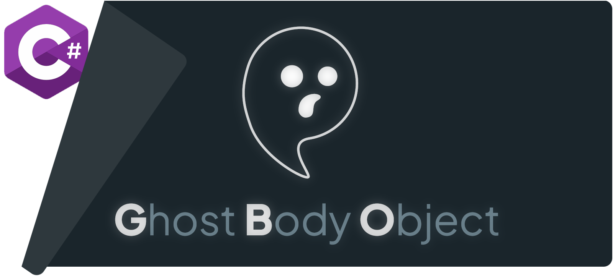
# What is GBO ?

## Let AI turn your app into a fast, distributed, scalable database

**GBO (Ghost Body Object)** is a high-performance, transactional, persistent, and distributed memory manager that turns your application into a database engine. Your code manages millions of C# objects in collections that can grow to several times the size of the available physical RAM. These objects are not transient representations of stored data. **They are the data itself.** These large collections can be shared and distributed, transparently and in real time, across dozens of applications running in a server cluster, on desktop computers, and on mobile devices. GBO brings the highest standards of snapshot isolation (MVCC) and durability (ACID, hash-based recovery) to your in-memory C# objects, even when those objects are shared across running applications.

**Why GBO ?**

To make AI code generation far more effective. GBO changes how we develop applications that manage state, which nearly all applications do. It allows AI to build large distributed systems with a fraction of the code and far less complexity. Applications running on Windows, Linux, macOS, iOS, and Android can all share memory spaces. You can use it to build simple CRUD systems, high load distributed systems that combine CQRS and event sourcing, and mobile, edge, and IoT applications that need to modify data while offline.

The upcoming complete GBO stack, from dedicated front-end UI systems to distributed data stores, is designed to push the limits of what you can build with AI. GBO’s main goal today is to enable a swarm of AI agents to manage an entire large-scale business application.

**How ?**

Three features are central to GBO’s approach.

1. **The GBO data model extends the capabilities of native C# objects.** It combines object aggregates, weak and strong references, entity-component systems (ECS), and edge-based graphs. It also supports various types of indexes, including text indexes.
    
2. **GBO provides stronger safety guarantees.** With GBO objects, you no longer encounter a `NullReferenceException`. GBO manages memory deterministically, largely outside the scope of the garbage collector. A fine-grained code analysis extension provides feedback on problems in your code. GBO also lets you compose large data models from loosely coupled modules, with thousands of entity types organized into a clear hierarchy of module-specific assemblies.
    
3. **Its API is ambient.** Managing these objects requires no explicit load or save operations. You open a transaction, create or find objects across deep call paths, modify them, and commit the transaction. This is called **orthogonal persistence**, a principle regarded as the holy grail of durable data management.
    

This combination of memory safety, deterministic memory management, and static analysis is similar to the one that makes Rust more effective for AI-assisted software development. GBO applies it to the development of large, full-stack .NET business applications. You can use these object collections to store a business application’s data, enable independent systems to communicate without a message broker, build caching infrastructure, aggregate data in edge computing or IoT environments, or build complex distributed systems that combine all of these capabilities. GBO can work alongside traditional DBMSs and message brokers or replace them entirely.

**The result ?**

A much smaller codebase and a dramatic reduction in complexity, from the simplest applications to the largest modular, distributed systems. GBO introduces a transactional paradigm at the object level. This paradigm is easy for human developers to work with and is designed for the next generation of **AI .NET Dark Software Factories**. GBO provides the memory model for these factories.

> [!WARNING]
> This repository is a preview of the upcoming official GBO repository. Not all projects and samples are available yet.
> 
> GBO is the fifth generation of a technology that has been in development since 2009. The project began with work for a healthcare company, continued with the development of a social media system, and later became a research side project. Earlier versions of the technology power a distributed healthcare system with 450 instances across France. The system supports terabyte-scale data aggregation, monitoring, and automated updates.

### A minimal sample

An agenda of appointments, kept on disk: the model in one file, the operations in another, then the same program on two nodes.

#### 1. The model: `Model.cs`

A model is a set of interfaces: the generator of GBO reads them at each build, and writes the classes.

```csharp
/// <summary>A subject value.</summary>
[ValueObject<GhostString>]
internal interface VSubject { }

/// <summary>A day and time of the calendar.</summary>
[ValueObject<DateTime>(ImplicitConversion = true)]
internal interface VDate { }

// An appointment: from this interface, the generator writes the class Appointment and AppointmentCollection.
[Root]       // an appointment lives by itself
[Enumerable] // AppointmentCollection enumerates the appointments
internal interface MAppointment
{
    VSubject Subject { get; set; }

    VDate At { get; set; }
}

// Your own code in the generated class: computed at each read, never stored.
internal partial class Appointment
{
    public bool Today => At.Date == DateTime.Today;
}

// The Repository of the model.
[GhostRepository(Schema = GhostSchema.Deduced), IncludeEntityModel(nameof(MAppointment))]
internal interface MAgendaRepository
{
}
```

This model is deliberately minimal: a model can declare many entity types, with complex relations, constraints and indexes ([Tutorials T002 to T005](Documentation/Tutorials/T002-Relationships.md)). A model that must evolve, read by both the old and the new versions of an application, gives its numbers, as [Tutorial T001](Documentation/Tutorials/T001-TheBasics.md) shows.

#### 2. The operations: `Program.cs`

Each operation is a transaction. The new objects and the collections find the open transaction by themselves: there is no context to pass.

```csharp
// A Store on disk, in "c:/gbo-sample/", and the Repository that binds the model to it.
using var store = TransactionalMemoryStore.NewFileRepositoryStore("c:/gbo-sample/", "agenda", StoreAccessMode.ReadWrite);
using var agenda = new AgendaRepository(store);

// A Write transaction inserts an appointment, today at 9:00: it is created in the open transaction, and written by Commit.
using (var tx = agenda.OpenTransaction(StoreAccessMode.ReadWrite))
{
    new Appointment { Subject = "Dentist", At = DateTime.Today.AddHours(9) };
    tx.Commit();
}

// A second one finds it, and moves it to 10:30.
using (var tx = agenda.OpenTransaction(StoreAccessMode.ReadWrite))
{
    AppointmentCollection.First(static a => a.Subject == "Dentist").At = DateTime.Today.AddHours(10.5);
    tx.Commit();
}

// A Read transaction finds the appointments of today, as committed.
using (agenda.OpenTransaction(StoreAccessMode.ReadOnly))
{
    foreach (var appointment in AppointmentCollection.Where(static a => a.Today))
        Console.WriteLine($"{appointment.Subject} at {appointment.At:t}"); // Dentist at 10:30
}
```

The same Store can be opened by several processes on the same computer, each with its own Repository, without duplicating the data in memory, and all of them can write. This lets the GBO tooling view and query the data while the applications run.

#### 3. Distributed: a second node

Each node runs the same program. An endpoint connects the nodes, and the Store is added to it before its first transaction: only the opening of the Store and the end of the program change.

```csharp
// An endpoint on the port 7000, which joins the cluster through the other node, its seed. The program receives its address:
// 10.0.0.2 on the node 10.0.0.1, and 10.0.0.1 on the node 10.0.0.2.
using var endPoint = new StoreDistributionEndPoint(DistributionModel.P2P, new() { ListenPort = 7000, Others = [new(args[0], 7000)] });

// The same Store on each node, in its own directory, added to the endpoint before its first transaction.
using var store = TransactionalMemoryStore.NewFileRepositoryStore("c:/gbo-sample/", "agenda", StoreAccessMode.ReadWrite);
endPoint.Add(store);
using var agenda = new AgendaRepository(store);

// The three transactions of Program.cs, unchanged.

// The node stays in the cluster until Enter. At its stop, the other node holds each of its commits.
Console.ReadLine();
```

Each commit on one node is copied to the other, in the order of the commits: both nodes read and write the same appointments. Start the second node while the first one runs. Two nodes that both wrote while apart hold two different histories: when they meet, both stop rather than merge them ([Tutorial T008](Documentation/Tutorials/T008-ChainsAndDistribution.md)).

You can read the tutorials to discover what GBO can do:

- [Tutorial T001: The Basics](Documentation/Tutorials/T001-TheBasics.md): an overview of GBO, its models, its transactions and its queries.
- [Tutorial T002: Relationships](Documentation/Tutorials/T002-Relationships.md): links, constraints and deterministic garbage collection.
- [Tutorial T003: Composition](Documentation/Tutorials/T003-Composition.md): the Entity Component System and object composition.
- [Tutorial T004: Edges](Documentation/Tutorials/T004-Edges.md): edges and graph-oriented models.
- [Tutorial T005: Indexes](Documentation/Tutorials/T005-Indexes.md): text indexes, value indexes, unique values and custom collections.
- [Tutorial T006: Records](Documentation/Tutorials/T006-Records.md): values of several fields, bags of Records, and when not to use them.
- [Tutorial T007: The Log](Documentation/Tutorials/T007-TheLog.md): facts in their order, subscriptions and replay.
- [Tutorial T008: Chains and Distribution](Documentation/Tutorials/T008-ChainsAndDistribution.md): several Stores in one transaction, on several servers.
- [Tutorial T009: Transaction Conflicts](Documentation/Tutorials/T009-Transaction-Conflicts.md): auto-merge and explicit merge, with `[Delta]`, `[Max]`, `[Min]` and the Mergers.
- [Tutorial T010: Claims, Points and Leases](Documentation/Tutorials/T010-Claims-Points-And-Leases.md): a decision on what was read, a rule over the parts of an aggregate, and entities held during a work outside a transaction.
- [Tutorial T011: Composition](Documentation/Tutorials/T011-Composition.md): separately compiled modules, private components and handlers, one global link model, public Commands, atomic sub-Mutations and replay.

## Why GBO?


<table width="100%">
  <tr>
    <td width="50%" valign="top">
	    <h3 align="left">👉 Extreme simplicity</h3>
	    <p>The database, the message broker and the application are one: the data is C# objects in the memory of the process, found and changed in ambient transactions, with no query to load them, no save, no mapping and no cache to keep in sync accross an entire cluster. The state is always coherent: a transaction reads a snapshot, and commits all or nothing, over every model it touches and on every server. The code shrinks with it: no SQL, no DTOs, no mappers, no cache invalidation, no integration tests.</p>
		    <p></p>
    </td>
    <td width="50%" valign="top">
	    <h3 align="left">👉 None of the pitfalls of an ORM</h3>
	    <p>No N+1 queries. A navigation is a read of memory, not a round trip, and lazy loading costs nothing: 1.39 M objects/s against 5,238 for EF Core with PostgreSQL. No change tracker, no context to keep alive or dispose at the right moment, no detached entity, no stale copy, no deferred index updates : an object changed is changed in its transaction, and the others see it at its commit. No impedance mismatch: the model is the C# model, its relations included.</p>
		    <p></p>
    </td>
  </tr>
  <tr>
    <td width="50%" valign="top">
	    <h3 align="left">👉 Deterministic memory, by the model</h3>
	    <p>An object lives while the model says so. A root, a part of its owner, or designated by a strong reference. It is removed at the instruction that ends this, its parts with it, its weak references cleared: no orphan, no dangling reference, no null reference (Option). The data stays out of the .NET garbage collector, which never scans it, whatever its volume.</p>
		    <p></p>
    </td>
    <td width="50%" valign="top">
	    <h3 align="left">👉 Infrastructure collapse</h3>
	    <p>One library in the process and one directory on the disk replace the database server, the ORM, the distributed cache and, for the events of the application, the message broker. Replicas copy the data where it is read, Logs and their subscriptions carry the events, a replay rebuilds a model. Fewer moving parts, less to deploy, to monitor, to secure and to pay for.</p>
		    <p></p>
    </td>
  </tr>
  <tr>
    <td width="50%" valign="top">
	    <h3 align="left">👉 High performance</h3>
	    <p>No serialization, no network round trip, no copy. The data is read where it is stored. Against EF Core with PostgreSQL, on the same machine, GBO inserts 24 to 53 times faster, reads orders by their key 335 times faster, and aggregates 3.3 to 7 times faster. On YCSB, it reads up to 6.19 M records/s on 8 threads, 9.2 times Garnet, the fastest of the other engines.</p>
		    <p></p>
    </td>
    <td width="50%" valign="top">
	    <h3 align="left">👉 Built for AI-assisted development</h3>
	    <p>A constrained model, which the generator checks at each build with about forty diagnostics: the relations and their cycles, the lifetimes, the types of the properties, the lambdas that would capture or allocate. An agent meets its mistake as a compile error, not as a bug in production. There is less code to generate, to read and to review, and each test runs the real engine in memory.</p>
		    <p></p>
    </td>
  </tr>
  <tr>
    <td width="50%" valign="top">
	    <h3 align="left">👉 Concurrency without locks</h3>
	    <p>Threads, processes and servers share the data through transactions, not critical sections. No lock to forget, no deadlock, no race on a half-written state. An exception, a failed rule or a conflict rolls the whole transaction back: an error never leaves a partial state to repair.</p>
		    <p></p>
    </td>
    <td width="50%" valign="top">
	    <h3 align="left">👉 Distribution by configuration</h3>
	    <p>A Store is replicated by adding it to an endpoint: read-only replicas for the front ends, several writers sharing one write token, each server with the part of the data it needs. The code of the application does not change.</p>
		    <p></p>
    </td>
  </tr>
  <tr>
    <td width="50%" valign="top">
	    <h3 align="left">👉 Events and history built in</h3>
	    <p>Logs of Records, subscriptions that replay then follow, chains that commit the models and their Log together: Event Sourcing, CQRS and Mutation Sourcing without an event store, a broker or a projection pipeline to run. A model rebuilt by a replay is a migration with no script to write.</p>
		    <p></p>
    </td>
    <td width="50%" valign="top">
	    <h3 align="left">👉 A model that evolves</h3>
	    <p>Each property has a number: a new version of the application reads the data of the old one, and the old one the data of the new one. Rolling upgrades, and no migration for a property added.</p>
		    <p></p>
    </td>
  </tr>
  <tr>
    <td width="50%" valign="top">
	    <h3 align="left">👉 Fast and faithful tests</h3>
	    <p>In-memory Stores run the same engine as the persistent ones. No database to start, no mock, a test in milliseconds - the thirty tests of Tutorial T007 run in half a second.</p>
		    <p></p>
    </td>
    <td width="50%" valign="top">
	    <h3 align="left">👉 Data that protects itself</h3>
	    <p>Stores on disk are read through read-only views, so that a stray write of the application cannot corrupt them. Each transaction carries its hash, checked at the opening and at each copy, so that a damaged or diverging replica is stopped, never replicated. A Store of 1,000,000 records reopens in 0.4 s, its index ready.</p>
		    <p></p>
    </td>
  </tr>
</table>

## GBO vs .NET objects

The speed of GBO comes first from where it puts its bytes. Three comparisons show it with plain .NET objects on the same work: 10,000,000 items of ten unique strings and a date, on one thread, each side in a process of its own, on the same machine. The first two measure what the garbage collector pays, the third what a query pays.

### Two ways to lay out an object

In .NET, a record holds references: each string is an object of its own on the managed heap, with its own header. In GBO, an object is one block of bytes, its **Ghost**: its values, a small table, then the characters of its strings, side by side. What you hold in C#, a **Body** or a **View**, is a thin handle on this block, and a `GhostString` reads the characters where they are, without a copy.

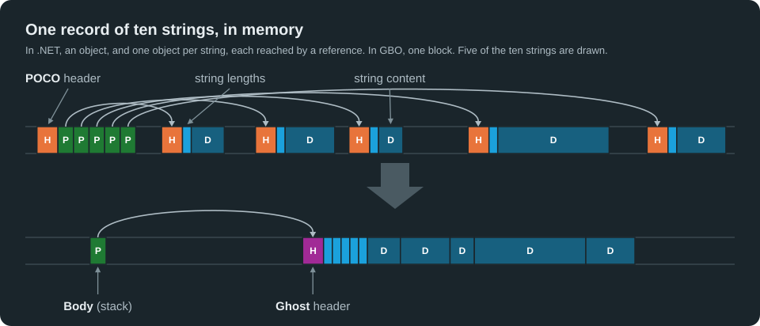

### Comparison 1: Records in a List

10,000,000 GBO Records kept in a `List<T>`, as records of .NET would be: a full collection with all of them alive, then the `List` cleared, then another full collection.

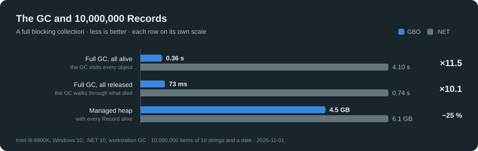

**Why is the GC so slow?**

A full collection must prove what is alive: it follows every reference, and visits each object it reaches. A record of .NET is 11 objects, so 10,000,000 records are 110,000,000 visits: 4.10 s, during which every thread of the application waits.

**Why is GBO faster?**

It does not give the GC less data, it gives it fewer objects. A GBO Record is one Body, a C# object of 40 bytes, and its Ghost sits in pinned pages of 128 KB: arrays of bytes, in which the GC has no reference to follow. 10,000,000 GBO Bodies instead of 110,000,000 objects: 11 times fewer visits, 11.5 times less time. The cost of a collection follows the number of objects, not the volume of the data.

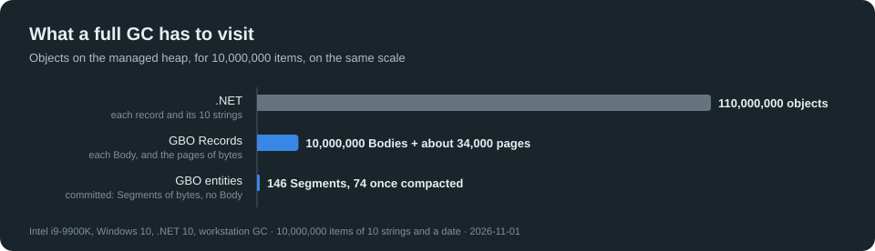

**Why is the release faster, but not free?**

Nothing is alive any more, so nothing is followed, but the GC still walks through the heap to find what it can free: 0.74 s across 110,000,000 dead objects, 73 ms across 10,000,000 Bodies.

The collections that nobody asks for pay the same price. During the creation, .NET spends 3.6 s of its 10.3 s in GC pauses, GBO 0.5 s of its 11.6 s. .NET still creates a little faster (×1.1): here GBO writes its fields one loop at a time, and a Ghost moves to a larger block as it grows.

**Why does GBO take 25 % less memory?**

Both sides hold the same characters, in UTF-16, about 298 bytes per item. What differs is the price of a string. In .NET, 8 bytes for its reference, 22 for its object header, its length and its terminator, then padding to a multiple of 8: about 34 bytes, ten times over. In a Ghost, one entry of 8 bytes in its table, ten times over. With its Body, a Record takes 488 bytes against 654, the managed heap 4.5 GB against 6.1 GB, and the working set 6.4 GB against 8.1 GB.

### Comparison 2: entities in a Store

10,000,000 entities created in one transaction of a GBO Repository, committed to a Store in memory, collected, removed, and collected again. .NET keeps the same objects in a `List<T>`: the collection that costs its GC the least, without a dictionary and without any identity.

**What is a commit, and what does it do?**

In a transaction, everything you create or change is private: a Body and its Ghost, in the memory of the transaction. The commit turns this work into shared data, all of it or nothing. It checks that nothing committed since the snapshot of the transaction conflicts with its writes, copies each Ghost to the end of the Store, one writer at a time, updates the indexes, then publishes it all at once to the next transactions. On a Store on disk, the same bytes then reach the disk according to its durability. The Bodies and the memory of the transaction are left to the GC: the entity is now bytes in the Store.

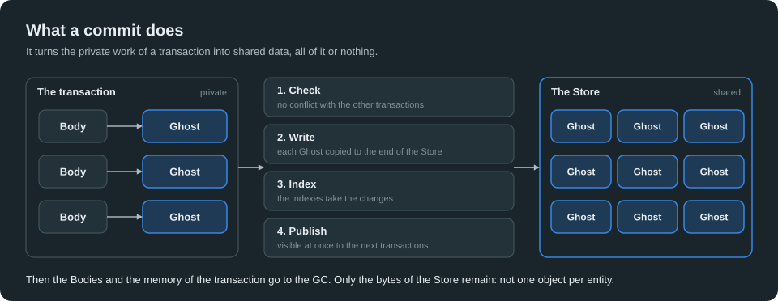

**What it costs here.** The 10,000,000 entities take 14.3 s to create, where .NET takes 10.3 s, then 2.6 s to commit: 3.9 M entities/s, 4 GB written in 146 Segments, the large blocks of a Store, whose size follows its data up to 64 MB.

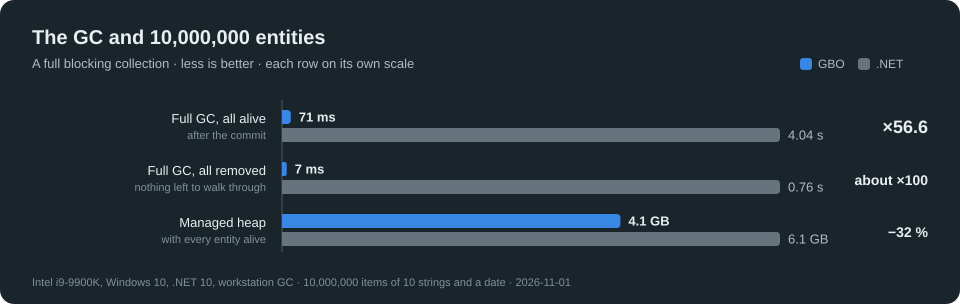

**Why is the GC even faster than with Records?**

Once committed, an entity is no longer a C# object, not even a Body. A query creates none either: a View is a struct, on the stack. All that is left for the GC is the 146 Segments of the Store, arrays of bytes without references: 71 ms against 4.04 s, 57 times faster. These 71 ms are mostly the walk through the 10,000,000 Bodies that the transaction left behind.

**Why is the last collection so fast?**

Removing the entities is the work of their transactions, 8.9 s by transactions of 10,000, where a `List` clears in 6 ms: GBO does this work at the instruction, not at some later collection. The Segments emptied by the removals are released, and the GC finds a few arrays to free: 7 ms, against the 0.76 s that .NET spends walking through 110,000,000 dead objects.

**Once committed, the managed heap holds 4.1 GB against 6.1 GB, 32 % less.** The working set does not follow yet, 10.5 GB against 8.1 GB: the memory of the transaction has not gone back to the system.

### Comparison 3: a query and the layout

A query on five strings, then a query on the date, measured in the same way: by LINQ on the `List<T>`, by the operators of GBO on its Views, in a new read-only transaction at each pass. Three states: as created, once dispersed, then aligned by the compactor.

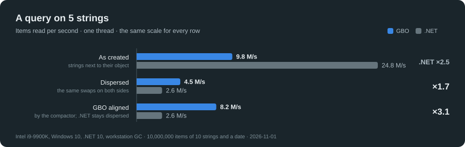

**Why is .NET 2.5 times faster at first?**

Here the strings follow their object, memory is read in order on both sides, and the difference is the code of a read. A `string` of .NET is one reference away, and its methods are among the most tuned code of the platform. A `GhostString` first has to find its characters: through the View, the table of the version of its Ghost, then the entry of the string, each step checked. This cost is in the processor, not in the memory, and it is the next one to lower. A program that would allocate all its first names in a row, then all its last names, would read 55 M/s in .NET; no running program keeps that order.

**Why does .NET then fall behind?**

A program lives: it replaces its strings, and each new string lands elsewhere on the heap. The GC compacts the heap but keeps the order of the addresses, so it never brings a record and its strings back together. The benchmark gives both sides this life at once. In .NET, each field swaps its string with the same field of a record drawn at random, and the `List` is shuffled. In GBO, each entity swaps its ten strings with another one, in transactions of 1,000, and its new version goes to the end of the Store.

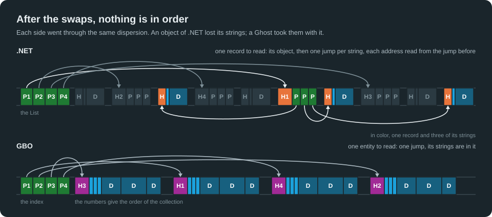

.NET falls from 24.8 to 2.6 M/s, 9.5 times slower: each string is now a chain of two random reads, the object then the string, five times per record. GBO falls from 9.8 to 4.5 M/s, 2.2 times slower: an entity is one random read, and its strings came with it.

**How does GBO get its order back?**

By its compactor, which .NET has no equivalent of. It copies the current version of each entity to the head of the Store, in the order of the identifiers, about 64 KB at a time, then releases the Segments it emptied. The order of a collection becomes the order of the memory again. Here it moves 4.5 GB in 6.7 s, and the query comes back to 8.2 M/s, 3.1 times .NET, whose strings stay dispersed until the end of the process. Entities written once have nothing to gain: a commit already writes them in order, and the compactor then moves 0 byte.

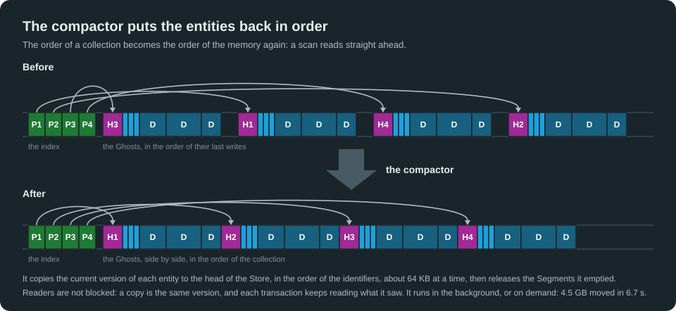

Any GBO Store - In Memory, in virtual memory or persisted on disk - is permanently optimized in background for faster enumerations and LINQ queries, and to compact the memory to reduce fragmentation. Align memory access patterns and memory layout is a major performance advantage of GBO memory model.

**Why these results on the date?**

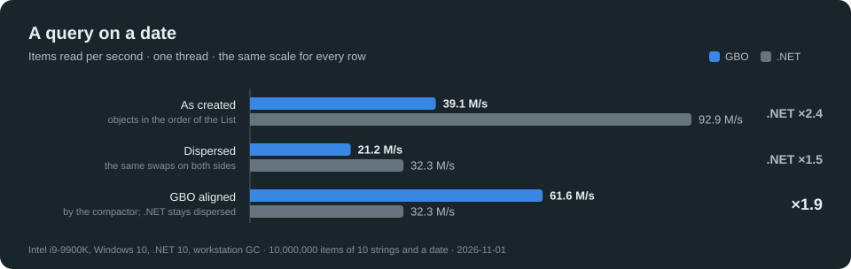

In .NET the date is in the object: one read per record, no chain. The dispersion costs far less than on the strings: from 92.9 to 32.3 M/s. Yet a random read alone reaches only 6.1 M/s: the same objects, in the same order, read as a linked list. The difference is that random reads overlap. A `List` holds all its addresses in one array, so the processor knows the next ones in advance, and starts them without waiting for the last one. Each read takes as long as before, but about five of them run at once. A string cannot do that: its address is in the object being read.

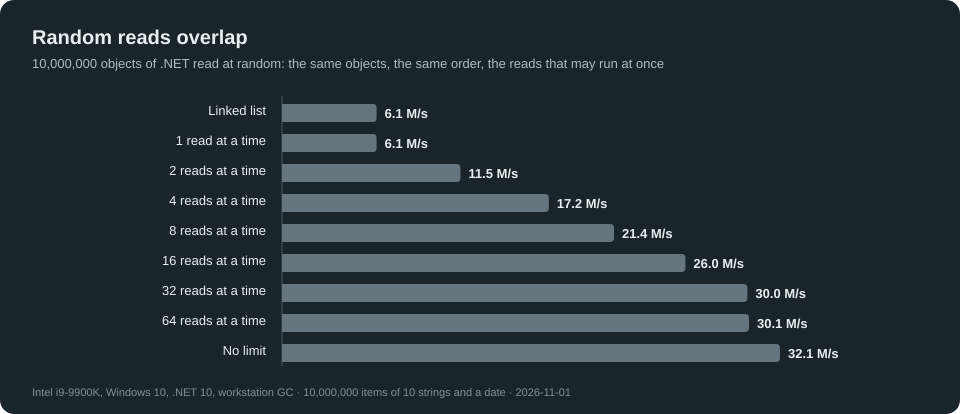

GBO does more than one read per item: each step of the enumeration finds the version that the transaction sees, checks it, and builds the View (it use MVCC - Multi Version Concurrency Control design). This is what gives a reader a stable snapshot while others write. As created, it reads 39.1 M/s, .NET 2.4 times faster. Dispersed, it changes Segment at almost every entity: 21.2 M/s, .NET 1.5 times faster. Once the entities are aligned, the enumeration goes straight ahead, loading the Ghosts 32 entities in advance: **61.6 M/s, 1.9 times .NET dispersed.** Only a .NET heap fresh from its creation stays ahead, a state that a program cannot get back.

A value does not slow an enumeration: at a fixed place in its Ghost, it is read 4 to 7.5 times faster than the five strings, on the same Views.

### What the layout brings

- **No external allocation for arrays,** strings included: they live in their object, and cost no object of their own.
- **Memory locality for the work on each object:** reading an entity is one jump from the base pointer, whatever its strings.
- **The logical alignment of the entities in memory, in their collections:** a scan reads straight ahead, and the compactor restores this order both in in-memory Stores and persistent ones.
- **A drastic reduction of the work of the GC,** a global and constant benefit: every collection of the process is shorter, for all its threads, whatever the volume of the data. In a heavy loaded .Net application, the GC overhead is drastically reduced.

These choices follow from one fact: a data manager generally performs far more reads than changes, by a factor of 10, 100, 1,000 or more when the system aggregates a lot of data. Using Views, GhostString, GhostSpan and static lambdas, GBO perform aggregations (like a .Count operation) and filtering (like a .Where selection) without any memory allocations. It can turns a .Net application in a high performance data processing system.

> [!WARNINGS]
> This repository is a preview of the upcoming official GBO repository. Not all projects are available yet.

These figures are those of the workstation GC. The code of the measures: [RecordStringsBenchmark](GhostBodyObject.Runtime.Common.Benchmarks/RecordStringsBenchmark.cs), run by its code, from `REC01` to `REC04`:

```bash
dotnet run -c Release --project GhostBodyObject.Integrations -- REC01
```

## GBO vs EF + PostgreSQL

GBO is faster than almost all general-purpose database engines, and gives a more coherent experience than an ORM such as Entity Framework. The same shop, 100,000 orders of 20 lines, built, read and changed in the same way by GBO and by EF Core with PostgreSQL 18, on the same machine; every read step checked equal on both sides.

| Mode                   | GBO                                                                                                             | PostgreSQL                                                                                   |
| ---------------------- | --------------------------------------------------------------------------------------------------------------- | -------------------------------------------------------------------------------------------- |
| Durable at each commit | `FlushPolicy.DurableOnDisk`: the commit returns once the transaction survives a power loss (`FlushFileBuffers`) | `synchronous_commit = on`: `COMMIT` returns once the WAL is flushed                          |
| Durable within a delay | `FlushPolicy.FastOnDisk`: flushed within **1 ms** or 8 MB, each flush followed by `FlushFileBuffers`            | `synchronous_commit = off`: the WAL writer flushes within 3 × `wal_writer_delay`, **600 ms** |


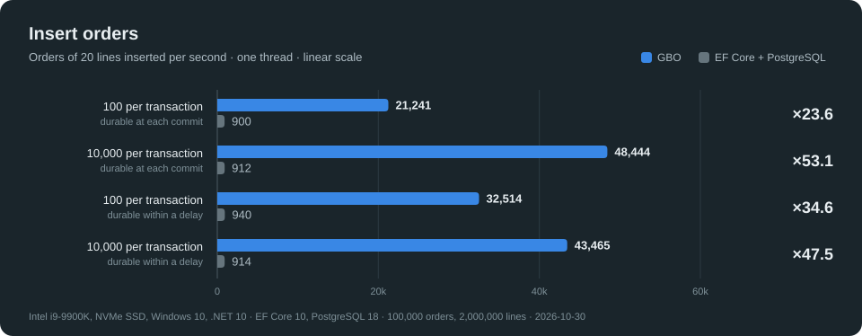

**Inserts: 24 to 53 times faster.** EF Core sends one `INSERT` per row, about 19,000 rows/s, whatever the size of the transaction.

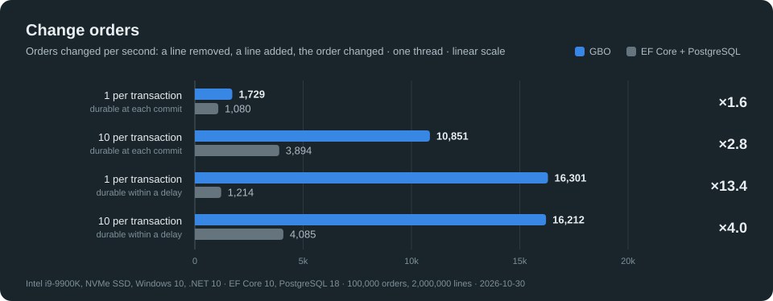

**Changes: 1.6 to 13 times faster.** Durable at each commit, a single change waits for the disk on both sides; flushed within a delay, GBO no longer waits.

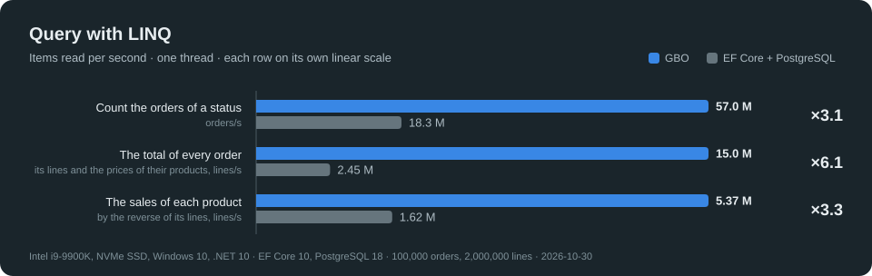

**Queries: 3 to 6 times faster,** although the aggregations run inside PostgreSQL.

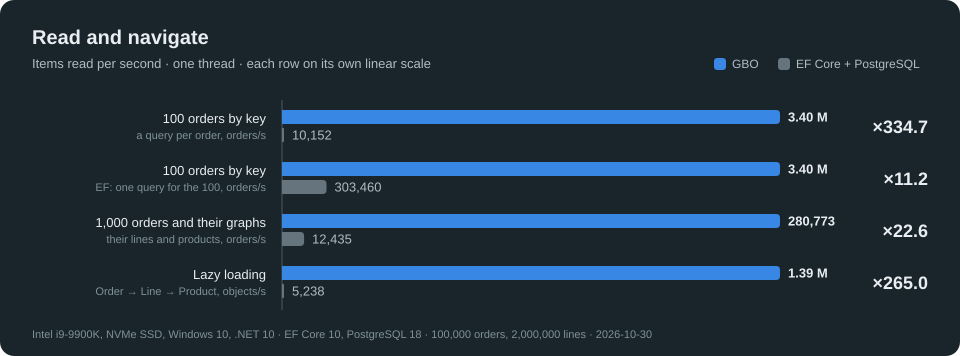

**Navigation is no longer a problem.** A round trip per object is where an ORM loses the most: GBO reads orders by key 335 times faster, and lazy loading 265 times. This comparison is unfair: GBO has no data to transport, every entity is at hand. Even one query for 100 orders leaves GBO 11.2 times faster.

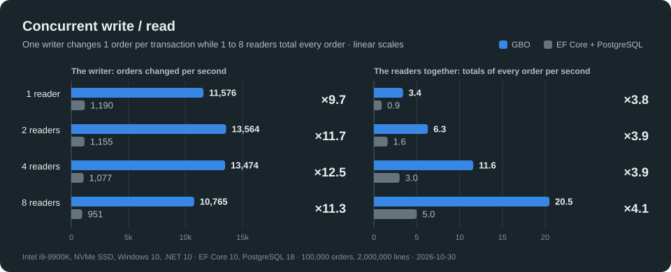

**Concurrent write and read:** from 1 to 8 readers, the writer of GBO stays 9.7 to 12.5 times faster, and its readers 3.8 to 4.1 times: 41.0 M lines/s with 8 readers, against 10.0 M.

The method, the durability settings and every figure: [GBO vs EF Core + PostgreSQL](Documentation/Benchmarks/BENCH-GBO-vs-EF-Postgres.md).

## GBO vs Event Sourcing solutions

GBO implements a new Event Sourcing pattern, **Mutation Sourcing**. A Mutation is a single work record that holds both the command (the intent) and its event (the decision), stored in the Log. GBO can also implement classic Event Sourcing, with persistent projections, including the one used to decide the commands. The same shop, 2,000,000 commands played in the same order by each engine, against KurrentDB and Marten on PostgreSQL, on the same machine.

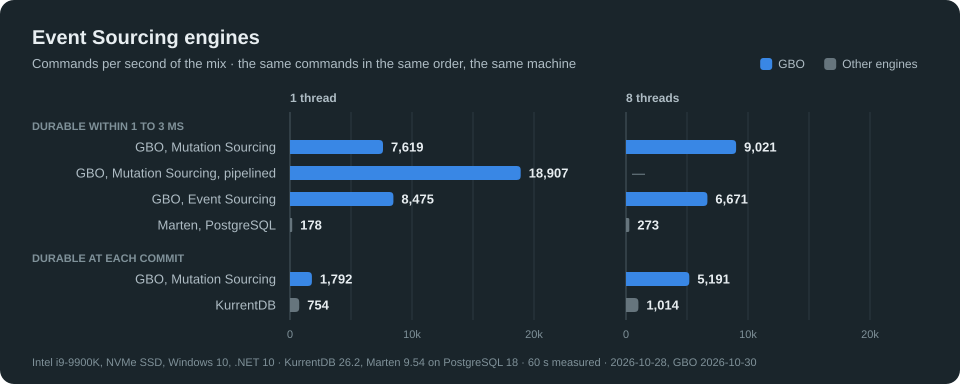

- **33 to 43 times Marten, with the same durability** (a flush within 1 to 3 ms), and 2.4 to 5.1 times KurrentDB with a flush at each commit, as KurrentDB does by default. Pipelined, Mutation Sourcing runs 18,907 commands/s on one thread.
- **No conflict in Mutation Sourcing:** the pump is the only writer, so 8 threads never run a command twice. On 8 threads, KurrentDB runs each command again 3.3 times on average, and Marten waits on its locks.
- **A command in 39 µs** at the median on one thread, 521 µs durable at each commit, against 1.2 ms for KurrentDB and 4.6 ms for Marten.

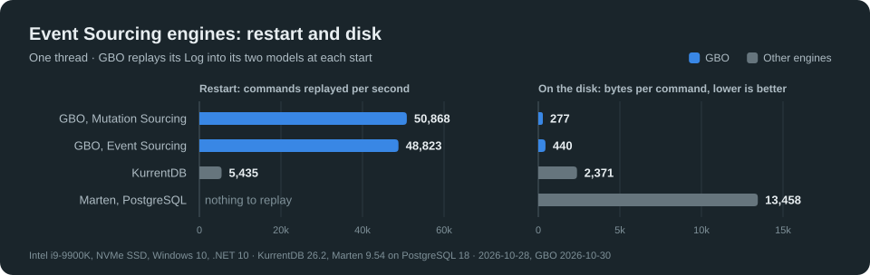

- **The restart replays the Log:** 49,000 to 69,000 commands/s into both models, Write and Read; KurrentDB rebuilds its Read model only, at 5,200 to 5,400 commands/s. Marten has nothing to replay: its snapshots and its Read model are tables.
- **A Mutation takes 188 to 277 bytes on the disk:** about 9 times less than the events of KurrentDB, in JSON, and 49 times less than the WAL that Marten writes.

The engines, their settings and every figure: [GBO vs Event Sourcing engines](Documentation/Benchmarks/BENCH-GBO-vs-Event-Sourcing-Engines.md).

## YCSB : GBO vs SQLite, RocksDB and Garnet

**These results are preliminary and will evolve.** GBO trails in several write workloads, and three improvements may raise its ingestion results:
- optimized and configurable indexes: each message of workload Q moves its sensor in the index of the levels;
- a better support of the `[Mergeable]` types, which the meters of workload M and the sensors and sites of workload Q use;
- an internal sharding of a Store, so that several threads commit in parallel: today, the commits of a Store are serialized.

Three workloads of YCSB and two of ingestion, meters and sensors, on 1,000,000 records: GBO against SQLite and RocksDB, embedded in the process, and Garnet, a Redis server reached through the loopback. Every engine is durable within about 1 ms, except SQLite, synced at its checkpoints. Each workload runs on 1 or 8 threads, with 1 or 100 operations per transaction; the ratio compares GBO with the fastest of the three others.

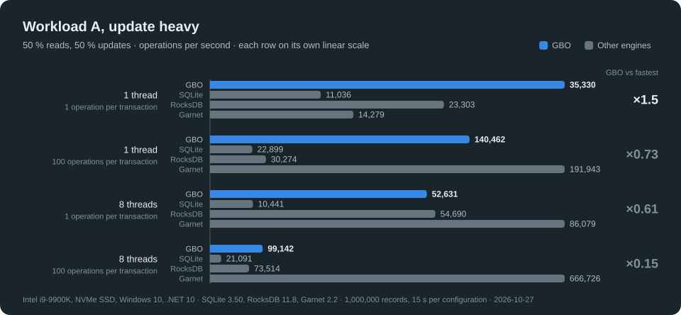

**Updates:** GBO leads with one operation per transaction, on one thread (×3.2) and on 8 (×1.3); with 100, GBO and Garnet are even on one thread, and Garnet leads on 8 threads, 5.5 times GBO.

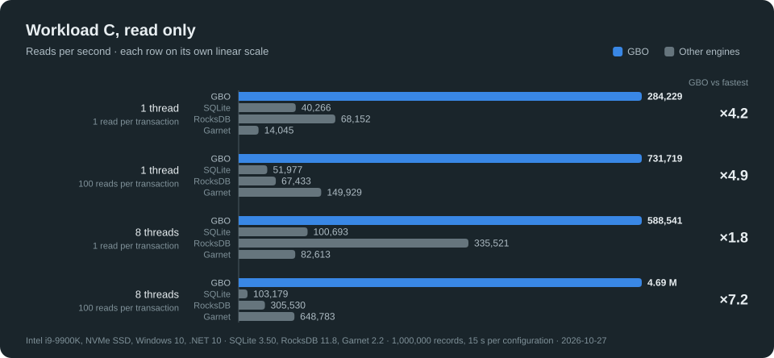

**Reads: GBO leads every configuration,** 6.1 to 10.9 times the fastest other engine: 6.19 M reads/s on 8 threads, 9.2 times Garnet.

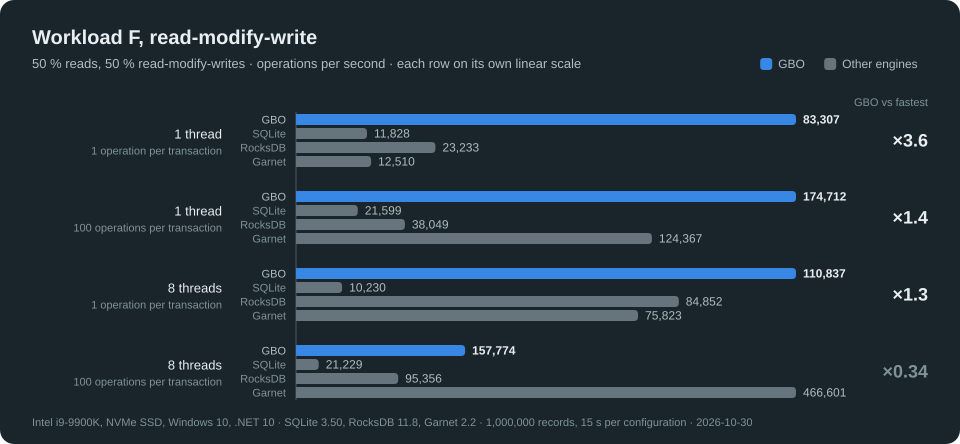

**Read-modify-writes:** GBO leads on one thread (×3.6 and ×1.4), and on 8 threads with one operation per transaction (×1.3); with 100 on 8 threads, Garnet leads, 3 times GBO.

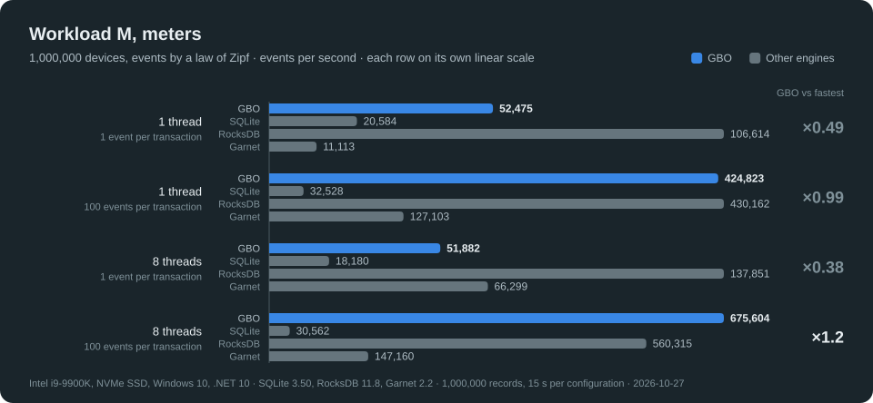

**Meters:** GBO and RocksDB with its merge operator run neck and neck: GBO leads with one event per transaction on one thread (×1.2), RocksDB with 100 on one thread (1.1 times GBO), and the two are even on 8 threads.

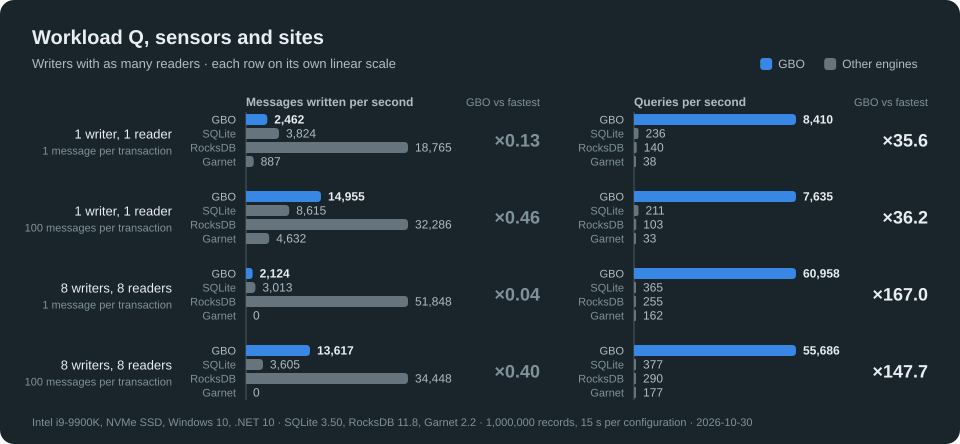

**Sensors and sites:** a query, a range of levels, an aggregate or the snapshot of a site and its 1,000 sensors, runs 36 to 167 times faster in GBO than in the fastest other engine, by its value indexes. GBO writes the messages slower: RocksDB writes 2.2 to 24 times more.

The engines and their settings, the loads and the reopen, the latencies, the memory and every figure: [GBO vs SQLite, RocksDB and Garnet](Documentation/Benchmarks/BENCH-GBO-vs-SQLite-RocksDB-Garnet.md).


## Spreadsheet

GBO on one page: what the engine does, how each guarantee is obtained, and the industry principle it follows. The details are in the [specifications](Documentation/Specifications/SPEC-Registry.md) and the [tutorials](Documentation/Tutorials/T001-TheBasics.md).

#### At a glance

| | GBO |
|---|---|
| **Kind** | An embedded, in-process transactional object store for .NET 10: the data lives in the memory of the application, as C# objects, with no database server and no mapping layer |
| **Data model** | C# interfaces, compiled by a source generator into structs: entities, their parts (composition), strong and weak references, components (ECS), edges (property graph); Records, immutable facts, in Logs |
| **Storage** | Append-only, log-structured segments, in RAM or in memory-mapped files; Repository Stores (the current state) and Log Stores (every Record, kept) |
| **Transactions** | ACID; snapshot isolation by MVCC; optimistic by default, pessimistic or exclusive on demand; commits serialized in the whole cluster |
| **Durability** | Group commit: from a flush to the device at each commit to a flush within 1 ms, 10 ms or 100 ms |
| **Replication** | Log shipping of the committed bytes, pulled by each replica; read-only replicas and several writers sharing one write token |
| **Queries** | Operators over read-only Views, without allocation; text indexes (BM25), value indexes, hash indexes, all transactional |
| **Memory** | The objects outside the .NET GC; their deletion deterministic, by ownership and reference counts |
| **Architectures** | Chains of Stores, one transaction over several models and their Log; subscriptions and replay (Event Sourcing, CQRS); Mutation Sourcing |

#### Transactions and concurrency

| Mechanism | How GBO does it | Industry principle |
|---|---|---|
| Isolation | A transaction reads every object as of its epoch, the last commit published when it opened. Each version keeps a link to the previous one; readers never block writers, nor writers readers | Multi-version concurrency control and snapshot isolation (Berenson et al., *A Critique of ANSI SQL Isolation Levels*, 1995), as in PostgreSQL and Oracle |
| Writes | A write copies the object into the arena of its transaction, local to its thread (copy-on-write): the transaction reads its own writes; the others see nothing before the commit | Copy-on-write, read-your-writes |
| Validation | At the commit, under the write token, each object written is checked against the versions committed since the epoch: the first committer wins, the second gets a `TransactionConflictException`, or `false` from `TryCommit` | Optimistic concurrency control, backward validation (Kung & Robinson, 1981) |
| Conflict levels | `Optimistic`: write-write conflicts, as snapshot isolation (write skew possible). `Pessimistic`: also the collections read, a conflict if one of their objects changed since the epoch (phantoms included). `Exclusive`: the write token taken at the opening, no other commit in the cluster until the end, nothing to validate | From snapshot isolation to serial execution |
| Mergeable types | Concurrent changes of the values of a `[Mergeable]` object are merged at the commit, from the version of the epoch, the head and the transaction, instead of conflicting; a removal wins | Three-way merge, in the spirit of CRDT counters (Shapiro et al., 2011) |
| Concurrency points | A change anywhere in an aggregate raises the version of its `[ConcurrencyPoint]`: two transactions on the same aggregate conflict, whatever objects they changed | Aggregate versioning, an ETag (Domain-Driven Design, optimistic concurrency tokens) |
| Leased locks | `Claim()` locks objects for a duration, across transactions and servers: committed and replicated with the object, checked at each write, refused at once (no queue, no deadlock); durations on the monotonic clock of each node, never a wall clock compared; a lease lost or expired fails its holder's commit | Leases (Gray & Cheriton, 1989) with fencing tokens (Kleppmann) |
| Unique values | A unique index refuses a duplicate at the write, and again at the commit against the commits of other transactions and other servers (`Uniqueness`) | `UNIQUE` constraints |

#### Storage and durability

| Mechanism | How GBO does it | Industry principle |
|---|---|---|
| Layout | Each commit is appended to the head segment of its Store, and never changed; a segment is sealed when full | Log-structured storage (Rosenblum & Ousterhout, *The Log-Structured File System*, 1991): the log is the database |
| Atomicity | Each transaction ends with its hash; a chain of Stores combines the hashes of its Stores in the commit of its first Store: all of them or none, without two-phase commit | Commit record, checksummed |
| Recovery | At the opening, a transaction whose hash is missing or wrong, interrupted, is discarded; nothing to redo or undo | Torn-write detection by checksum |
| Durability | The flush policy of a Store: `Durable` (each commit flushed before it returns), `Fast` (within 1 ms or 8 MB), `Paged`, `Batched`, `Delayed`, `Manual`; `OnDisk` adds `FlushFileBuffers` on Windows (on Linux, `msync(MS_SYNC)` already reaches the device). Another process or server sees a commit only once it is durable | Group commit (DeWitt et al., 1984), as `synchronous_commit` in PostgreSQL |
| Index of the objects | The current version of each object, in an index in RAM, rebuilt at the opening; on disk, each sealed segment has an index file, which the opening reads instead of the segment | Bitcask and its hint files |
| Old versions | A version is kept while a transaction may still read it: the oldest open transaction sets the horizon | Epoch-based reclamation, as the vacuum horizon of PostgreSQL |
| Space and order | A compactor moves the live versions to the head, oldest segment first, so that its file can be deleted; it keeps each collection in runs of about 64 KB in the order of its objects, which scans read sequentially | Segment cleaning of log-structured stores; clustering |
| Several processes | The memory-mapped files are shared by the processes of a machine; a lock file serializes their commits | Shared memory, single writer at a time |
| Protection | A Store on disk is read through read-only mapped views: a stray write of the application cannot corrupt it | Protected memory |

#### Replication and distribution

| Mechanism | How GBO does it | Industry principle |
|---|---|---|
| Membership | Each `StoreDistributionEndPoint` listens on a TCP port and joins through one seed; members spread by gossip with heartbeat counters; a member silent for `DeadTimeout` is ejected; a restarted process is a new incarnation | Gossip-style failure detection (van Renesse et al., 1998), as in Cassandra |
| Data | A replica copies the committed bytes of each segment, identical, verifies each transaction by its hash, then publishes it; it pulls one block of 32 KB at a time, from any replica that has it, chosen at random | Physical log shipping, as the streaming replication of PostgreSQL; pull-based |
| Roles | A Store opened `ReadWrite` is a Master, `ReadOnly` a Slave; a Slave shows only the transactions that every admitted Master holds, so that any Master that remains holds what a Slave showed | Primary-copy replication, consistent prefix |
| Writes | One write token per chain of Stores. A commit asks the owner, which hands it over in the order of the requests, the queue travelling with the token, its generation increasing at each move; the new owner first catches up with the last commit. The commits form one sequence, the same on every replica. A Master that writes alone keeps the token and commits without a network round trip | Token-based mutual exclusion (Suzuki–Kasami, 1985), generations as fencing epochs |
| Partial replicas | A server may hold a part of a chain: the Read model of a CQRS front end alone, a Log alone and its subscription | Selective replication |
| Leaving and joining | A Master that stops hands its token over and waits until another Master holds its last commit; a new replica copies the whole Store, then follows | Graceful leave, catch-up replication |
| Failures | If the owner of the token is lost, the writes of its chain stop (`WriteTokenUnavailable`) and the reads go on; data that do not verify stop the chain (`Corrupt`). No quorum and no automatic fail-over yet: high availability is planned for a second version | Consistency over availability (CP) |
| Not yet | The Hub model, for WAN, IoT and edge computing over WebSocket; the sharing of transactions over UDP | |

#### Model, memory and queries

| Mechanism | How GBO does it | Industry principle |
|---|---|---|
| Model | Interfaces with `[Entity]`, `[Record]`, `[Property(n)]`; the source generator writes the Bodies (to change), the Views (to read), the Repositories, the Logs | Code generation from a schema |
| Versions of the model | Properties identified by their number, not their name: a binary reads the objects of older and newer versions of its model, in both directions | Field numbers, as in Protocol Buffers |
| Memory | The values of an object in one contiguous block; strings and arrays read in place, without copy (`GhostString`, `GhostSpan<T>`); the .NET GC never scans the data | Off-heap storage, zero-copy |
| Lifetime | An object lives while it is a Root, has an owner, or a strong reference designates it; removed at the instruction that ends this, its parts in cascade, its weak references cleared; no graph is ever traversed | Ownership and reference counting, deterministic (as Rust ownership or `ON DELETE CASCADE`) |
| Queries | `Where`, `Count`, `FirstOrNone`... over the Views, with lambdas that capture nothing, so no allocation; a scan reads collections kept in order by the compactor | Language-integrated queries, sequential scans |
| Text index | Words of the texts, whatever their case and accents; required words, alternatives, exclusions, wildcards, fuzzy terms; the most relevant first | Inverted index, BM25 ranking with the parameters of Lucene (`k1 = 1.2`, `b = 0.75`) |
| Value indexes | Keys of any standard type, alone or composite, in sorted pages of 512 bytes; each key's set of objects in the most compact container: array, bitmap, runs, inverted, full | B+tree-like sorted pages; Roaring bitmaps (Chambi, Lemire et al., 2016) |
| Hash index | A key found without order, its buckets in pages | Hash index |
| Up to date | Every index is up to date at the next instruction, in the transaction too, rolled back with it, committed with it, rebuilt from the objects when needed | Transactional, synchronous indexes |
| Logs and subscriptions | A subscription reads a Log from any transaction, then follows its new commits on a thread of its own; its handlers capture nothing | Catch-up subscriptions, as in EventStoreDB, or the offsets of Kafka |
| Replay | A model chained with its Log is rebuilt by replaying it: in memory at each opening, or on disk on request | Event Sourcing, CQRS |
| Mutation Sourcing | A Mutation records the intention and the decision of a command; a pump runs the Decides one at a time on each server, in the order received, the effects in the models applied by `Apply` | Single-writer principle (LMAX Disruptor), the Decider pattern |

#### Limits

- **One writer at a time per chain.** The commits of a chain are serialized in the whole cluster: write throughput is that of one writer, without network round trips while it keeps the token. Writers scale by splitting the data into several chains.
- **Little-endian platforms only.**

## To come

- [ ] **Permissions.** Object level permission, with access, write, read restrictions over collections and entities.
- [ ] **Automatic fail-over.** The loss of the owner of the write token stops the writes of its chain, the reads going on, until the chain is restarted. It will perform a recovery with quorum.
- [ ] **Internet Scale Distribution**. Will use Web Sockets.
- [ ] **Transparent SQL connectors**, to fill an SQL server with every transaction done using GBO. EF entities included.
- [ ] **GBO Explorer** : dedicated tool with Schema Versions, live Query, model edition in real-time, complete suite.


