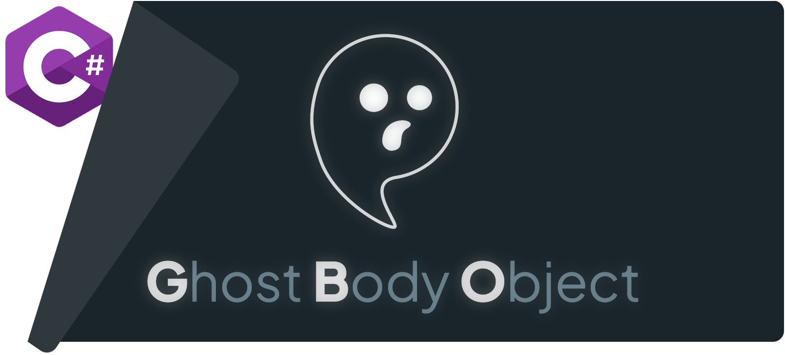
# What is GBO?

GBO (Ghost Body Object) is a high-performance, transactional, persistent and distributed memory manager. It manages millions of C# objects in collections that can be several times larger than the physical RAM. These large collections can be shared and spread over dozens of servers in real time, transparently. It meets the highest standards of snapshot isolation (MVCC) and durability (ACID, hash-based recovery).

Its API is ambient: managing these objects requires no load or save operation. You open a transaction, create or find the objects across deep call paths, change them, and commit the transaction. These collections of objects can hold the data of a business application, make independent systems communicate without a message broker, build a cache infrastructure, aggregate data in edge computing or IoT, or build complex distributed systems that combine all of these. GBO can be used alongside traditional DBMSs and message brokers, or replace them.

Transactions at the memory level bring a massive simplification and a smaller code base, from the smallest applications to the largest, modular and distributed ones. The data model combines object graphs, entity component systems and edge-based graphs, and supports various indexes, including text indexes.

GBO introduces a new paradigm in error and memory management, easy for human developers and powerful for the next generation of AI Dark Software Factories. It combines strong safety (no more `NullReferenceException`), deterministic memory management and a sophisticated, constrained data model: the combination that makes Rust so efficient in AI-assisted software development.

### A minimal sample

An agenda of appointments, kept on disk: the model in one file, the operations in another, then the same program on two nodes.

#### 1. The model: `Model.cs`

A model is a set of interfaces: the generator of GBO reads them at each build, and writes the classes.

```csharp
/// <summary>A subject value.</summary>
[ValueObject<GhostString>]
internal interface VSubject { }

/// <summary>A day and time of the calendar.</summary>
[ValueObject<DateTime>(ImplicitConversion = true)]
internal interface VDate { }

// An appointment: from this interface, the generator writes the class Appointment and AppointmentCollection.
[Root]       // an appointment lives by itself
[Enumerable] // AppointmentCollection enumerates the appointments
internal interface MAppointment
{
    VSubject Subject { get; set; }

    VDate At { get; set; }
}

// Your own code in the generated class: computed at each read, never stored.
internal partial class Appointment
{
    public bool Today => At.Date == DateTime.Today;
}

// The Repository of the model.
[GhostRepository(Schema = GhostSchema.Deduced), IncludeEntityModel(nameof(MAppointment))]
internal interface MAgendaRepository
{
}
```

This model is deliberately minimal: a model can declare many entity types, with complex relations, constraints and indexes ([Tutorials Two to Five](Documentation/Tutorials/Two-Relationships.md)). A model that must evolve, read by both the old and the new versions of an application, gives its numbers, as [Tutorial One](Documentation/Tutorials/One-TheBasics.md) shows.

#### 2. The operations: `Program.cs`

Each operation is a transaction. The new objects and the collections find the open transaction by themselves: there is no context to pass.

```csharp
// A Store on disk, in "c:/gbo-sample/", and the Repository that binds the model to it.
using var store = TransactionalMemoryStore.NewFileRepositoryStore("c:/gbo-sample/", "agenda", StoreAccessMode.ReadWrite);
using var agenda = new AgendaRepository(store);

// A Write transaction inserts an appointment, today at 9:00: it is created in the open transaction, and written by Commit.
using (var tx = agenda.OpenTransaction(StoreAccessMode.ReadWrite))
{
    new Appointment { Subject = "Dentist", At = DateTime.Today.AddHours(9) };
    tx.Commit();
}

// A second one finds it, and moves it to 10:30.
using (var tx = agenda.OpenTransaction(StoreAccessMode.ReadWrite))
{
    AppointmentCollection.First(static a => a.Subject == "Dentist").At = DateTime.Today.AddHours(10.5);
    tx.Commit();
}

// A Read transaction finds the appointments of today, as committed.
using (agenda.OpenTransaction(StoreAccessMode.ReadOnly))
{
    foreach (var appointment in AppointmentCollection.Where(static a => a.Today))
        Console.WriteLine($"{appointment.Subject} at {appointment.At:t}"); // Dentist at 10:30
}
```

The same Store can be opened by several processes on the same computer, each with its own Repository, without duplicating the data in memory, and all of them can write. This lets the GBO tooling view and query the data while the applications run.

#### 3. Distributed: a second node

Each node runs the same program. An endpoint connects the nodes, and the Store is added to it before its first transaction: only the opening of the Store and the end of the program change.

```csharp
// An endpoint on the port 7000, which joins the cluster through the other node, its seed. The program receives its address:
// 10.0.0.2 on the node 10.0.0.1, and 10.0.0.1 on the node 10.0.0.2.
using var endPoint = new StoreDistributionEndPoint(DistributionModel.P2P, new() { ListenPort = 7000, Others = [new(args[0], 7000)] });

// The same Store on each node, in its own directory, added to the endpoint before its first transaction.
using var store = TransactionalMemoryStore.NewFileRepositoryStore("c:/gbo-sample/", "agenda", StoreAccessMode.ReadWrite);
endPoint.Add(store);
using var agenda = new AgendaRepository(store);

// The three transactions of Program.cs, unchanged.

// The node stays in the cluster until Enter. At its stop, the other node holds each of its commits.
Console.ReadLine();
```

Each commit on one node is copied to the other, in the order of the commits: both nodes read and write the same appointments. Start the second node while the first one runs. Two nodes that both wrote while apart hold two different histories: when they meet, both stop rather than merge them ([Tutorial Eight](Documentation/Tutorials/Eight-ChainsAndDistribution.md)).

You can read the eight tutorials to discover what GBO can do:

- [Tutorial One: The Basics](Documentation/Tutorials/One-TheBasics.md): an overview of GBO, its models, its transactions and its queries.
- [Tutorial Two: Relationships](Documentation/Tutorials/Two-Relationships.md): links, constraints and deterministic garbage collection.
- [Tutorial Three: Composition](Documentation/Tutorials/Three-Composition.md): the Entity Component System and object composition.
- [Tutorial Four: Edges](Documentation/Tutorials/Four-Edges.md): edges and graph-oriented models.
- [Tutorial Five: Indexes](Documentation/Tutorials/Five-Indexes.md): text indexes, value indexes, unique values and custom collections.
- [Tutorial Six: Records](Documentation/Tutorials/Six-Records.md): values of several fields, bags of Records, and when not to use them.
- [Tutorial Seven: The Log](Documentation/Tutorials/Seven-TheLog.md): facts in their order, subscriptions and replay.
- [Tutorial Eight: Chains and Distribution](Documentation/Tutorials/Eight-ChainsAndDistribution.md): several Stores in one transaction, on several servers.

## Why GBO?

### **Extreme simplicity**

The database, the message broker and the application are one: the data is C# objects in the memory of the process, found and changed in ambient transactions, with no query to load them, no save, no mapping and no cache to keep in sync accross an entire cluster. The state is always coherent: a transaction reads a snapshot, and commits all or nothing, over every model it touches and on every server. The code shrinks with it: no SQL, no DTOs, no mappers, no cache invalidation, no integration tests.

### **None of the pitfalls of an ORM**

No N+1 queries: a navigation is a read of memory, not a round trip, and lazy loading costs nothing: 1.39 M objects/s against 5,238 for EF Core with PostgreSQL. No change tracker, no context to keep alive or dispose at the right moment, no detached entity, no stale copy: an object changed is changed in its transaction, and the others see it at its commit. No impedance mismatch: the model is the C# model, its relations included.

### **Deterministic memory, by the model**

An object lives while the model says so: a root, a part of its owner, or designated by a strong reference. It is removed at the instruction that ends this, its parts with it, its weak references cleared: no orphan, no dangling reference, no null reference (`Option<T>`). The data stays out of the .NET garbage collector, which never scans it, whatever its volume.

### **Infrastructure collapse**

One library in the process and one directory on the disk replace the database server, the ORM, the distributed cache and, for the events of the application, the message broker: replicas copy the data where it is read, Logs and their subscriptions carry the events, a replay rebuilds a model. Fewer moving parts: less to deploy, to monitor, to secure and to pay for.

### **High performance**

No serialization, no network round trip, no copy: the data is read where it is stored. Against EF Core with PostgreSQL, on the same machine, GBO inserts 24 to 53 times faster, reads orders by their key 335 times faster, and aggregates 3.3 to 7 times faster ([results](Documentation/Benchmarks/BENCH-GBO-vs-EF-Postgres.md)). On YCSB, it reads up to 6.19 M records/s on 8 threads, 9.2 times Garnet, the fastest of the other engines ([results](Documentation/Benchmarks/BENCH-GBO-vs-SQLite-RocksDB-Garnet.md)).

### **Built for AI-assisted development**

A constrained model, which the generator checks at each build with about forty diagnostics: the relations and their cycles, the lifetimes, the types of the properties, the lambdas that would capture or allocate. An agent meets its mistake as a compile error, not as a bug in production. There is less code to generate, to read and to review, and each test runs the real engine in memory.

### **Concurrency without locks**

Threads, processes and servers share the data through transactions, not critical sections: no lock to forget, no deadlock, no race on a half-written state. An exception, a failed rule or a conflict rolls the whole transaction back: an error never leaves a partial state to repair.

### **Distribution by configuration**

A Store is replicated by adding it to an endpoint: read-only replicas for the front ends, several writers sharing one write token, each server with the part of the data it needs. The code of the application does not change.

### **Events and history built in**

Logs of Records, subscriptions that replay then follow, chains that commit the models and their Log together: Event Sourcing, CQRS and Mutation Sourcing without an event store, a broker or a projection pipeline to run. A model rebuilt by a replay is a migration with no script to write.

### **A model that evolves**

Each property has a number: a new version of the application reads the data of the old one, and the old one the data of the new one. Rolling upgrades, and no migration for a property added.

### **Fast and faithful tests**

In-memory Stores run the same engine as the persistent ones: no database to start, no mock, a test in milliseconds; the thirty tests of Tutorial Seven run in half a second.

### **Data that protects itself**

Stores on disk are read through read-only views, so that a stray write of the application cannot corrupt them; each transaction carries its hash, checked at the opening and at each copy, so that a damaged or diverging replica is stopped, never replicated. A Store of 1,000,000 records reopens in 0.4 s, its index ready.

## GBO vs EF + PostgreSQL

GBO is faster than almost all general-purpose database engines, and gives a more coherent experience than an ORM such as Entity Framework. The same shop, 100,000 orders of 20 lines, built, read and changed in the same way by GBO and by EF Core with PostgreSQL 18, on the same machine; every read step checked equal on both sides.

| Mode                   | GBO                                                                                                             | PostgreSQL                                                                                   |
| ---------------------- | --------------------------------------------------------------------------------------------------------------- | -------------------------------------------------------------------------------------------- |
| Durable at each commit | `FlushPolicy.DurableOnDisk`: the commit returns once the transaction survives a power loss (`FlushFileBuffers`) | `synchronous_commit = on`: `COMMIT` returns once the WAL is flushed                          |
| Durable within a delay | `FlushPolicy.FastOnDisk`: flushed within **1 ms** or 8 MB, each flush followed by `FlushFileBuffers`            | `synchronous_commit = off`: the WAL writer flushes within 3 × `wal_writer_delay`, **600 ms** |


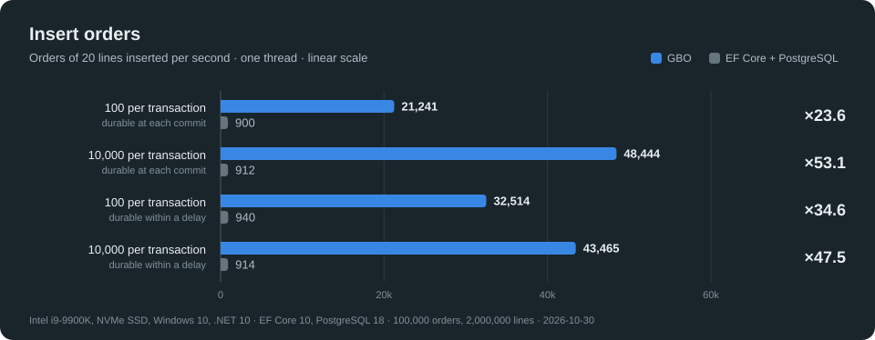

**Inserts: 24 to 53 times faster.** EF Core sends one `INSERT` per row, about 19,000 rows/s, whatever the size of the transaction.

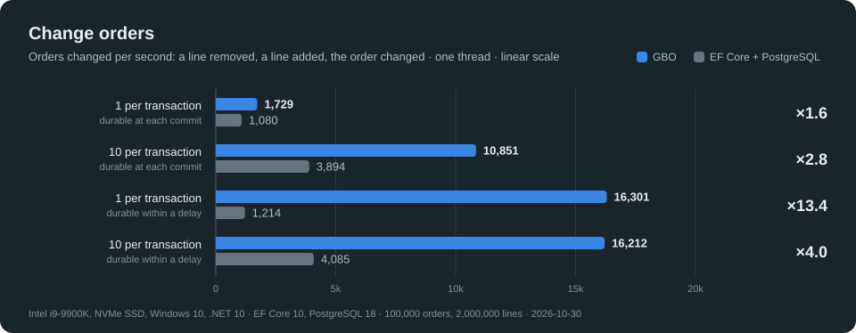

**Changes: 1.6 to 13 times faster.** Durable at each commit, a single change waits for the disk on both sides; flushed within a delay, GBO no longer waits.

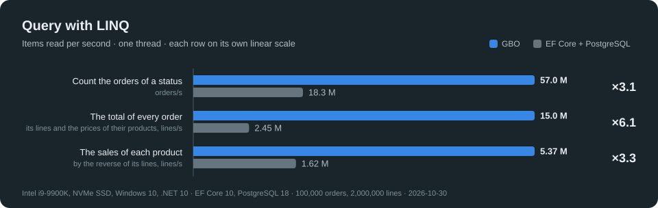

**Queries: 3 to 6 times faster,** although the aggregations run inside PostgreSQL.

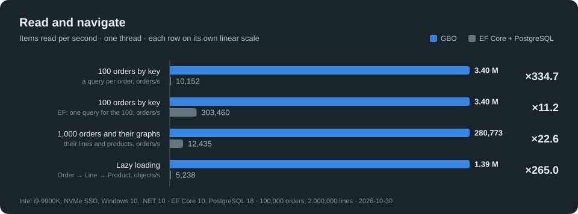

**Navigation is no longer a problem.** A round trip per object is where an ORM loses the most: GBO reads orders by key 335 times faster, and lazy loading 265 times. This comparison is unfair: GBO has no data to transport, every entity is at hand. Even one query for 100 orders leaves GBO 11.2 times faster.

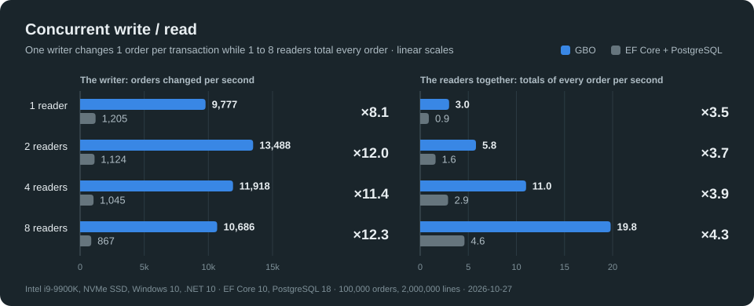

**Concurrent write and read:** from 1 to 8 readers, the writer of GBO stays 9.7 to 12.5 times faster, and its readers 3.8 to 4.1 times: 41.0 M lines/s with 8 readers, against 10.0 M.

The method, the durability settings and every figure: [GBO vs EF Core + PostgreSQL](Documentation/Benchmarks/BENCH-GBO-vs-EF-Postgres.md).

## GBO vs Event Sourcing solutions

GBO implements a new Event Sourcing pattern, **Mutation Sourcing**. A Mutation is a single work record that holds both the command (the intent) and its event (the decision), stored in the Log. GBO can also implement classic Event Sourcing, with persistent projections, including the one used to decide the commands. The same shop, 2,000,000 commands played in the same order by each engine, against KurrentDB and Marten on PostgreSQL, on the same machine.

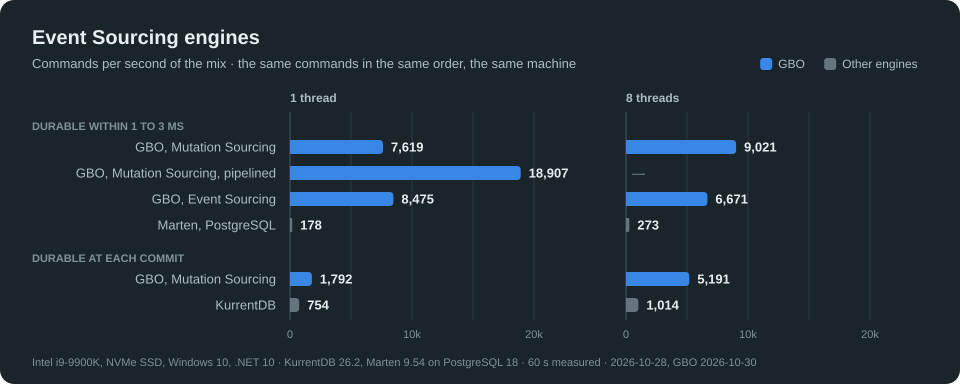

- **33 to 43 times Marten, with the same durability** (a flush within 1 to 3 ms), and 2.4 to 5.1 times KurrentDB with a flush at each commit, as KurrentDB does by default. Pipelined, Mutation Sourcing runs 18,907 commands/s on one thread.
- **No conflict in Mutation Sourcing:** the pump is the only writer, so 8 threads never run a command twice. On 8 threads, KurrentDB runs each command again 3.3 times on average, and Marten waits on its locks.
- **A command in 39 µs** at the median on one thread, 521 µs durable at each commit, against 1.2 ms for KurrentDB and 4.6 ms for Marten.

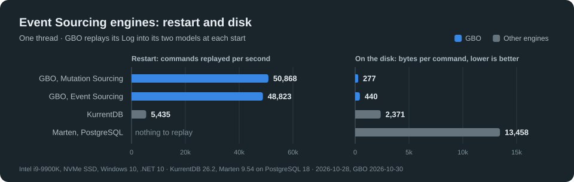

- **The restart replays the Log:** 49,000 to 69,000 commands/s into both models, Write and Read; KurrentDB rebuilds its Read model only, at 5,200 to 5,400 commands/s. Marten has nothing to replay: its snapshots and its Read model are tables.
- **A Mutation takes 188 to 277 bytes on the disk:** about 9 times less than the events of KurrentDB, in JSON, and 49 times less than the WAL that Marten writes.

The engines, their settings and every figure: [GBO vs Event Sourcing engines](Documentation/Benchmarks/BENCH-GBO-vs-Event-Sourcing-Engines.md).

## GBO vs SQLite, RocksDB and Garnet

**These results are preliminary and will evolve.** GBO trails in several write workloads, and three improvements may raise its ingestion results:
- optimized and configurable indexes: each message of workload Q moves its sensor in the index of the levels;
- a better support of the `[Mergeable]` types, which the meters of workload M and the sensors and sites of workload Q use;
- an internal sharding of a Store, so that several threads commit in parallel: today, the commits of a Store are serialized.

Three workloads of YCSB and two of ingestion, meters and sensors, on 1,000,000 records: GBO against SQLite and RocksDB, embedded in the process, and Garnet, a Redis server reached through the loopback. Every engine is durable within about 1 ms, except SQLite, synced at its checkpoints. Each workload runs on 1 or 8 threads, with 1 or 100 operations per transaction; the ratio compares GBO with the fastest of the three others.

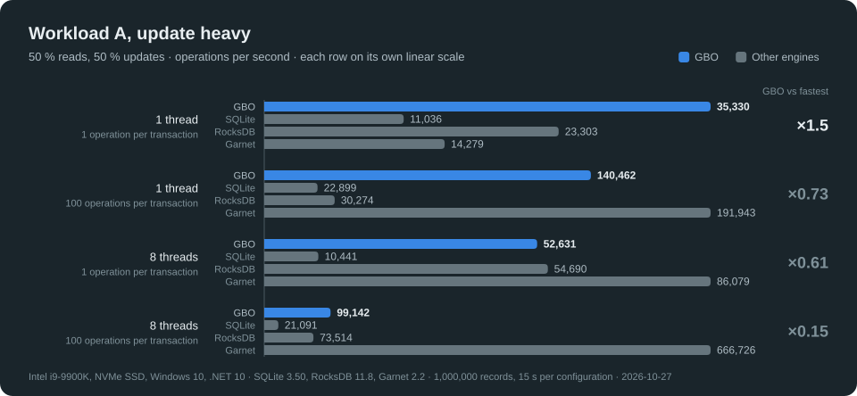

**Updates:** GBO leads with one operation per transaction, on one thread (×3.2) and on 8 (×1.3); with 100, GBO and Garnet are even on one thread, and Garnet leads on 8 threads, 5.5 times GBO.

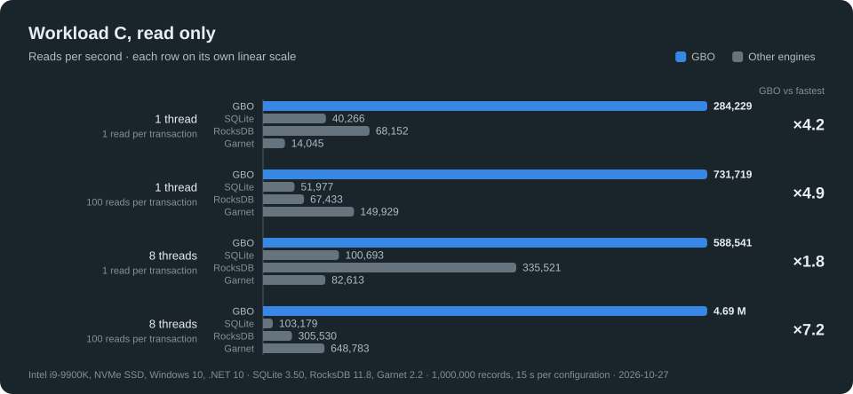

**Reads: GBO leads every configuration,** 6.1 to 10.9 times the fastest other engine: 6.19 M reads/s on 8 threads, 9.2 times Garnet.

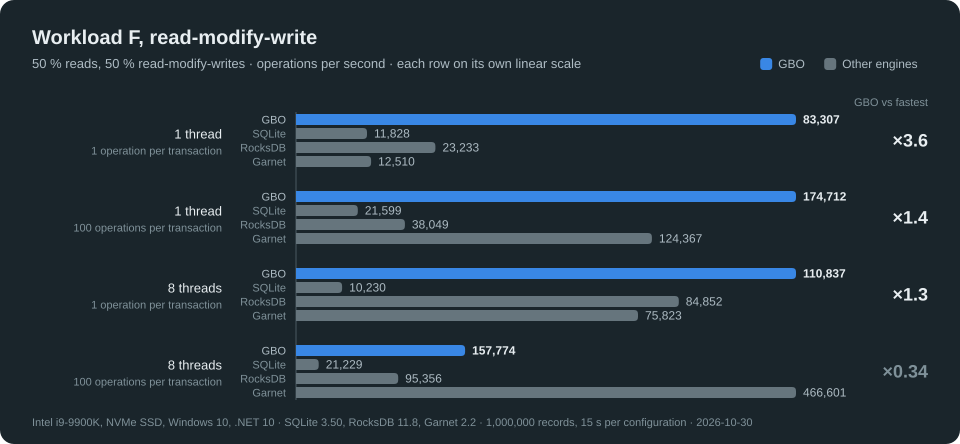

**Read-modify-writes:** GBO leads on one thread (×3.6 and ×1.4), and on 8 threads with one operation per transaction (×1.3); with 100 on 8 threads, Garnet leads, 3 times GBO.

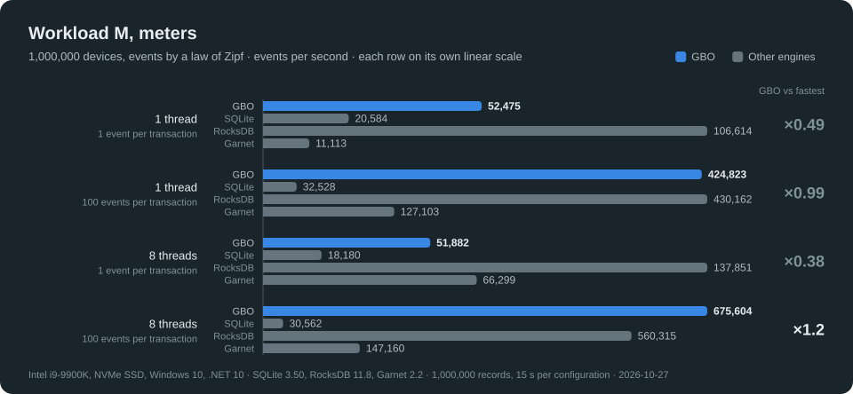

**Meters:** GBO and RocksDB with its merge operator run neck and neck: GBO leads with one event per transaction on one thread (×1.2), RocksDB with 100 on one thread (1.1 times GBO), and the two are even on 8 threads.

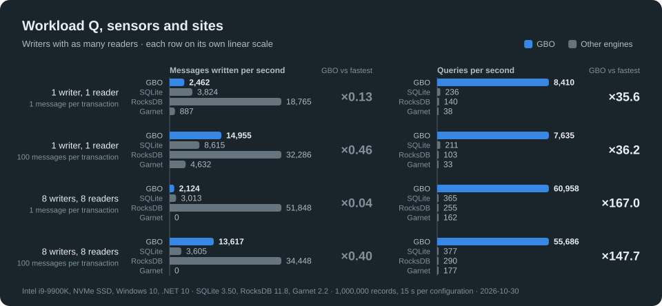

**Sensors and sites:** a query, a range of levels, an aggregate or the snapshot of a site and its 1,000 sensors, runs 36 to 167 times faster in GBO than in the fastest other engine, by its value indexes. GBO writes the messages slower: RocksDB writes 2.2 to 24 times more.

The engines and their settings, the loads and the reopen, the latencies, the memory and every figure: [GBO vs SQLite, RocksDB and Garnet](Documentation/Benchmarks/BENCH-GBO-vs-SQLite-RocksDB-Garnet.md).

## Spreadsheet

GBO on one page: what the engine does, how each guarantee is obtained, and the industry principle it follows. The details are in the [specifications](Documentation/Specifications/SPEC-Registry.md) and the [tutorials](Documentation/Tutorials/One-TheBasics.md).

#### At a glance

| | GBO |
|---|---|
| **Kind** | An embedded, in-process transactional object store for .NET 10: the data lives in the memory of the application, as C# objects, with no database server and no mapping layer |
| **Data model** | C# interfaces, compiled by a source generator into structs: entities, their parts (composition), strong and weak references, components (ECS), edges (property graph); Records, immutable facts, in Logs |
| **Storage** | Append-only, log-structured segments, in RAM or in memory-mapped files; Repository Stores (the current state) and Log Stores (every Record, kept) |
| **Transactions** | ACID; snapshot isolation by MVCC; optimistic by default, pessimistic or exclusive on demand; commits serialized in the whole cluster |
| **Durability** | Group commit: from a flush to the device at each commit to a flush within 1 ms, 10 ms or 100 ms |
| **Replication** | Log shipping of the committed bytes, pulled by each replica; read-only replicas and several writers sharing one write token |
| **Queries** | Operators over read-only Views, without allocation; text indexes (BM25), value indexes, hash indexes, all transactional |
| **Memory** | The objects outside the .NET GC; their deletion deterministic, by ownership and reference counts |
| **Architectures** | Chains of Stores, one transaction over several models and their Log; subscriptions and replay (Event Sourcing, CQRS); Mutation Sourcing |

#### Transactions and concurrency

| Mechanism | How GBO does it | Industry principle |
|---|---|---|
| Isolation | A transaction reads every object as of its epoch, the last commit published when it opened. Each version keeps a link to the previous one; readers never block writers, nor writers readers | Multi-version concurrency control and snapshot isolation (Berenson et al., *A Critique of ANSI SQL Isolation Levels*, 1995), as in PostgreSQL and Oracle |
| Writes | A write copies the object into the arena of its transaction, local to its thread (copy-on-write): the transaction reads its own writes; the others see nothing before the commit | Copy-on-write, read-your-writes |
| Validation | At the commit, under the write token, each object written is checked against the versions committed since the epoch: the first committer wins, the second gets a `TransactionConflictException`, or `false` from `TryCommit` | Optimistic concurrency control, backward validation (Kung & Robinson, 1981) |
| Conflict levels | `Optimistic`: write-write conflicts, as snapshot isolation (write skew possible). `Pessimistic`: also the collections read, a conflict if one of their objects changed since the epoch (phantoms included). `Exclusive`: the write token taken at the opening, no other commit in the cluster until the end, nothing to validate | From snapshot isolation to serial execution |
| Mergeable types | Concurrent changes of the values of a `[Mergeable]` object are merged at the commit, from the version of the epoch, the head and the transaction, instead of conflicting; a removal wins | Three-way merge, in the spirit of CRDT counters (Shapiro et al., 2011) |
| Concurrency points | A change anywhere in an aggregate raises the version of its `[ConcurrencyPoint]`: two transactions on the same aggregate conflict, whatever objects they changed | Aggregate versioning, an ETag (Domain-Driven Design, optimistic concurrency tokens) |
| Leased locks | `Claim()` locks objects for a duration, across transactions and servers: committed and replicated with the object, checked at each write, refused at once (no queue, no deadlock); durations on the monotonic clock of each node, never a wall clock compared; a lease lost or expired fails its holder's commit | Leases (Gray & Cheriton, 1989) with fencing tokens (Kleppmann) |
| Unique values | A unique index refuses a duplicate at the write, and again at the commit against the commits of other transactions and other servers (`Uniqueness`) | `UNIQUE` constraints |

#### Storage and durability

| Mechanism | How GBO does it | Industry principle |
|---|---|---|
| Layout | Each commit is appended to the head segment of its Store, and never changed; a segment is sealed when full | Log-structured storage (Rosenblum & Ousterhout, *The Log-Structured File System*, 1991): the log is the database |
| Atomicity | Each transaction ends with its hash; a chain of Stores combines the hashes of its Stores in the commit of its first Store: all of them or none, without two-phase commit | Commit record, checksummed |
| Recovery | At the opening, a transaction whose hash is missing or wrong, interrupted, is discarded; nothing to redo or undo | Torn-write detection by checksum |
| Durability | The flush policy of a Store: `Durable` (each commit flushed before it returns), `Fast` (within 1 ms or 8 MB), `Paged`, `Batched`, `Delayed`, `Manual`; `OnDisk` adds `FlushFileBuffers` on Windows (on Linux, `msync(MS_SYNC)` already reaches the device). Another process or server sees a commit only once it is durable | Group commit (DeWitt et al., 1984), as `synchronous_commit` in PostgreSQL |
| Index of the objects | The current version of each object, in an index in RAM, rebuilt at the opening; on disk, each sealed segment has an index file, which the opening reads instead of the segment | Bitcask and its hint files |
| Old versions | A version is kept while a transaction may still read it: the oldest open transaction sets the horizon | Epoch-based reclamation, as the vacuum horizon of PostgreSQL |
| Space and order | A compactor moves the live versions to the head, oldest segment first, so that its file can be deleted; it keeps each collection in runs of about 64 KB in the order of its objects, which scans read sequentially | Segment cleaning of log-structured stores; clustering |
| Several processes | The memory-mapped files are shared by the processes of a machine; a lock file serializes their commits | Shared memory, single writer at a time |
| Protection | A Store on disk is read through read-only mapped views: a stray write of the application cannot corrupt it | Protected memory |

#### Replication and distribution

| Mechanism | How GBO does it | Industry principle |
|---|---|---|
| Membership | Each `StoreDistributionEndPoint` listens on a TCP port and joins through one seed; members spread by gossip with heartbeat counters; a member silent for `DeadTimeout` is ejected; a restarted process is a new incarnation | Gossip-style failure detection (van Renesse et al., 1998), as in Cassandra |
| Data | A replica copies the committed bytes of each segment, identical, verifies each transaction by its hash, then publishes it; it pulls one block of 32 KB at a time, from any replica that has it, chosen at random | Physical log shipping, as the streaming replication of PostgreSQL; pull-based |
| Roles | A Store opened `ReadWrite` is a Master, `ReadOnly` a Slave; a Slave shows only the transactions that every admitted Master holds, so that any Master that remains holds what a Slave showed | Primary-copy replication, consistent prefix |
| Writes | One write token per chain of Stores. A commit asks the owner, which hands it over in the order of the requests, the queue travelling with the token, its generation increasing at each move; the new owner first catches up with the last commit. The commits form one sequence, the same on every replica. A Master that writes alone keeps the token and commits without a network round trip | Token-based mutual exclusion (Suzuki–Kasami, 1985), generations as fencing epochs |
| Partial replicas | A server may hold a part of a chain: the Read model of a CQRS front end alone, a Log alone and its subscription | Selective replication |
| Leaving and joining | A Master that stops hands its token over and waits until another Master holds its last commit; a new replica copies the whole Store, then follows | Graceful leave, catch-up replication |
| Failures | If the owner of the token is lost, the writes of its chain stop (`WriteTokenUnavailable`) and the reads go on; data that do not verify stop the chain (`Corrupt`). No quorum and no automatic fail-over yet: high availability is planned for a second version | Consistency over availability (CP) |
| Not yet | The Hub model, for WAN, IoT and edge computing over WebSocket; the sharing of transactions over UDP | |

#### Model, memory and queries

| Mechanism | How GBO does it | Industry principle |
|---|---|---|
| Model | Interfaces with `[Entity]`, `[Record]`, `[Property(n)]`; the source generator writes the Bodies (to change), the Views (to read), the Repositories, the Logs | Code generation from a schema |
| Versions of the model | Properties identified by their number, not their name: a binary reads the objects of older and newer versions of its model, in both directions | Field numbers, as in Protocol Buffers |
| Memory | The values of an object in one contiguous block; strings and arrays read in place, without copy (`GhostString`, `GhostSpan<T>`); the .NET GC never scans the data | Off-heap storage, zero-copy |
| Lifetime | An object lives while it is a Root, has an owner, or a strong reference designates it; removed at the instruction that ends this, its parts in cascade, its weak references cleared; no graph is ever traversed | Ownership and reference counting, deterministic (as Rust ownership or `ON DELETE CASCADE`) |
| Queries | `Where`, `Count`, `FirstOrNone`... over the Views, with lambdas that capture nothing, so no allocation; a scan reads collections kept in order by the compactor | Language-integrated queries, sequential scans |
| Text index | Words of the texts, whatever their case and accents; required words, alternatives, exclusions, wildcards, fuzzy terms; the most relevant first | Inverted index, BM25 ranking with the parameters of Lucene (`k1 = 1.2`, `b = 0.75`) |
| Value indexes | Keys of any standard type, alone or composite, in sorted pages of 512 bytes; each key's set of objects in the most compact container: array, bitmap, runs, inverted, full | B+tree-like sorted pages; Roaring bitmaps (Chambi, Lemire et al., 2016) |
| Hash index | A key found without order, its buckets in pages | Hash index |
| Up to date | Every index is up to date at the next instruction, in the transaction too, rolled back with it, committed with it, rebuilt from the objects when needed | Transactional, synchronous indexes |
| Logs and subscriptions | A subscription reads a Log from any transaction, then follows its new commits on a thread of its own; its handlers capture nothing | Catch-up subscriptions, as in EventStoreDB, or the offsets of Kafka |
| Replay | A model chained with its Log is rebuilt by replaying it: in memory at each opening, or on disk on request | Event Sourcing, CQRS |
| Mutation Sourcing | A Mutation records the intention and the decision of a command; a pump runs the Decides one at a time on each server, in the order received, the effects in the models applied by `Apply` | Single-writer principle (LMAX Disruptor), the Decider pattern |

#### Limits

- **One writer at a time per chain.** The commits of a chain are serialized in the whole cluster: write throughput is that of one writer, without network round trips while it keeps the token. Writers scale by splitting the data into several chains.
- **No SQL.** The queries are C#, over the Views and the indexes.
- **Little-endian platforms only.**

#### To come

- **Automatic fail-over.** The loss of the owner of the write token stops the writes of its chain, the reads going on, until the chain is restarted. It will perform a recovery with quorum.
- **Internet Scale Distribution**. Will use Web Sockets.
- **Transparent SQL connectors**, to fill an SQL server with every transaction done using GBO. EF entities included.
